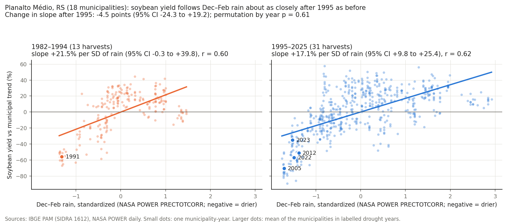

# Did soybean become less sensitive to summer drought after winter cover became the rule? (Planalto Médio, RS, Brazil)

> **SI-assisted:** the hypothesis was synthesized with Claude Code (Anthropic) at the team lead's request from the team's Landsat residue result (PR #54); the scripts and this text were written with Claude Code. Every number in this folder is produced by the scripts on the sources listed; none is produced by the AI. Human review pending. See [`SI-USAGE.md`](../../SI-USAGE.md).

## Question

Landsat shows that the share of Cruz Alta cropland with a probable bare-soil signature in early November fell from a median of 5.7% in 1984–1994 to at most 2.2% in every year since 1995 (0.3% in the median year since 2005; `analysis/residue-landsat`, PR #54). **After winter cover became the rule, did the soybean yield of the Planalto Médio become less sensitive to December–February drought?**

## Pre-registered method

Written and committed **before** any result was computed (see the git history of this file). The results section reports this method unchanged; anything added later is labelled "post hoc".

**Units.** The 18 municipalities of `analysis/enso-wheat` (Cruz Alta and neighbours), with the IBGE codes and centroids already committed in `analysis/ground-truth-proagro/results/municipalities.csv` (IBGE localities API and mesh metadata).

**Yield.** IBGE PAM, SIDRA table 1612, variable 112 (average yield, kg/ha), soybean (c81/2713), harvest years **1982–2025** (PAM year Y = summer harvest of Y). Missing values (`...`, `-`, `..`) are skipped. Planted area (variable 109) is fetched only to describe the change in soybean area.

**Detrending.** Per municipality, a linear trend (`numpy.polyfit`, degree 1) on all valid years 1982–2025; yield deviation `dev = yield / trend − 1`. Robustness: a LOESS trend (local linear, tricube weights, span 0.5 of the years).

**Drought index.** Window **1 December (Y−1) to the end of February (Y)** for harvest Y (soybean flowering and grain fill in the region). NASA POWER daily, point at each municipality centroid:
- primary: **DJF rain total**, `PRECTOTCORR` (mm), standardized per municipality over 1982–2025 (`z_rain`; negative = drier);
- robustness: **longest dry spell** in DJF (consecutive days < 1 mm), standardized and sign-flipped so that negative = drier (`z_dry`);
- descriptive only: days with `T2M_MAX` ≥ 32 °C in DJF (POWER Tmax has a known shift after about 2019, so heat is not used in any test).
Ground check: the ANA rain gauge 2853015 (Três Capões, 14.9 km from the Cruz Alta point) replaces POWER for Cruz Alta in one robustness run; a year enters only with a complete DJF window.

**Sensitivity.** Ordinary least-squares slope of `dev` on `z_rain`, pooling the municipality-years of a period (one intercept per period): the change in relative yield per one standard deviation of summer rain. Pearson r is reported beside it. Periods: **A = 1982–1994** (13 harvests, before the Landsat drop), **B = 1995–2025** (31 harvests); **B′ = 2005–2025** reported beside B.

**Primary statistic.** `Δ = slope_B − slope_A`. The hypothesis predicts Δ < 0 (yield follows summer rain less closely after 1995).

**Inference, with the year as the unit** (neighbouring municipalities share the same summer, so the effective n is the number of years, not of municipality-years):
- bootstrap by year: harvest years resampled with replacement within each period, all municipalities of a drawn year kept together; 10,000 draws, seed 20261115; 95% percentile interval for each slope and for Δ;
- permutation by year: the 44 harvest years shuffled between A and B (13 and 31), municipalities of a year kept together; 10,000 draws; **two-sided p** for Δ.

**Spatial replication.** Slope per municipality in A and B (municipalities with at least 10 valid harvests in A); count of municipalities with `slope_B < slope_A`. Descriptive only: the municipalities are not independent.

**Robustness (all run every time).** Cut year 1993, 1994, 1995, 1996, 1997, 1998 (A = 1982 to cut−1, B = cut to 2025); without 2005, without 2012, without 2022, without 2023, and without all four; LOESS detrending; `z_dry` instead of `z_rain`; B′ = 2005–2025 instead of B; regional means (one point per year: mean `dev` against mean `z_rain` of the municipalities); Cruz Alta alone with POWER and with the ANA gauge.

**Decision rule.** The hypothesis is called **supported** only if Δ < 0, the bootstrap 95% interval of Δ excludes 0, the permutation p < 0.05, and Δ keeps its sign in every cut-year and drop-year variant. If the interval contains 0 or the sign flips, the answer is **not supported** and is reported as such. Even when supported, the wording is "consistent with", never causal: plant breeding, sowing dates, soybean area and the quality of old PAM data change over the same years.

## Answer in one paragraph

**Not supported.** Soybean yield in the 18 municipalities follows December–February rain about as closely after 1995 as before. Per standard deviation of summer rain (NASA POWER), yield moved **+21.5% of its trend in 1982–1994** (95% interval −0.3 to +39.8; r = 0.60; 13 harvests) and **+17.1% in 1995–2025** (+9.8 to +25.4; r = 0.62; 31 harvests). The change, **−4.5 points, has a 95% interval of −24.3 to +19.2** and a permutation p by year of **0.61**. Since 2005, when bare soil in November was already rare (0.3% in the median year), the slope is **+25.1%** (+14.4 to +40.9), not lower. The sign of the change flips when the cut year moves to 1997 or 1998, so it fails the pre-registered rule on three of four counts. The test is also weak: with only 13 harvests and one drought summer (1991) before 1995, it could not have told a halving of the sensitivity from no change. What the data do show, in every variant, is that **summer drought still costs soybean yield in the Planalto Médio**: in the five driest summers since 1995 (2005, 2012, 2020, 2022, 2023), the municipalities' mean yield fell 25% to 70% below trend.



## Data

| Source | What is used | NASA? | Terms | Committed here? |
|---|---|---|---|---|
| NASA POWER Daily API (v2.10.3), `PRECTOTCORR` and `T2M_MAX`, community AG, one point per municipality centroid, 1981-01-01 to 2025-12-31 | DJF rain total, longest dry spell, hot days | **NASA** | [POWER referencing](https://power.larc.nasa.gov/docs/referencing/) | DJF indices per municipality-year (`results/djf_power.csv`); raw JSON in the raw folder only |
| IBGE PAM, SIDRA table 1612, `apisidra.ibge.gov.br/values/t/1612/n6/<18 codes>/v/109,112/p/all/c81/2713` | soybean average yield (kg/ha) and planted area (ha) | no (IBGE) | public federal data; cite IBGE | `results/soy_yield.csv` |
| ANA rain gauge 2853015 (Três Capões), HidroWeb `HidroSerieHistorica`, parsed by `analysis/storms-bare-soil/fetch_ana.py` | DJF rain check for Cruz Alta | no (ANA) | Brazilian federal open data; cite ANA | DJF indices per year (`results/djf_ana_2853015.csv`) |
| IBGE localities API and mesh metadata | codes and centroids of the 18 municipalities | no (IBGE) | public federal data | reused from `analysis/ground-truth-proagro/results/municipalities.csv` |
| Landsat bare-soil series and IBGE Censo Agropecuário no-till area | the "before/after" context only (not an input of any test) | Landsat: **NASA/USGS** | see `analysis/residue-landsat` (PR #54) | quoted, not recomputed |

URLs and access times are in `results/sources.json`. The 18 centroids fall in **9 distinct POWER grid cells** (about 0.5° × 0.625°), so several municipalities share the same rain series.

## How to run

From the repository root (Python 3.12, [uv](https://docs.astral.sh/uv/)):

```
uv run --project services/science --with matplotlib==3.10.7 python -I analysis/drought-resilience/reproduce.py
```

Raw downloads go to `~/.cache/fieldshift/drought-resilience/` (or `--raw DIR`) and are never committed. Results are rewritten in `results/` with `run_info.json`. The bootstrap and permutation use a fixed seed, so a rerun gives the same numbers as long as IBGE and POWER serve the same values.

## Results

Files in [`results/`](results/): `resilience.json` (everything below), `robustness.csv`, `municipality_slopes.csv`, `panel.csv` (municipality-year rows: yield, trends, deviations, DJF indices), the three input tables and the figure. Numbers are from the run of 2026-11-15 (UTC times in `results/sources.json` and `results/run_info.json`).

### Primary test (pre-registered)

| Period | Harvests | Municipality-years | Slope (% of trend per SD of DJF rain) | 95% interval (bootstrap by year) | r |
|---|---|---|---|---|---|
| A 1982–1994 | 13 | 213 | **+21.5** | −0.3 to +39.8 | 0.60 |
| B 1995–2025 | 31 | 552 | **+17.1** | +9.8 to +25.4 | 0.62 |
| B′ 2005–2025 | 21 | — | +25.1 | +14.4 to +40.9 | 0.72 |

Δ = B − A = **−4.5 points** (95% interval −24.3 to +19.2), permutation by year **p = 0.61** (two-sided; one-sided for "lower after", p = 0.32).

Decision rule (from the pre-registration): Δ < 0 **yes**; interval excludes 0 **no**; p < 0.05 **no**; sign kept in every cut-year and drop-year variant **no** (flips at 1997 and 1998). Verdict: **not supported**.

### Robustness (all pre-registered; slopes in % of trend per SD, 95% intervals in brackets)

| Variant | Years A / B | Slope A | Slope B | Δ | p (perm. by year) |
|---|---|---|---|---|---|
| primary | 1982–1994 (13) / 1995–2025 (31) | +21.5 (−0.3 to +39.8) | +17.1 (+9.8 to +25.4) | −4.5 (−24.3 to +19.2) | 0.61 |
| cut year 1993 | 1982–1992 (11) / 1993–2025 (33) | +30.4 (+9.7 to +44.5) | +16.2 (+8.6 to +24.1) | −14.2 (−30.0 to +7.0) | 0.13 |
| cut year 1994 | 1982–1993 (12) / 1994–2025 (32) | +30.6 (+9.5 to +45.6) | +16.2 (+8.9 to +23.9) | −14.4 (−30.7 to +8.1) | 0.11 |
| cut year 1996 | 1982–1995 (14) / 1996–2025 (30) | +21.3 (−0.5 to +37.3) | +17.0 (+9.5 to +25.6) | −4.3 (−22.4 to +19.5) | 0.62 |
| cut year 1997 | 1982–1996 (15) / 1997–2025 (29) | +17.2 (−4.0 to +33.7) | +18.0 (+10.4 to +27.3) | **+0.8** (−17.4 to +23.5) | 0.93 |
| cut year 1998 | 1982–1997 (16) / 1998–2025 (28) | +17.1 (−2.4 to +32.4) | +18.2 (+10.5 to +28.1) | **+1.1** (−15.5 to +22.6) | 0.90 |
| without 2005 | 13 / 30 | +21.5 | +14.8 (+8.0 to +22.7) | −6.7 (−26.4 to +16.5) | 0.42 |
| without 2012 | 13 / 30 | +21.5 | +15.9 (+8.1 to +24.5) | −5.6 (−25.9 to +18.0) | 0.54 |
| without 2022 | 13 / 30 | +21.5 | +15.6 (+8.1 to +24.1) | −5.9 (−25.9 to +17.6) | 0.51 |
| without 2023 | 13 / 30 | +21.5 | +16.6 (+8.5 to +25.6) | −4.9 (−25.2 to +18.8) | 0.60 |
| without 2005, 2012, 2022, 2023 | 13 / 27 | +21.5 | +9.4 (+3.5 to +16.2) | −12.1 (−31.4 to +10.8) | 0.13 |
| LOESS detrend (span 0.5) | 13 / 31 | +21.5 (−0.2 to +39.6) | +16.2 (+9.0 to +24.3) | −5.2 (−24.9 to +18.1) | 0.54 |
| longest dry spell instead of rain | 13 / 31 | +10.7 (−7.3 to +21.8) | +7.8 (−3.1 to +19.1) | −2.8 (−18.7 to +18.9) | 0.83 |
| B′ = 2005–2025 | 13 / 21 | +21.5 | +25.1 (+14.4 to +40.9) | **+3.5** (−17.2 to +29.6) | 0.74 |
| regional means (one point per year) | 13 / 31 | +22.1 (−0.2 to +41.9) | +17.3 (+10.0 to +26.2) | −4.8 (−25.8 to +19.3) | 0.60 |
| Cruz Alta alone, POWER | 13 / 31 | +22.7 (+0.2 to +44.2) | +17.0 (+9.1 to +25.8) | −5.7 (−28.7 to +18.4) | 0.54 |
| Cruz Alta alone, ANA gauge | 13 / 26 | +17.5 (−1.3 to +40.0) | +16.4 (+8.0 to +29.2) | −1.1 (−24.6 to +20.8) | 0.91 |

No variant has a 95% interval of Δ that excludes zero, and none has p < 0.05. The ANA gauge and POWER agree on DJF rain in Cruz Alta (r = 0.89 over 39 summers; the gauge lacks complete DJF windows in 2013–2017).

**Spatial replication (descriptive).** Of the 16 municipalities with at least 10 harvests before 1995, 14 have a lower slope after (median Δ −5.9 points; `results/municipality_slopes.csv`). This is the same −4.5 seen 16 times, not 16 independent confirmations: the municipalities share the same summers and 9 POWER cells.

**Drought summers (post hoc, descriptive).** Regional mean `z_rain` ≤ −1 happened once before 1995 (1991: −56% of trend) and five times after (2005 −70%, 2012 −51%, 2020 −25%, 2022 −57%, 2023 −35%; mean −48%). Dropping the four big post-1995 droughts lowers slope B to +9.4: outside extreme droughts, yield follows rain less closely after 1995, but the extreme droughts still cost as much as 1991 did. This is not a test (A has a single drought year, which cannot be dropped symmetrically).

### Context (not tests)

- Mean soybean yield of the 18 municipalities: 1,646 kg/ha in 1982–1994, 2,473 kg/ha in 1995–2025 (the trend is removed before any test).
- Planted soybean area of the 18 municipalities (PAM): 883,200 ha in 1990, 711,000 ha in 1994, 859,032 ha in 2005, 977,184 ha in 2025.
- B was drier on average than A in standardized terms (regional mean `z_rain` −0.02 vs +0.05; −0.32 in 2005–2025) and had a wider spread (SD 1.08 vs 0.74). A slope estimated from the narrower, wetter A range is less precise, which is why its interval reaches zero.
- Hot days (POWER `T2M_MAX` ≥ 32 °C in DJF, descriptive only): mean 14.5 per summer in A, 17.1 in B, 20.9 in 2005–2025. POWER Tmax shifts after about 2019, so this is not used in any test.

## What can and cannot be said

- **Can:** "Forty years of NASA POWER rain and IBGE yields show that summer drought still costs soybean yield in the Planalto Médio: about 17% of the yield trend per standard deviation of December–February rain since 1995, and 25% to 70% in the five driest summers." This supports why drought risk matters for the farmer's decision; it is not new evidence that soil cover reduces it.
- **Can:** "We tested whether yields became less drought-sensitive after winter cover became the rule (Landsat). The data do not show it; the test had little power because only 13 harvests predate the change."
- **Cannot:** "Cover crops / no-till protect soybean yield from drought", "40 years of NASA data prove soil care protects income", or any causal sentence. Field trials may show it; this regional test does not.

## Confounders and limits

- **Breeding and cultivars**: modern soybean cultivars (including indeterminate, earlier-maturing types) changed over the same years and may change drought tolerance in either direction; this test cannot separate them from soil management.
- **Sowing dates**: earlier sowing moves flowering and grain fill relative to the fixed DJF window, so the window may capture a different crop stage in A and B.
- **Soybean area and where it is planted**: area dipped in the early 1990s and grew later; expansion onto poorer or shallower soils would raise sensitivity and mask any gain from cover.
- **Irrigation** is close to nil in these municipalities for soybean; not modelled.
- **Old PAM data**: municipal yields of the 1980s are survey estimates, often rounded; noise in A widens its interval.
- **One point per municipality**: rain at a centroid (9 POWER cells for 18 municipalities) is not the rain on each field; the gauge agrees with POWER at Cruz Alta (r = 0.89) but is one station.
- **Before/after is a proxy**: the Landsat series covers Cruz Alta only, and its 1984–1994 years have one or two scenes each; the change in soil cover is taken as region-wide around 1995, consistent with the Censo Agropecuário no-till area of 2006 and 2017 quoted in PR #54. MapBiomas was not used.
- **Linear sensitivity**: yield may respond non-linearly (saturating in wet summers); B has more extreme droughts than A, which can change an OLS slope even with no change in the crop.
