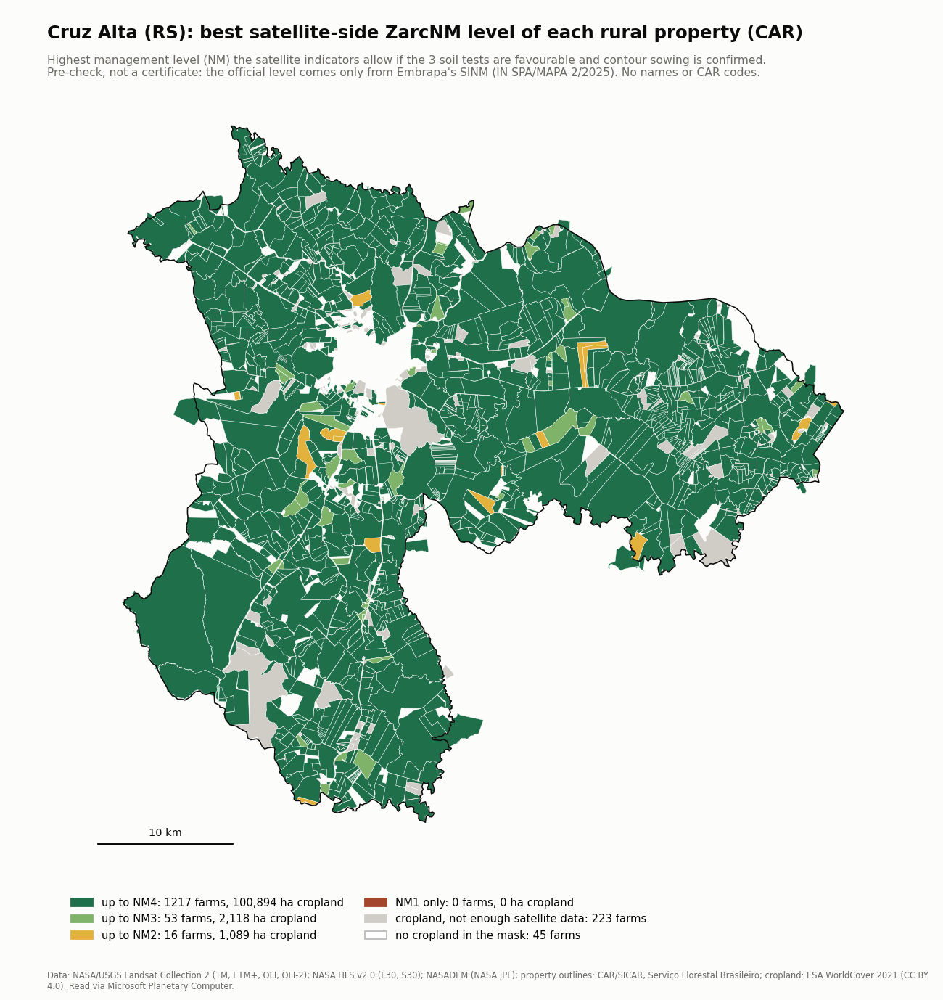
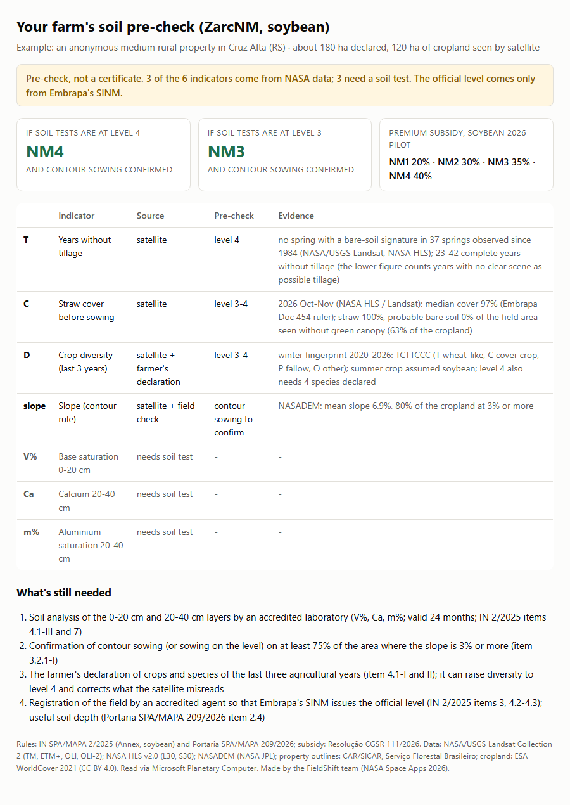
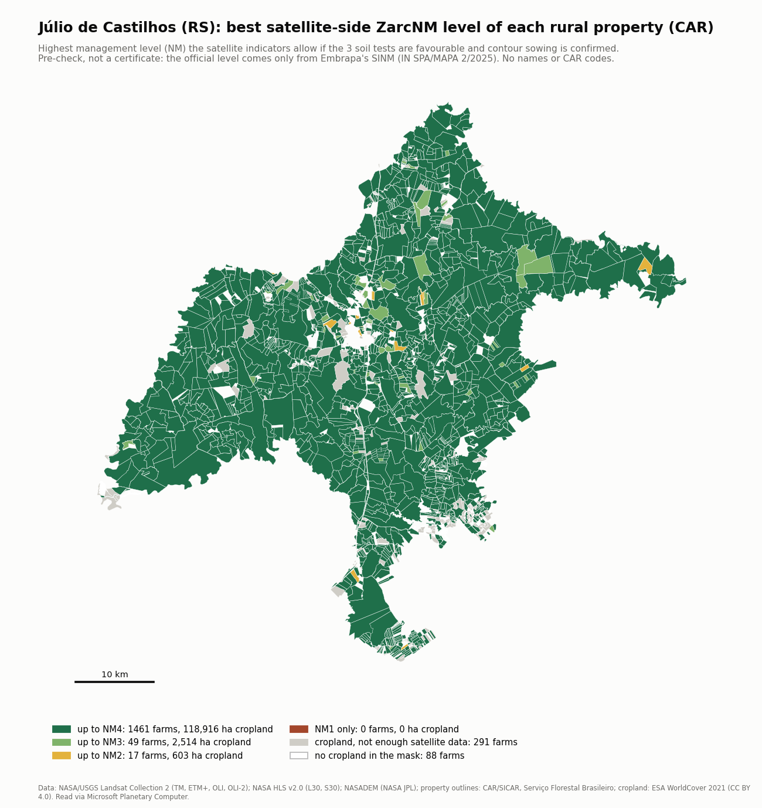

# Every farm in Brazil, one free soil report from NASA data: ZarcNM pre-check for each rural property of Cruz Alta (RS)

> **SI-assisted:** origin: the team generated the starting ideas at a human ideation meeting; at the team lead's request, SI helped compare and synthesize options from those ideas and verified data; the team chose the direction (D-001). This idea ("every farm in Brazil, one free soil report from NASA data": run the ZarcNM pre-check on every property outline of the public rural-property registry) is one of those SI-synthesized options. The scripts, tests and this text were written with Claude Code. Every number below was produced by running the scripts in this folder on the sources listed; none was produced by the AI. Human review pending. See [`SI-USAGE.md`](../../SI-USAGE.md).

Method summary for the app: [`content/methods/farm-reports.md`](../../content/methods/farm-reports.md). Output read by the app: [`results/farm_reports.json`](results/farm_reports.json).



## What this is

Since the 2026/27 season, Rio Grande do Sul soybean has a **ZarcNM** zoning (Portaria SPA/MAPA 209/2026): a field falls in a management level NM1-NM4 from six indicators (IN SPA/MAPA 2/2025), and in the 2026 pilot the federal premium subsidy for soybean is 20 / 30 / 35 / 40% of the premium for NM1 / NM2 / NM3 / NM4 (Resolução CGSR 111/2026). Three of the six indicators are about management, and the norm recommends Landsat, Sentinel-2 or HLS imagery to read them (item 6.4; MODIS is accepted above 100 ha, item 6.4-I) and an elevation model "such as NASADEM or equivalent" for slope (item 6.3).

This folder takes **every rural property of one municipality in the CAR** (Cadastro Ambiental Rural, the public registry of rural-property outlines kept by the Serviço Florestal Brasileiro), and for each one with cropland reads, from NASA data:

| Indicator (IN 2/2025, Table 1) | What is read | Data |
|---|---|---|
| **C**, straw cover before sowing (row 5) | % straw and % probable bare soil of the cropland seen without green canopy, 1 Oct - 15 Nov 2026; straw cover with the Embrapa Documentos 454 ruler | NASA HLS v2.0 (L30, S30), NASA/USGS Landsat 8/9 |
| **T**, years without tillage (row 4) | the last spring (20 Oct - 20 Nov) since 1984 in which the property showed a bare-soil signature | NASA/USGS Landsat 4-9 Collection 2, NASA HLS |
| **D**, crop diversity of the last 3 years (row 6) | the winter path of every 30 m pixel in 2020-2026 (wheat-like cereal, cover crop, fallow) and the diversity level of the 2023-2025 winters | NASA HLS v2.0 |
| Contour rule (item 3.2.1-I) | mean slope and % of the cropland at 3% or more | NASADEM |
| V%, Ca, m% (rows 1-3) | **not observable**: "needs soil test" | — |

It then applies the published rule ([`../zarcnm-precheck/zarcnm_rules.py`](../zarcnm-precheck/zarcnm_rules.py), every item cited and tested) to every combination of the observed level ranges and gives each property a **satellite-side NM range**: the levels the property can reach *if* its three soil tests come back at level 4 (and at level 3), with contour sowing still to confirm.

## What this is NOT

- **A pre-check, not a certificate.** The official level is produced only by Embrapa's SINM, after an accredited agent registers the field, its remote-sensing history and its soil analyses (IN 2/2025, items 3 and 4). Nothing here states a final NM.
- Not field data: no property was visited; the satellite thresholds have no field calibration in Cruz Alta.
- Not about people: nothing here says who owns or works a property.

## Privacy

- The CAR layer used (SICAR public GeoServer, `sicar:sicar_imoveis_rs`) **has no owner name, CPF or CNPJ field**. At download, only the outline, CAR code, declared area, fiscal modules, property type and status are kept; the creation date and the analysis-condition text are dropped.
- The **CAR code never leaves the raw folder** (`~/.cache/fieldshift/farm-reports/<ibge>/`, outside git). Properties get a sequential number after sorting by a SHA-256 of the code; that number is not published either.
- Committed results are **aggregates** (counts and areas by band and size class), the **map** (outlines coloured by band, no labels) and **one anonymous example** (area rounded to 10 ha, no outline, no coordinates). The per-property table stays in the raw folder.
- The raw shapefile/GeoJSON is **not redistributed** here: SICAR's service states no licence or access constraint (its WFS capabilities leave both empty), so the script downloads it at run time. See [`RESOURCES.md`](../../RESOURCES.md).

## Results

Run of 15 November 2026 (BRT). Files in [`results/`](results/): `farm_reports.json` (aggregates and the example, read by the app), `farm-reports-map.png`, `example-report.html` and `example-report.png` (the one-page report of one anonymous property), `summary_by_size.csv`.

**Properties.** The SICAR service returned 1,583 records for Cruz Alta (IBGE 4306106); **1,554 are active** (29 cancelled), all but one of them rural properties (one settlement). Their declared areas add up to 136,581 ha, more than the municipality, because outlines overlap. **1,509 have cropland** in the WorldCover mask (108,574 ha summed over properties); **1,286 have all three satellite indicators** and get a range; 223 lack at least one (mostly small properties with too few clear 60 m pixels for the 40-year series: T missing for 153, C for 103, D for 29); 45 have no cropland in the mask.

**Satellite-side NM range, if the three soil tests come back at level 4** (contour to confirm):

| Range | Properties | Cropland (ha) | Declared area (ha) |
|---|---|---|---|
| NM4 | 881 | 72,869 | 90,385 |
| NM3-NM4 | 333 | 27,837 | 33,568 |
| NM3 | 49 | 2,068 | 3,017 |
| NM2-NM3 | 4 | 50 | 75 |
| NM2 | 14 | 938 | 1,318 |
| NM1-NM4 | 3 | 187 | 258 |
| NM1-NM2 | 2 | 150 | 165 |
| not assessed (cropland, an indicator missing) | 223 | 4,474 | 7,604 |
| no cropland in the mask | 45 | 0 | 191 |

By the **upper end** (the map's colours): up to NM4 1,217 properties (100,894 ha of cropland), up to NM3 53 (2,118 ha), up to NM2 16 (1,089 ha), NM1 only 0.

**"Satellite-ready for NM3+"**: **1,263 of the 1,286 assessed properties (98%; 102,774 ha of cropland)** have their whole range at NM3 or above *if* the three soil tests come back at level 4 and contour sowing is confirmed; **1,223 (100,953 ha)** if the soil tests come back at level 3. In Cruz Alta, the capital of no-till, the satellite side is rarely the bottleneck: the soil tests and the contour are. **1,284 of the 1,286 assessed properties have a mean cropland slope of 3% or more**, so all of them need contour sowing confirmed (median share of their cropland at ≥ 3%: 89.7%).

**By size** (fiscal modules; ready = whole range NM3+ with soil tests at level 4):

| Size | Properties | Cropland (ha) | Assessed | Up to NM4 | Up to NM3 | Up to NM2 | Ready NM3+ |
|---|---|---|---|---|---|---|---|
| Small (≤ 4 modules) | 1,139 | 24,061 | 885 | 837 | 41 | 7 | 872 |
| Medium (4-15) | 330 | 40,694 | 319 | 299 | 11 | 9 | 309 |
| Large (> 15) | 85 | 43,820 | 82 | 81 | 1 | 0 | 82 |

Small properties are three quarters of the registry but a fifth of the cropland, and they are most of the gaps: 209 of the 223 "not assessed" and all 45 without cropland in the mask.

**Indicators of the 1,286 assessed properties:**

- **C (straw cover):** level "3 or 4" for 1,269; the median cover reads 97.1%, at the ruler's plateau, and probable bare soil averages 1.1% of the area seen without green (29 properties at 10% or more). 644 properties were read in 1 Oct - 15 Nov 2026 (8 scene dates; most of the cropland was already green or cloudy) and 642 fell back to 1 Oct - 30 Nov 2025.
- **T (years without tillage):** level 4 for 1,193, level 3 for 22, level 2 for 17, level 1 for 54. Last spring with a bare-soil signature, all 1,509 cropland properties: 1990-1994 for 659 (the municipal signature collapses after 1993, as in `analysis/residue-landsat`), never in the observed springs for 335, 2020-2026 for 79, no clear observation for 153. **This is the most threshold-sensitive result**: properties with a signature since 2019 are 96 at the 25% rule, 205 at 10%, 38 at 50%, and **578 with the NDTI threshold at 0.10** instead of 0.06.
- **D (diversity, 2023-2025):** level 2 for 329, level 3 for 385, level 3 with the cover durations of level 4 ("3-4", pending the species declaration) for 572. Most common fingerprints 2020-2026: CCCCCCC (52), CCCCCCO (37), CCTCTCO (30), CCTCTCC (29).
- Locks that bind: two indicators at level 2 (item 3.2.1-IV-b) for 20 properties, two at level 1 (IV-a) for 2, "consecutive soybean" read literally (II) for 3 with mostly fallow winters.

**Scenes read:** 80 for C (59 used), 323 for T (115 used: ≥ 50% of the properties' cropland clear; 37 springs with data from 1984 to 2026, none in 1985, 1989, 1990, 1996, 1997 and 2002), 636 for D (583 used).



The example (rule in `pick_example`: a medium property read in 2026 whose upper end is the most common one, closest to the median cropland of those): about 180 ha declared, 120 ha of cropland; **NM4 if the soil tests are at level 4, NM3 if at level 3**, contour sowing to confirm.

## Second municipality: Júlio de Castilhos (scale test)

To test that the method scales, the **same code, rules and thresholds** (no tuning) were run for a second Planalto Médio municipality, **Júlio de Castilhos (RS), IBGE 4311205** (code checked on the IBGE localidades API), on 15 November 2026, step by step as `reproduce.py --ibge 4311205 --name "Júlio de Castilhos (RS)" --results results/julio-de-castilhos` would, with the three scene steps run in parallel (16 threads each), as for Cruz Alta. The only per-municipality input is the scene footprint in `common.AREAS`: the same Landsat path/rows (223/080 covers all of its cropland) and HLS tiles as Cruz Alta, and the winter fingerprint reads tile **T22JBN** instead of T22JBP (T22JBN covers about 98% of its cropland; the rest has no winter class, limitation 7). Same privacy treatment: no CAR code, no names, no raw geometry committed; only aggregates, the unlabelled map and one rounded anonymous example. Files: [`results/julio-de-castilhos/`](results/julio-de-castilhos/).



| | Cruz Alta (RS) | Júlio de Castilhos (RS) |
|---|---|---|
| CAR records returned / active | 1,583 / 1,554 | 1,917 / 1,906 |
| With cropland in the mask (cropland summed over properties) | 1,509 (108,575 ha) | 1,818 (124,655 ha) |
| Assessed (all three satellite indicators) | 1,286 (85% of those with cropland) | 1,527 (84%) |
| **Satellite-ready NM3+** (whole range NM3+, soil tests at level 4) | **1,263 (98% of assessed; 102,774 ha)** | **1,508 (99% of assessed; 121,336 ha)** |
| Satellite-ready NM3+, soil tests at level 3 | 1,223 (95%) | 1,468 (96%) |
| Upper end NM4 / NM3 / NM2 / NM1 | 1,217 / 53 / 16 / 0 | 1,461 / 49 / 17 / 0 |
| **Bottleneck: contour to confirm** (mean cropland slope ≥ 3%) | **1,284 of 1,286 assessed** | **1,527 of 1,527 assessed** |
| Median share of cropland at ≥ 3% slope | 89.7% | 89.1% |
| T level 4 / C "3 or 4" / D level 2 (assessed) | 1,193 / 1,269 / 329 | 1,360 / 1,521 / 272 |
| Last bare-soil signature 2020-2026 / never in the observed springs (cropland properties) | 79 / 335 | 114 / 1,069 |
| Signature since 2019 at the 25% rule / 10% / 50% / NDTI 0.10 | 96 / 205 / 38 / 578 | 115 / 318 / 24 / 614 |
| Scenes found (C / T / D) | 80 / 323 / 636 | 81 / 325 / 624 |
| Scene steps, wall-clock (parallel) | about 75 min (night, 4 failed reads retried) | **10.4 min** (13:52-14:02 BRT, 0 failed reads) |
| CAR download / grids / winter + report | 8 s / 28 s / 34 s | 14 s / 71 s / 67 s |

**What stays the same.** The picture repeats almost number for number: if the three soil tests come back at level 4, 99% of the assessed properties have their whole satellite-side range at NM3 or above, and **every assessed property has a mean cropland slope of 3% or more**, so in both municipalities the bottleneck to the subsidy is not what the satellite reads but **the soil tests and confirming contour sowing**. The gaps are the same kind as well: 291 properties with cropland lack an indicator (mostly T, 233 with no clear observation, as small properties have too few clear 60 m pixels) and 88 have no cropland in the mask; small properties are 1,579 of the 1,906 active records but 45,080 of the 124,655 ha of cropland. All nine limitations above apply unchanged; none of the thresholds was calibrated in either municipality.

**What changes.** The only result that moves a lot is the one already flagged as the most threshold-sensitive: in Júlio de Castilhos 1,069 cropland properties show **no** bare-soil signature in any observed spring (Cruz Alta: 335), and the oldest-signature peak of 1990-1994 is smaller (196 vs 659). With the NDTI threshold at 0.10 instead of 0.06 the "never" count falls to 504 and properties with a signature since 2019 rise to 614, so this reads as the NDTI threshold meeting a different soil/residue background (limitation 3), not as a finding about tillage history. Winters also differ: more fallow years in the fingerprints (most common CCCCCCC 154, CCCCCCO 101, CCCOCCO 41), fewer properties at diversity level 2 (272 vs 329). The processing time differs by a factor of seven for about the same number of scenes (1,030 vs 1,039): the time is set by the network reads of the Planetary Computer at the time of the run, not by the municipality or its number of properties. Example property (same `pick_example` rule): about 200 ha declared, 170 ha of cropland; NM4 if the soil tests are at level 4, NM3 if at level 3, contour sowing to confirm.

## Method

**Properties.** SICAR WFS, filter `cod_municipio_ibge` (`fetch_car.py`). Active records (status AT; cancelled CA dropped). Size class by fiscal modules (Lei 8.629/1993, art. 4): small ≤ 4, medium > 4 to 15, large > 15 (Cruz Alta's fiscal module: as declared in the record, `m_fiscal`).

**Grid and cropland** (`grids.py`). UTM 22S, 30 m (straw now, slope) and 60 m (40-year series, winter fingerprint; 2× decimated windows, as in `analysis/residue-landsat/scenes.py`). Cropland: ESA WorldCover 2021 class 40 on ≥ 50% of the pixel. A property's pixels are the pixel centres inside its outline; overlapping outlines each keep theirs.

**Pixel classes** (same thresholds as `analysis/residue-landsat`, PR #54): green NDVI ≥ 0.30; straw NDVI < 0.30 and NDTI ≥ 0.06; probable bare soil NDVI < 0.30 and NDTI < 0.06. NDTI = (SWIR1 − SWIR2)/(SWIR1 + SWIR2) (Van Deventer et al. 1997). Clouds, shadows, water and fill masked with Landsat `QA_PIXEL` and HLS `Fmask`.

**C, straw cover** (`scenes.py now`, `report.py`). Every HLS L30/S30 and Landsat 8/9 scene of 1 Oct - 15 Nov 2026 (cloud cover < 70%, ≥ 2% of the cropland clear). Per 30 m pixel, the median NDTI of its clear observations without green canopy; converted to % cover with the **Embrapa ruler** (quadratic fitted to Embrapa Soja Documentos 454, Table 2, 19 fields; `embrapa_ruler.py`, a vendored copy of `analysis/residue-landsat/embrapa.py`). Per property: median cover of its observed pixels, read only when at least 25% of its cropland was seen without green; otherwise 1 Oct - 30 Nov 2025 is used, and the year read is stored with the property. Level range: Table 1 row 5 at cover ± 8.3 points (the ruler's RMSE); cover ≥ 80% (the ruler's saturation, Doc 454 p. 29) reads "level 3 or 4".

**T, years without tillage** (`scenes.py series`). Every Landsat C2 L2 scene (WRS-2 223/080 and 222/080) and HLS granule of 20 Oct - 20 Nov, 1984-2026, cloud cover < 70%, used when ≥ 50% of all the properties' cropland is clear. Per property and scene: share of its clear cropland that is probable bare soil (counted when ≥ 10 pixels and ≥ 50% of its cropland are clear); per year, the maximum over the scenes. A **bare-soil signature year** = ≥ 25% of the property's clear cropland probable bare soil (choice; 10% and 50%, and NDTI 0.04 / 0.10, kept as sensitivities in the per-property table). T = complete years since the last signature year (IN 2/2025 item 6.8: tillage shows as a sudden exposure of soil); the lower end of the range also counts every unobserved year after the last signature as a possible tillage.

**D, diversity** (`scenes.py winter`, `winter.py`). Every HLS granule of tile T22JBP, 1 Apr - 30 Nov 2020-2026 (cloud cover < 90%). The rules of [`analysis/rotation-fingerprint`](../rotation-fingerprint/README.md) (PR #59; vendored, constants checked identical to the merged `classify.py`): half-month median NDVI, gap filling, one class per pixel-year (T wheat-like cereal, C cover crop, P fallow, O other), and Table 1 row 6 on the 2023-2025 winters with one summer crop per year assumed soybean. Per property: the level held by at least half of its classified pixels; level 4 only as an upper end when ≥ 50% of its pixels have level-4 cover durations (4 species need the farmer's declaration). The property's fingerprint is the majority class of each year.

**Slope** (`grids.py`). NASADEM, bilinear to 30 m, percent slope; mean and share ≥ 3% over the property's cropland. Mean ≥ 3% → "contour sowing to confirm" (item 3.2.1-I).

**NM range** (`indicators.py`). `zarcnm_rules.classify` over every combination of the T, C and D level ranges, the three soil indicators at level 4 (headline) or 3; contour assumed confirmed; when at least half of the property's pixels had a fallow winter in 2023-2025, the literal reading of "two consecutive soybean crops" (item 3.2.1-II, NM1) sets the lower end, as `analysis/zarcnm-precheck` keeps both readings. The map colours each property by the **upper end** (the best level the satellite indicators allow).

## Limitations

1. **CAR is self-declared and overlaps.** The outlines are declared by the holders and mostly not yet analysed by the state agency ("aguardando análise"); outlines overlap (the active records add up to more than the municipality's area), so the same pixel can count for two properties. Totals of area here are sums over properties, not municipal hectares.
2. **Cropland mask.** WorldCover 2021 is one year at 10 m; fields that changed use, and pasture in crop-livestock systems, are misclassified. Properties with no WorldCover cropland are "no cropland", not "no farming".
3. **No field calibration.** The NDTI threshold (0.06) and the Embrapa ruler were not calibrated in Cruz Alta; the ruler is a transfer from north Paraná and Sentinel-2, saturates near 80% cover (so level 3 and level 4 of C cannot be separated), and kaolinite-rich Oxisols can make bare soil read as straw (Hively et al. 2021), which would hide tillage and overstate C and T.
4. **3 of 6 indicators.** V%, Ca and m% need a soil test; m% alone can lower NM4 to NM3 or NM2 (item 3.2.1-V). Every range is conditional on them.
5. **Contour is not seen.** On a mean slope ≥ 3% a missing contour forces NM1 whatever the rest; the range assumes it is confirmed. Useful soil depth (Portaria 209/2026 item 2.4) is not checked.
6. **Few scenes.** Some springs have one clear scene, some none; T counts a year only when the property was seen. A tillage between scenes, or in a year without a clear scene, is missed (the lower end of T covers the unobserved years only after the last signature).
7. **Winter classes are rules, not crops.** Summer is assumed soybean every year; cover-crop species and consortia cannot be counted; the 2026 winter is read up to the run date; tile T22JBP alone is read, so property pixels outside it have no winter class.
8. **Property, not field.** The norm classifies a field (talhão); here each indicator is a property-level median, and a property with several fields can hide one bad field.
9. **Time of day, not of sowing.** C is read in a calendar window (1 Oct - 15 Nov), not "the month before this field's sowing" (item 6.7); fields still green (wheat not yet harvested) are not read and do not count.

## How to scale

The same code runs for any municipality the SICAR WFS serves: `python -I reproduce.py --ibge <code> --name "<name>"` (add the state's two-digit IBGE prefix to `UF_BY_PREFIX` in `fetch_car.py`, and the municipality's Landsat path/rows, HLS tiles and winter tile to `AREAS` in `common.py`; for Cruz Alta they are WRS-2 223/080 and 222/080, MGRS T22JBP/T22JBN and winter tile T22JBP). Thresholds and rules are not per municipality and do not change. **Time per municipality** (Cruz Alta, 1,554 properties, measured on a home connection on 15 November 2026): about **75 minutes wall-clock**, almost all of it network reads of 1,039 scene windows (80 + 323 + 636) through the Planetary Computer, with the three scene steps run in parallel (16 threads each); the CAR download takes 8 s, the grids 28 s, and the per-property part (`winter.py` + `report.py`) about 35 s. The second municipality, Júlio de Castilhos (1,906 properties, 1,030 scene windows), took **10.4 minutes** for the scene steps on a home connection in the afternoon, with no failed read, and about 2.5 minutes for the rest (see the table above). The time depends on the area and the number of scenes, not on the number of properties, and neighbouring municipalities share scenes: a state run should read each scene once for many municipalities (not done here). Rio Grande do Sul has 497 municipalities; at this rate one machine would take about 26 days run municipality by municipality (about 4.5 days at the second run's 13 minutes), so scaling means reading each Landsat/HLS tile once and running many tiles in parallel near the data.

## Reproduce

From the repository root, with [uv](https://docs.astral.sh/uv/):

```bash
uv run --project services/science --with numpy==2.3.4 --with rasterio==1.4.3 --with pystac-client==0.9.0 --with planetary-computer==1.0.0 --with matplotlib==3.10.7 python -I analysis/farm-reports/reproduce.py
uv run --project services/science --with numpy==2.3.4 --with rasterio==1.4.3 --with pystac-client==0.9.0 --with planetary-computer==1.0.0 --with matplotlib==3.10.7 pytest -q analysis/farm-reports/tests
```

| Step | Script | Output (raw folder unless stated) |
|---|---|---|
| 1 | [`fetch_car.py`](fetch_car.py) | `car.geojson` (minimal fields), `car_access.json` |
| 2 | [`grids.py`](grids.py) | `farms.json`, `grid.json`, cropland and slope rasters, per-property pixel indices |
| 3 | [`scenes.py`](scenes.py) `now` / `series` / `winter` | per-scene values of the properties' cropland pixels (resumable) |
| 4 | [`winter.py`](winter.py) | per-pixel winter classes, `winter_farms.json` |
| 5 | [`report.py`](report.py) | `farm_results.json` (per property, raw folder only); **`results/`**: `farm_reports.json`, `farm-reports-map.png`, `example-report.html`, `summary_by_size.csv` |

The tests (`tests/test_indicators.py`, `tests/test_areas.py`) cover the property-level choices on top of the rules module and the per-municipality scene footprints; they are not part of the CI `science` job, which runs only `services/science`.

## Sources

- IN SPA/MAPA nº 2, de 8 de julho de 2025, Annex (soybean); Portaria SPA/MAPA nº 209/2026; Resolução CGSR nº 111/2026: see [`../zarcnm-precheck/README.md`](../zarcnm-precheck/README.md).
- Serviço Florestal Brasileiro, SICAR, public GeoServer WFS, layer `sicar:sicar_imoveis_rs` (https://geoserver.car.gov.br/geoserver/sicar/wfs), accessed 2026-11-15.
- Landsat Collection 2 Level-2 (USGS/NASA; DOIs 10.5066/P9IAXOVV, 10.5066/P9C7I13B, 10.5066/P9OGBGM6); HLS v2.0 (NASA LP DAAC; DOIs 10.5067/HLS/HLSL30.002, 10.5067/HLS/HLSS30.002; Claverie et al. 2018); NASADEM (NASA JPL; doi:10.5067/MEaSUREs/NASADEM/NASADEM_HGT.001); ESA WorldCover 2021 v200 (CC BY 4.0, "ESA WorldCover project 2021 / Contains modified Copernicus Sentinel data (2021) processed by ESA WorldCover consortium"); all read through the Microsoft Planetary Computer STAC, anonymous.
- Franchini, J.C. et al. (2023). Embrapa Soja, Documentos 454 (https://www.infoteca.cnptia.embrapa.br/infoteca/bitstream/doc/1156802/1/DOC-454.pdf).
- Hively, W.D. et al. (2021). Evaluation of SWIR crop residue bands for the Landsat Next mission. *Remote Sensing* 13, 3718. doi:10.3390/rs13183718
- Van Deventer, A.P. et al. (1997). Using Thematic Mapper data to identify contrasting soil plains and tillage practices. *PE&RS* 63(1), 87-93.
- Lei nº 8.629/1993, art. 4 (property size in fiscal modules), as amended by Lei nº 13.465/2017.
