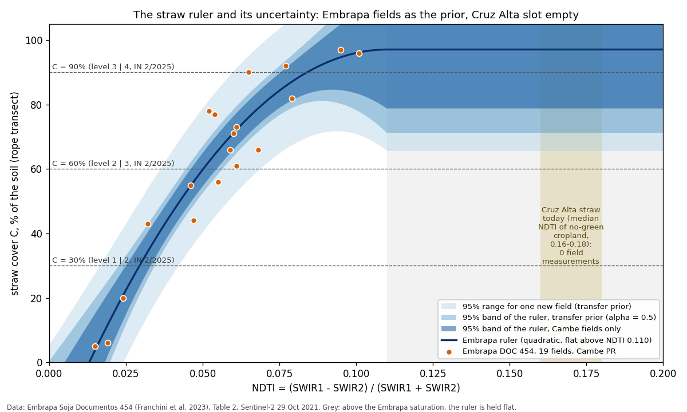

# Field calibration: every rope in a field sharpens the satellite straw ruler for the neighbours

> **SI-assisted:** the idea (turn "the satellite straw index has no field calibration in Cruz Alta" into a ruler that improves with each farmer's measurement) was synthesized with Claude Code (Anthropic) at the team lead's request; the scripts and this text were written with Claude Code. Every number below comes from running the scripts in this folder on the sources listed, or from the cited documents; none was produced by the AI. Human review pending. See [`SI-USAGE.md`](../../SI-USAGE.md).



## The problem it answers

[`../residue-landsat/`](../residue-landsat/) turns the NASA HLS / Landsat residue index NDTI into straw cover with the only published field calibration, **Embrapa Soja Documentos 454** (19 fields in Cambé, north Paraná, Sentinel-2, one date; quadratic fitted there to the document's Table 2, R² 0.91). Its README says it plainly: **no field calibration exists for the Oxisols of the Planalto Médio**, and Cruz Alta straw reads NDTI 0.16–0.18, beyond every Cambé field (0.015–0.101).

This folder makes that gap fillable by the people who stand in the fields:

1. **a 20-minute protocol** ([`protocol.md`](protocol.md), Portuguese [`protocolo.md`](protocolo.md)): a 15 m rope on the diagonal of the rows, 100 marks every 15 cm, each counted as straw / bare soil / green plant (the Embrapa line transect), plus one vertical photo, the Google Maps pin, the date, the winter crop and whether the soil was wet;
2. **code that looks up the satellite pixel** of each measurement (`fetch_pixel.py`: NASA HLS S30/L30, then Landsat C2 L2, the clear scene closest in date, anonymous Planetary Computer, no login) and **re-fits the ruler** (`bayes.py`, `calibrate.py`) with the 19 Embrapa fields as the prior, reporting how the uncertainty falls with each new point;
3. **an empty Cruz Alta slot** ([`measurements/cruz_alta.csv`](measurements/cruz_alta.csv)): today **no Cruz Alta field has been measured**. Nothing is invented; when someone sends a transect, it goes in and the figure and JSON change;
4. **a small NDTI grid of Cruz Alta cropland** (`grid.py`, NASA HLS spring 2026) so the app screen `/calibrate` can show the satellite value on the phone without sending the location anywhere.

## Method

**Model** (`bayes.py`). The Embrapa ruler written as a Bayesian linear regression:

C = b0 + b1·u + b2·u² + e, with u = 10 · min(NDTI, 0.110), e ~ Normal(0, σ²).

- 0.110 is the vertex of the quadratic fitted to Documentos 454, Table 2; above it the ruler is flat (the document states that NDTI saturates near 80% cover, p. 29). It is **held fixed**, so a Cruz Alta field at NDTI 0.17 informs the plateau level, not the shape beyond it.
- σ is **held at the Embrapa residual SD, 9.09 cover points** (SSE / (n − 3), n = 19). With σ known the model is conjugate, and the posterior covariance depends only on *where* (at which NDTI) the measurements fall, not on the measured cover. That is why the app can say "your point would reduce the uncertainty by X%" before the rope is laid.
- **Prior for Cruz Alta**: the Embrapa posterior with its covariance divided by α = 0.5 (a power prior: the 19 Paraná fields count as 9.5 local ones, because the soil, region and sensor differ). α is a choice; 0.25 and 1 are run as sensitivity.
- Readings with NDVI ≥ 0.30 are skipped (Documentos 454 masks NDVI > 0.3: a green canopy hides the straw signal).

**Satellite value of a measurement** (`fetch_pixel.py`). For each row of the private input (lat, lon, date, counts), it searches HLS S30, HLS L30 and Landsat C2 L2 within ±10 days, takes the closest scene whose pixel is clear (HLS Fmask, Landsat QA_PIXEL), reads the 3 × 3 pixels around the point and keeps the centre NDTI and NDVI. It writes the **public** file without coordinates. Smoke test on the public quadrat CA-Q1 of `../residue-landsat` (−28.77507, −53.75102), date 21 Oct 2026: HLS S30 of 20 Oct 2026, NDTI 0.183, NDVI 0.60 (a green canopy that day, so it would be skipped). The smoke row is not a measurement and is not committed.

**Grid for the app** (`grid.py`). Every HLS S30/L30 scene of 1 Sep – 15 Nov 2026 over tiles T22JBP/T22JBN with at least 30% of the municipality's cropland clear, read at about 60 m with the reader of `../residue-landsat/scenes.py`, masked to clear WorldCover 2021 cropland inside the IBGE polygon, summarised per 0.005° cell (about 490 m × 550 m): median NDTI of the no-green pixels (NDVI < 0.30), median NDVI and the no-green share. A cell mixes fields; it is a pointer, not the pixel under the rope.

## Results (`results/`, run of 2026-11-15)

| File | Content |
|---|---|
| `calibration.json` | model, Embrapa posterior, Cruz Alta prior and posterior (equal today), ruler SD by NDTI, the gain of one more point, learning and design curves, the power analysis |
| `calibration.png` | the ruler with the 95% band (Cambé only and transferred) and the 95% range for one field; Cruz Alta NDTI range shaded, 0 points |
| `uncertainty_by_n.png` | left: how the ruler tightens as the 19 Cambé fields are added (median of 400 random orders); right: Cruz Alta, planned, by design and α |
| `cruz_alta_ndti_grid_2026.json` | the app grid (scenes and per-cell values, integers × 1000; attribution inside) |

**How the uncertainty falls.** With a weak prior, the SD of the ruler at the 90% line falls from 11.2 points with 3 Cambé fields to 4.7 with 10 and 3.4 with all 19 (at 30%: 8.9 → 4.6 → 3.3). Transferred to Cruz Alta (α = 0.5) it starts at 4.7 / 3.7 / 4.8 points at C = 30 / 60 / 90%, and 13.2 points on the plateau (NDTI ≥ 0.110), where Cruz Alta straw sits. Planned Cruz Alta points:

| New Cruz Alta measurements (α = 0.5) | SD of the ruler at C = 90%, points: all on the plateau (typical no-till straw) | spread over NDTI 0.02–0.11 (a planned campaign with ploughed to full-straw fields) |
|---|---|---|
| 0 | 4.8 | 4.8 |
| 1 | 3.8 | 4.7 |
| 5 | 3.4 | 3.3 |
| 10 | 3.3 | 2.8 |
| 20 | 3.3 | 2.3 |
| 40 | 3.3 | 1.7 |

Points on the plateau quickly fix the plateau level (one point cuts the plateau SD from 13.2 to about 7.5 points) but stop helping at the 90% line after about five: they say nothing about where the curve bends. Only a spread of fields, including some with little straw, keeps shrinking it. One more point lowers the ruler SD over NDTI 0–0.11 by 12% on average if it sits on the plateau, 6% at NDTI 0.02, 3% at 0.05–0.08.

## How many measurements would separate NM3 from NM4?

The straw part of NM3 vs NM4 is the 90% line of indicator 5 (IN SPA/MAPA 2/2025: level 3 = 60–90%, level 4 ≥ 90%). The calculation (`calibrate.py`, `power_analysis`) asks it for a field 5 points from the line (95% or 85%), one-sided 5% error, 80% power (z = 1.645 + 0.842 = 2.49):

1. **Satellite + ruler, one field: no number of calibration points is enough.** The ruler's own SD falls with n, but a single field scatters about the ruler by σ ≈ 9.1 points (Embrapa). Even with a perfect ruler, a field at 95% lands on the right side of 90% only **71%** of the time; reaching 95% / 80% would need σ ≤ 2.0 points. On top of that NDTI saturates near 80%.
2. **Does NDTI respond between 85% and 95% at all?** On the 12 Cambé fields with C ≥ 60%, NDTI rises 0.0093 per 10 cover points with a residual SD of 0.0112. Showing that difference (two-sided 5%, 80% power) takes **24 measured fields near 85% and 24 near 95% (48 in total)**. That is the campaign that would tell whether, in Cruz Alta, the satellite can see level 3 vs 4 at all; with the Cambé numbers it cannot be shown with a handful.
3. **The field itself.** A 100-point rope at 90% cover has a binomial SD of 3.0 points; with a between-rope SD τ inside the field, a field 5 points from the line needs **3 ropes if τ = 0, 9 if τ = 5, 27 if τ = 10**. τ is not measured in Cruz Alta; the only published hint is that the Documentos 454 transect and drone-image covers of the same 19 fields differ with an SD of 6.9 points (mean −5.0).

So: the satellite can carry the calibration to the neighbours for **level 1 vs level 3+** (ploughed vs no-till), and local ropes can sharpen the ruler; **placing a single field in level 3 or level 4 stays a ground job** (3–27 ropes), and straw is one of the six ZarcNM indicators, next to the soil tests and Embrapa's own classification.

## Alignment with NASA GLOBE Observer (what we adopted, and what not)

The NASA-sponsored **GLOBE Program** runs citizen science through the **GLOBE Observer** app; its **Land Cover** protocol asks for photos facing north, east, south, west, up and down (the down photo documents ground cover), an observation of a uniform area about 100 m × 100 m, surface conditions, and, since August 2025, shows Landsat and Sentinel-2 overpass times so observations match a satellite pass. Each photo is classified with the Modified UNESCO Classification (MUC) and percent sliders.

- **Adopted:** the vertical "down" photo (required) and the four side photos (optional); the uniform ~100 m site; surface condition, narrowed to dry / wet soil because moisture changes NDTI; measuring close to a satellite day.
- **Not adopted:** the MUC classes and visual percent sliders (the ruler needs a measured percentage, so we count 100 points, the Embrapa method); submission to the GLOBE database.
- **No partnership:** FieldShift is not part of GLOBE and has no agreement with NASA, the GLOBE Program or Embrapa. A farmer can also record the same site in the official GLOBE Observer app.

Sources: GLOBE Observer, [Land Cover: taking observations](https://observer.globe.gov/do-globe-observer/land-cover/taking-observations) (accessed 2026-11-15); GLOBE, [Land Cover Classification protocol](https://www.globe.gov/web/biosphere/protocols/land-cover-classification); Embrapa Soja, [Documentos 454](https://www.infoteca.cnptia.embrapa.br/infoteca/bitstream/doc/1156802/1/DOC-454.pdf) (Franchini et al. 2023).

## Data

| Source | What is used | NASA? | Terms | Committed here? |
|---|---|---|---|---|
| Embrapa Soja Documentos 454 (2023), Table 2 | 19 (NDTI, transect cover) pairs, Cambé PR | no | public Embrapa publication; facts transcribed with citation | read from `../residue-landsat/embrapa.py` |
| HLS v2.0 S30 and L30 (NASA LP DAAC; doi:10.5067/HLS/HLSS30.002, 10.5067/HLS/HLSL30.002) | red, NIR, SWIR1, SWIR2, Fmask | **NASA** | NASA data, no restriction; citation requested | per-cell medians only (`cruz_alta_ndti_grid_2026.json`) |
| Landsat Collection 2 Level-2 (USGS/NASA) | fallback in `fetch_pixel.py` | **NASA/USGS** | public domain | no |
| ESA WorldCover 2021 v200 | cropland mask of the grid | no (ESA) | CC BY 4.0 | no |
| IBGE municipal mesh 2022 | municipal boundary | no | public federal data | already in `data/dev/` |
| GLOBE Observer Land Cover protocol | method inspiration only | NASA-sponsored programme | cited | no GLOBE data used |

## Limitations

1. **No Cruz Alta measurement.** Every Cruz Alta number here is a plan or a prior, not a result. The first local points may disagree with the Cambé ruler; that would be the finding, and it gets published.
2. **Another soil, region and sensor.** The prior is Sentinel-2 over a clayey Latossolo in north Paraná with corn and wheat residue; Cruz Alta is HLS/Landsat over Planalto Médio Oxisols, probably kaolinite-rich (kaolinite can mimic straw in NDTI, Hively et al. 2021). α = 0.5 is a judgement.
3. **Fixed plateau and σ.** The saturation point is held at the Embrapa vertex and σ at the Embrapa scatter. With 10–20 local points both should be estimated (a breakpoint model and an unknown-variance update); the code is written so that change is local to `bayes.py`.
4. **Timing.** Sowing and desiccation change the cover in days; a measurement more than ~5 days from a clear scene is weak. The HLS archive on the Planetary Computer starts in 2017 (L30) and 2020 (S30).
5. **Pixel vs rope.** A 15 m rope samples one spot of a 30 m pixel; the grid cell (~500 m) mixes fields. `fetch_pixel.py` reports the 3 × 3 spread so a heterogeneous spot can be flagged.
6. **Privacy.** A field's coordinates can identify its owner through the rural land registry; they stay in the private input and are never committed. Photos with people are not collected.

## Reproduce

From the repository root, with [uv](https://docs.astral.sh/uv/):

```bash
# ruler, uncertainty, power analysis, figures (seconds)
uv run --project services/science --with numpy==2.3.4 --with matplotlib==3.10.7 python analysis/field-calibration/calibrate.py
# app grid (about 20 minutes, network)
uv run --project services/science --with numpy==2.3.4 --with rasterio==1.4.3 --with pystac-client==0.9.0 --with planetary-computer==1.0.0 python -I analysis/field-calibration/grid.py
# a new batch of measurements (private CSV outside git -> public CSV without coordinates), then re-run calibrate.py
uv run --project services/science --with numpy==2.3.4 --with rasterio==1.4.3 --with pystac-client==0.9.0 --with planetary-computer==1.0.0 python -I analysis/field-calibration/fetch_pixel.py ~/private/transects.csv --out analysis/field-calibration/measurements/cruz_alta.csv
# tests
uv run --project services/science --with numpy==2.3.4 --with matplotlib==3.10.7 --with pytest python -m pytest -q analysis/field-calibration/tests
```

The scripts are linted with Ruff (`ruff.toml` here) and live outside the `services/science` package. They import `embrapa.py` and `scenes.py` from `../residue-landsat/` (on main) instead of copying them.
