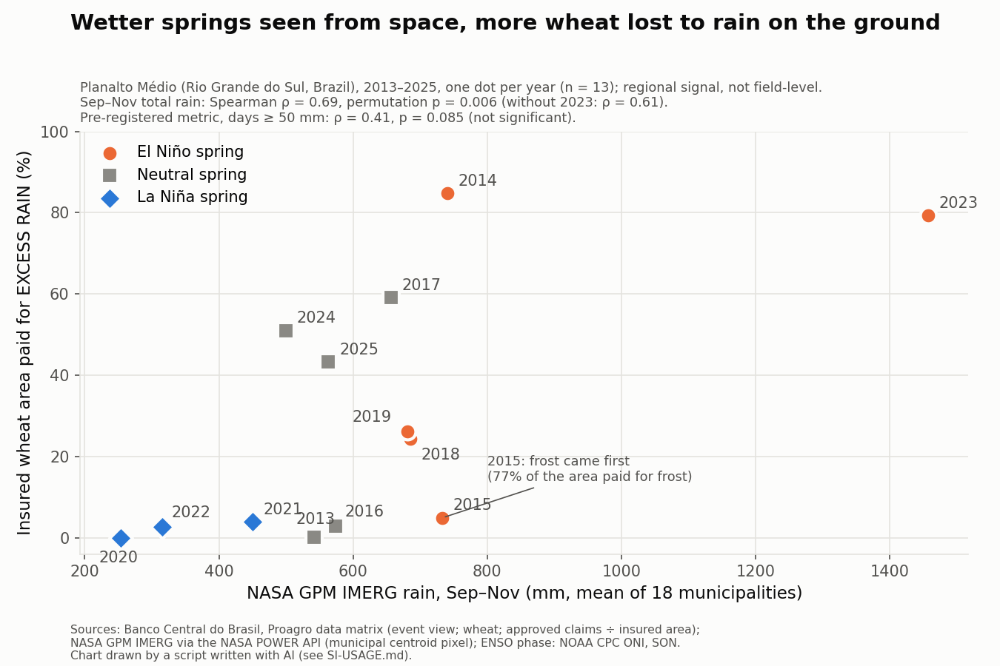

# Ground truth: insured wheat losses to excess rain vs NASA GPM IMERG spring rain

> **SI-assisted:** scripts ported to English and this text written with Claude Code (Anthropic) from the team's analysis of 2026-11-14 in the private planning repository; every number below was produced by running the scripts in this folder against the public sources, not by the AI. Human review pending. See [`SI-USAGE.md`](../../SI-USAGE.md).

Does the rain that a NASA satellite product sees match what an insurance programme paid on the ground? This folder tests it, year by year, in the 18 wheat municipalities of the Planalto Médio (Rio Grande do Sul, Brazil) used in [`analysis/enso-wheat/`](../enso-wheat/README.md), and reruns from the public endpoints with one command.

## Question

In the Planalto Médio, does the share of insured wheat area that Brazil's public crop-guarantee programme (**Proagro**, run by the Central Bank) paid for **excess rain** ("CHUVA EXCESSIVA" in the source) follow, from one year to the next, the September–November rain measured by **NASA GPM IMERG**?

## Answer

| Test (one point per year, 2013–2025, n = 13) | Spearman ρ | one-sided permutation p | Status |
|---|---|---|---|
| **Pre-registered:** IMERG days with ≥ 50 mm (Sep–Nov) vs % of insured area paid for excess rain | **0.41** | **0.085** | not significant at 5% |
| same, without 2023 | 0.27 | 0.20 | the signal rests on 2023 |
| **Secondary:** IMERG Sep–Nov total rain vs % of insured area paid for excess rain | **0.69** | **0.006** | strong |
| same, without 2023 | 0.61 | 0.020 | does not depend on 2023 |
| same, leaving any one year out (minimum) | 0.60 | | stable |

- **The metric chosen before the test does not pass.** Counting heavy-rain days (≥ 50 mm) in one 0.1° pixel is a small, noisy count: in most years the mean of the 18 municipalities sits between 2 and 4 days, and only 2023 (13.9) and the La Niña springs (0 to 2) stand out.
- **The total spring rain of the same IMERG series does track the insured losses**, and not only because of 2023. It was *not* the pre-registered metric, so it is reported as secondary, with every other test the script ran (`results/ground_truth.json`).
- **Multiple testing.** Over the 5 distinct full-sample tests (both correlations of the primary metric, the secondary metric, heavy-rain days vs nominal BRL, El Niño vs other years), the secondary p = 0.006 becomes **0.031** after Bonferroni (Holm gives the same). Over **all 8 p-values** the script computes (adding the leave-2023-out and leave-2025-out variants), it becomes **0.050**: at the edge of 5%. The pre-registered metric stays non-significant under any correction (Holm 0.25 and 0.34).
- **Approximate 95% interval** of the secondary ρ (Fisher z, n = 13): 0.22 to 0.90. Wide: 13 years is a small sample.



### Year by year (18 municipalities summed)

| Year | ENSO phase (SON) | IMERG Sep–Nov, mm (mean) | IMERG days ≥ 50 mm (mean) | Insured area (ha) | % paid for excess rain | % paid for frost | Approved for excess rain (BRL, nominal) |
|---|---|---|---|---|---|---|---|
| 2013 | neutral | 542 | 2.7 | 105,553 | 0.1 | 1.7 | 14 thousand |
| 2014 | El Niño | 741 | 3.1 | 90,062 | **84.8** | 3.7 | 69.3 million |
| 2015 | El Niño | 733 | 4.3 | 89,858 | 4.9 | **76.7** | 3.3 million |
| 2016 | neutral | 574 | 2.8 | 36,044 | 2.9 | 0.2 | 0.6 million |
| 2017 | neutral | 657 | 2.3 | 57,697 | **59.1** | 1.2 | 27.3 million |
| 2018 | El Niño | 686 | 2.7 | 59,479 | 24.3 | 20.5 | 10.5 million |
| 2019 | El Niño | 681 | 3.7 | 60,493 | 26.2 | 4.5 | 12.8 million |
| 2020 | La Niña | 253 | 0.1 | 94,600 | 0.0 | **45.8** | 0 |
| 2021 | La Niña | 451 | 1.9 | 101,301 | 3.9 | 0.4 | 4.9 million |
| 2022 | La Niña | 316 | 0.0 | 92,080 | 2.8 | 1.9 | 8.3 million |
| 2023 | El Niño | 1,457 | 13.9 | 99,348 | **79.4** | 13.5 | **255.2 million** |
| 2024 | neutral | 500 | 1.8 | 84,631 | **51.0** | 3.5 | 93.5 million |
| 2025 | neutral | 563 | 2.6 | 37,960 | **43.2** | 1.2 | 28.8 million |

Full table: `results/table_by_year.csv`.

### ENSO

| Phase (SON) | Years | % paid for excess rain, mean (median) | % paid for frost, mean |
|---|---|---|---|
| El Niño | 2014, 2015, 2018, 2019, 2023 | 43.9 (26.2) | 23.8 |
| Neutral | 2013, 2016, 2017, 2024, 2025 | 31.2 (43.2) | 1.5 |
| La Niña | 2020, 2021, 2022 | **2.2 (2.8)** | 16.0 |

El Niño minus the other years: +23.5 percentage points, permutation p = 0.093 (without 2023: +14.7). "El Niño means rain losses" does not hold every year: in **2015**, a strong El Niño, the money went to **frost** (76.7% of the insured area), and three neutral years (2017, 2024, 2025) had large excess-rain losses. The clear contrast is La Niña: excess-rain claims almost vanish (0 to 4% of the insured area).

## Data

| Source | Endpoint | What it gives | Terms | Committed here? |
|---|---|---|---|---|
| Banco Central do Brasil, Proagro data matrix, "evento" (event) view | file list `www.bcb.gov.br/api/servico/sitebcb/Documentos/byListGuid?...&pasta=%2Fevento` ([page](https://www.bcb.gov.br/estabilidadefinanceira/proagro)); yearly files by year of contract issue, 2013–2026 | insured (enrolled) area and claims notified, approved and under analysis, by municipality × event × month of issue | BCB site terms: reproduction allowed with the source cited and the information kept intact ([Política de Privacidade e Termos de Uso](https://www.bcb.gov.br/acessoinformacao/politicaprivacidade), read 2026-11-14) | derived, wheat only: per municipality (18) and Rio Grande do Sul totals, `results/proagro_*.csv` |
| NASA GPM IMERG via the NASA POWER Daily API | `power.larc.nasa.gov/api/temporal/daily/point`, parameter `IMERG_PRECTOT`, UTC days, 1998–2025 (DOI [10.5067/GPM/IMERG/3B-HH/07](https://doi.org/10.5067/GPM/IMERG/3B-HH/07)) | daily rain at each municipality's centroid pixel | NASA data, no restriction; cite (see `RESOURCES.md`) | derived: Sep–Nov total and days ≥ 50 mm per municipality-year, `results/imerg_son_by_municipality.csv` |
| IBGE localities API and meshes v3 metadata | `servicodados.ibge.gov.br/api/v1/localidades/...`, `/api/v3/malhas/municipios/<code>/metadados` | IBGE codes (matched by name), centroid and area | public federal data; cite IBGE | `results/municipalities.csv` |
| NOAA CPC ONI, operational SON phase | read from [`data/sites/cruz-alta/output/enso-rain-signal.json`](../../data/sites/cruz-alta/output/enso-rain-signal.json) | ENSO phase of each spring | public domain | already in the repo |

Raw downloads (about 130 MB of Proagro files and 18 POWER responses) go to `~/.cache/fieldshift/ground-truth-proagro/` (or `--raw DIR`) and are never committed. `results/sources.json` records every URL, the Proagro file publication dates (2026-06-28 and 2026-09-10) and the access times (UTC). The numbers here come from the run of **2026-11-14 BRT** (2026-11-15 UTC; `results/run_info.json`). No name of a person or financial institution is written.

## Method

- **Year** = year of contract issue. In Rio Grande do Sul about 99% of the wheat contracts of 2013–2026 were issued in January–July (`results/proagro_wheat_rs_issue_month.csv`), so the issue year is that winter's crop. **2026 is excluded** (still under claim adjustment).
- **Loss metric** = area with an **approved** ("deferida") claim for the event ÷ insured area of the year, summed over the 18 municipalities. A share of area removes inflation and the size of the programme (insured area ranged from 36 thousand ha in 2016 to 106 thousand ha in 2013). BRL values are nominal and enter only as a comparison.
- **Rain** = IMERG `IMERG_PRECTOT` at the IBGE centroid of each municipality, September 1 – November 30; a year enters only with a complete window; mean of the 18 municipalities.
- **Test** = Spearman by year (n = 13), never by municipality-year (neighbouring municipalities share the weather). One-sided permutation p (ρ > 0), 200,000 draws, seed 20261114. Pre-registration text: header of [`ground_truth.py`](ground_truth.py).
- **Negative control:** heavy-rain days vs % paid for frost gives ρ = 0.29, not zero: El Niño springs bring frost and rain together (2015, 2018, 2023).

## Limitations

1. **n = 13 years.** One number per year; autocorrelation between consecutive years was not measured. The interval of the secondary ρ is wide (0.22 to 0.90).
2. **The signal is regional and year-to-year, not municipal.** Within a year, across the 18 municipalities, the rainier pixel does not lose more: mean ρ = 0.06, positive in 5 of 11 years (`within_year_across_municipalities`). IMERG here does not say which farm or which municipality will lose.
3. **The pre-registered metric failed** (p = 0.085; 0.27 without 2023). The strong result comes from a secondary metric; after correcting for all 8 p-values it sits at p = 0.050.
4. **2015 was frost, not rain**, despite a strong El Niño; and **neutral years also lose** (2017, 2024, 2025). ENSO changes the type of risk; it does not guarantee a rain loss.
5. **Proagro is a sample.** It covers only financed area that enrolled (36 to 106 thousand ha in these municipalities), and the event is declared by the farmer or the bank and checked by an inspector. It is not the total loss of the municipality.
6. **IMERG through POWER:** one 0.1° pixel at the centroid represents municipalities of 220 to 2,250 km²; POWER does not report which IMERG run (Early, Late, Final) it serves.
7. **2025** had no area still under analysis in these municipalities and was treated as final; without it the primary result keeps its conclusion (ρ = 0.48, p = 0.057).
8. **Correlation, not cause.** The 18 municipalities were chosen by another analysis (`analysis/enso-wheat/`), not by this result.

**Say:** "Across 13 wheat seasons in the Planalto Médio, springs that NASA GPM IMERG saw as wetter were the seasons when Proagro paid for more wheat lost to excess rain (Spearman ρ = 0.69, p = 0.006; 0.61 without 2023; a secondary metric — the pre-registered heavy-rain-day count gave ρ = 0.41, p = 0.085)."
**Do not say:** "heavy-rain days predict insurance losses"; "El Niño always means rain losses"; "the satellite tells which farm will lose".

## Reproduce

From the repository root, with [uv](https://docs.astral.sh/uv/) (downloads about 130 MB on the first run, a few minutes):

```bash
uv run --with httpx==0.28.1 --with numpy==2.5.4 --with matplotlib==3.10.7 \
  python -I analysis/ground-truth-proagro/reproduce.py
```

| Step | Script | Output (`results/`) |
|---|---|---|
| 1 | [`fetch_sources.py`](fetch_sources.py) | `proagro_wheat_*.csv`, `municipalities.csv`, `imerg_son_by_municipality.csv`, `sources.json` |
| 2 | [`ground_truth.py`](ground_truth.py) | `table_by_year.csv`, `ground_truth.json` (every test, leave-one-out, ENSO, within-year, corrections) |
| 3 | [`figure.py`](figure.py) | `ground-truth-proagro.png` (no logo) |

The scripts are linted with Ruff (`ruff.toml` here); they are outside the `services/science` package and its CI job.

### Check against the team's analysis

The run of 2026-11-14 reproduced the team's private analysis of the same day to the last digit: the 13-row year table, every correlation and permutation p-value (0.407/0.0847, 0.527/0.0501, 0.266/0.203, 0.483/0.0573, 0.687/0.0062, 0.608/0.0199, leave-one-out minimum 0.601, 0.214/0.2416, frost control 0.286), the within-year mean ρ (0.062, 5 of 11 years), the ENSO table and the El Niño difference (+23.5 pp, p = 0.0929), and every aggregated CSV (identical cell by cell). The IMERG Sep–Nov series at Cruz Alta (total and days ≥ 50 mm, 1998–2025) is identical to the `gpm-imerg` series of `enso-rain-signal.json` used by the pipeline (checked year by year). The team's second path (MAPA rural-insurance subsidy records, PSR) was not ported: its raw files carry policyholder names and its 2016–2024 file is truncated.
