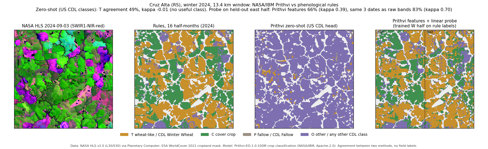

# NASA's AI on Cruz Alta's winter: the Prithvi geospatial foundation model against our phenological rules (HLS, winter 2024)

> **SI-assisted:** the idea (run the NASA/IBM Prithvi geospatial foundation model, trained on NASA HLS, on Cruz Alta and compare its winter classes with the rule-based classes of `analysis/rotation-fingerprint`) was synthesized with Claude Code (Anthropic) at the team lead's request. The scripts and this text were written with Claude Code. Every number below was produced by running the scripts in this folder on the sources listed; none was produced by the AI. Human review pending. See [`SI-USAGE.md`](../../SI-USAGE.md).

Method summary for the app: [`content/methods/nasa-ai-prithvi.md`](../../content/methods/nasa-ai-prithvi.md).



## Question

The challenge suggests comparing SI approaches. NASA and IBM publish an open geospatial foundation model, **Prithvi**, pre-trained on NASA HLS, plus a version fine-tuned to classify crops from three HLS dates. Can it read the winter of a Cruz Alta field (wheat-like cereal, cover crop or other) as well as, or better than, our explicit phenological rules?

1. Does the published crop model run on a laptop CPU, with no GPU and no account?
2. Without any Brazilian training (zero-shot), do its classes agree with our rules pixel by pixel?
3. If not, do its internal features carry the information (a linear probe trained on the rule classes as weak labels)?

## Answer in one paragraph

**It runs, but it does not help here yet.** The published Prithvi crop model (100 M parameters) runs on a laptop CPU through a plain-PyTorch re-implementation written here, which reproduces its own published behaviour on its US validation chips (56.6% pixel accuracy on 40 chips, against 60.6% published for the full validation set). On a 13.4 km × 13.4 km Cruz Alta window with three clear HLS dates of winter 2024 (23 July, 3 September, 10 November) it gives **no useful winter class**: 77.9% of the compared cropland pixels go to the US class "Other", and "Winter Wheat" covers 2.4% of the pixels where our rules see a wheat-like cereal on 51.0% (binary agreement 48.5%, Cohen's kappa −0.01, i.e. chance). This is expected: the head was fine-tuned on US 2022 crops with the northern-hemisphere calendar and has no cover-crop class. A **linear probe** on its features, trained on the rule classes of the west half of the window and tested on the east half, reproduces the rules on **65.6–69.7%** of the pixels (kappa 0.39–0.47), and the encoder of the newer foundation model (Prithvi-EO-2.0-100M-TL, not fine-tuned) on 48.0% (kappa 0.23); **the same probe on the 18 raw band values of the same three dates does better, 82.7% (kappa 0.70)**, and still 68.4% when the raw bands are degraded to Prithvi's 480 m patch size. So, without fine-tuning on Brazilian labels, NASA's foundation model adds nothing over the raw HLS bands for this question, and our rules (16 half-months of NDVI, with cited calendar dates) remain the method the team uses. **None of these numbers is an accuracy: there are no field labels; they are agreement between methods.**

## Data and model

| Source | What is used | NASA? | Terms | Committed here? |
|---|---|---|---|---|
| HLS v2.0 HLSL30 and HLSS30 (NASA LP DAAC; DOIs [10.5067/HLS/HLSL30.002](https://doi.org/10.5067/HLS/HLSL30.002), [10.5067/HLS/HLSS30.002](https://doi.org/10.5067/HLS/HLSS30.002)) | tile T22JBP, 1 April – 30 November 2024: red, NIR and Fmask of 96 granules (rules); Blue, Green, Red, Narrow NIR, SWIR 1, SWIR 2 of three granules (Prithvi) | **NASA** | NASA data, no restriction; citation requested | **no imagery**: window coordinates, granule ids and results only |
| **Prithvi-EO-1.0-100M multi-temporal crop classification** (NASA/IBM; Li et al. 2023, doi:[10.57967/hf/0954](https://doi.org/10.57967/hf/0954)) | the published checkpoint `multi_temporal_crop_classification_Prithvi_100M.pth` (SHA-256 `37ed41637eccccec65ca2031324e2c03a4f168e1ea0ea71ad180910589fa018c`, checked against the Hugging Face LFS id); fine-tuned on US HLS 2022 chips with USDA Cropland Data Layer labels, 13 classes | **NASA** (with IBM) | **Apache-2.0** ([model card](https://huggingface.co/ibm-nasa-geospatial/Prithvi-EO-1.0-100M-multi-temporal-crop-classification)) | no (1.7 GB, downloaded at run time) |
| **Prithvi-EO-2.0-100M-TL** (NASA/IBM; Szwarcman et al. 2024, [arXiv:2412.02732](https://arxiv.org/abs/2412.02732)) | the pre-trained encoder (`Prithvi_EO_V2_100M_TL.pt`, SHA-256 `d45406d5fc51af1d9657d48f2e2c3ff077408a2e1113f9a242889a4fe4469b17`) and its official `prithvi_mae.py`; pre-trained on 4.2 M NASA HLS samples, with time and location encodings | **NASA** (with IBM) | **Apache-2.0** ([model card](https://huggingface.co/ibm-nasa-geospatial/Prithvi-EO-2.0-100M-TL)) | no (455 MB, downloaded at run time) |
| HLS multi-temporal crop classification dataset (NASA/IBM/Clark University) | the first 40 chips of `validation_chips.tgz` (US, with CDL labels), only to check the re-implementation | **NASA** (with partners) | CC BY 4.0 ([dataset card](https://huggingface.co/datasets/ibm-nasa-geospatial/multi-temporal-crop-classification)) | no |
| ESA WorldCover 2021 v200 | cropland mask (class 40 ≥ 50% of the 30 m pixel), as in `analysis/rotation-fingerprint` | no (**ESA, partner data**) | CC BY 4.0 | no |
| IBGE municipal mesh 2022 and IBGE PAM (SIDRA 1612) | municipal boundary; 2024 winter-grain and wheat shares, read from `analysis/rotation-fingerprint/results/winter_paths_by_year.csv` | no (IBGE) | public federal data | already in the repository |

Imagery and the WorldCover tile are read anonymously through the Microsoft Planetary Computer STAC; the model files from Hugging Face, without an account.

**Feasibility, as checked on 2026-11-15** (official Hugging Face organisation `ibm-nasa-geospatial`): fifteen public models, all Apache-2.0 and none gated: Prithvi-EO-1.0-100M (base, burn scars, Sen1Floods11, multi-temporal crop classification), Prithvi-EO-2.0 (tiny-TL, 100M-TL, 300M, 300M-TL, 600M, 600M-TL, fine-tuned flood and burn-scar versions) and the Prithvi-WxC weather models. The only crop model is the 1.0 one; it expects 224 × 224 chips of 6 HLS bands × 3 dates (reflectance × 10,000) and was trained with mmsegmentation, whose old stack (mmcv 1.x) does not install on current Python. Its architecture is small (a 6-block ViT encoder, a transposed-convolution neck, a one-layer FCN head), so `prithvi_crop.py` re-implements it in plain PyTorch and refuses a checkpoint with a missing or unexpected weight. On a laptop CPU the full 448 × 448 window (nine overlapping chips) runs in 39 s including loading the weights (`inference_seconds` in the JSON); no GPU is needed for inference. Fine-tuning on Brazilian labels would need labels we do not have and, realistically, a GPU.

## Method

**Window.** The 448 × 448 px block (2 × 2 chips, 13.4 km × 13.4 km; about −53.55 to −53.42 longitude, −28.61 to −28.73 latitude) of the rotation-fingerprint 30 m grid with the most WorldCover cropland inside the IBGE polygon of Cruz Alta (82.5%). Chosen by that rule, not by looking at the result.

**Rule classes (reference).** The red, NIR and Fmask of all 96 granules of 2024 for the window, the half-month median composite, gap filling and the MAIN rules of `analysis/rotation-fingerprint/classify.py`, imported, not copied: T wheat-like cereal, C cover crop, P fallow, O other. In the window 51.0% of the compared pixels are T (municipality in 2024: 52.4%).

**Prithvi input.** For each of three winter periods (July, September, 15 October – 30 November) the granule with the clearest cropland: S30 2024-07-23 (99.9% clear), L30 2024-09-03 (100%), S30 2024-11-10 (99.9%). Pixels compared: cropland, classified by the rules and clear on all three dates (165,315 pixels).

**Channel order.** The official mmseg test pipeline reshapes the 18 file channels (stored date by date) straight into 6 × 3, so the model was trained on that order, not on a band × date order. `validate_us_chips.py` settles it on the model's own US validation chips: 56.6% pixel accuracy with the official order, 16.9% with the band × date order. Both runs on Cruz Alta use the official order (a first run with the band × date order gave the same conclusion: 1.6% Winter Wheat, kappa −0.01).

**Zero-shot comparison.** Sliding 224 × 224 windows with stride 112 (the official `test_cfg`), logits averaged. Mapping fixed before looking at the result: T = "Winter Wheat", P = "Fallow/Idle Cropland", everything else = not wheat; CDL has no cover-crop class, so C has no counterpart and the full 13 × 4 cross-table is reported.

**Linear probes (experiment).** Multinomial logistic regression (standardised features, balanced class weights) with the rule classes as **weak labels** (T, C, O; P merged into O, it is 0.3% of the pixels), trained on 40,000 pixels of the west half of the window and tested on 30,000 pixels of the east half (spatial hold-out, the same pixels for every feature set). Feature sets: (a) the 256 per-pixel features of the crop model's head; (b) the 2,304 per-pixel features of its neck; (c) the 768-d × 3-date tokens of the last layer of the Prithvi-EO-2.0-100M-TL encoder (one per 16 × 16 patch = 480 m, bilinearly brought to 30 m; time and location encodings passed as in the official `inference.py`); (d) the 18 raw band values of the same three dates; (e) the same 18 values averaged over each 480 m patch and brought back to 30 m the same way, a fair baseline for (c).

## Results

Files in [`results/`](results/):

| File | Content |
|---|---|
| `prithvi_vs_rules.json` | model, licence, input granules (with STAC links), window, shares, binary wheat table, post-hoc share of each rule class in "Other", the three probes on the crop model and raw bands, what cannot be said, library versions |
| `crosstab_cdl_x_rules.csv` | the 13 Prithvi CDL classes × the 4 rule classes, pixel counts |
| `foundation_probe.json` | the Prithvi-EO-2.0 encoder probe and the raw-bands-at-480 m baseline |
| `us_validation_check.json` | pixel accuracy of the re-implementation on 40 official US validation chips, both channel orders |
| `prithvi-vs-rules.png` | the figure above (no logo) |

### Zero-shot: no useful class

| | Rules: T | Rules: not T |
|---|---|---|
| **Prithvi: Winter Wheat** | 1,632 | 2,378 |
| **Prithvi: not Winter Wheat** | 82,716 | 78,589 |

Agreement 48.5%, kappa −0.01. Prithvi classes over the compared pixels: Other 77.9%, Corn 9.5%, Soybeans 3.4%, Winter Wheat 2.4%, Cotton 2.3%, Natural Vegetation 1.5%, the rest below 1.2% each. **Post-hoc observation, not a mapping:** 93.2% of the rule-T pixels fall into "Other", against 63.4% of the rule-C pixels (18.7% of which go to "Corn"), so the US head does separate the two winter paths somewhat, but under labels that mean nothing here. Against IBGE PAM 2024 for the whole municipality (winter grains 38.2% and wheat 27.1% of the soybean area), the rule T share (51.0% in the window, 52.4% in the municipality) is too high and the Prithvi Winter Wheat share (2.4%) far too low; the window is not the municipality, so this is only a level check.

### Linear probes: Prithvi features do not beat the raw bands

| Features (probe trained on the west half, tested on the east half) | Dimensions | Agreement with the rules (T/C/O) | Kappa |
|---|---|---|---|
| Prithvi-EO-1.0 crop model, head features (30 m) | 256 | 65.6% | 0.39 |
| Prithvi-EO-1.0 crop model, neck features (30 m) | 2,304 | 69.7% | 0.47 |
| Prithvi-EO-2.0-100M-TL encoder tokens (480 m patches → 30 m) | 2,304 | 48.0% | 0.23 |
| Raw HLS bands of the same three dates, 480 m patches → 30 m | 18 | 68.4% | 0.48 |
| **Raw HLS bands of the same three dates (30 m)** | **18** | **82.7%** | **0.70** |

The probe learns the rule labels, so a high number means "three dates seen through these features can reproduce the 16-half-month rules", not that either is right. The raw bands win at both scales; the foundation encoder loses even to raw bands at its own patch size.

## Limitations

- **No field labels.** Every number is agreement between two methods; the rules are themselves phenological hypotheses (`analysis/rotation-fingerprint/README.md`).
- **Out of domain.** The crop head was fine-tuned on US 2022 crops and the northern-hemisphere calendar (US winter wheat is sown in autumn and harvested in early summer); applied to a southern-hemisphere winter with three dates of July–November it is outside what it learned. The negative zero-shot result says nothing about the model where it was trained.
- **No fine-tuning.** The fair test of a foundation model is to fine-tune it on local labels. We have none (field labels or a Brazilian equivalent of the CDL); fine-tuning on our own rule classes would only teach it the rules.
- **Linear probes only.** A non-linear head, more dates, other layers or other pooling could do better; the 480 m patch size of the encoder is coarse for fields of a few tens of hectares.
- **One window, one year, three dates**; the probe's train and test halves are neighbours, so the hold-out is spatial but not independent of the farming region.
- The re-implementation reproduces the published accuracy level on 40 chips (56.6% against 60.6% on the full set), not the full validation set.
- Location coordinates for Prithvi-EO-2.0 are passed in the order of the official `inference.py` (rasterio `lnglat`, longitude first), although the model code's docstring says latitude first; we did not test the other order.

## Reproduce

From the repository root (raw files and weights go to directories outside git):

```bash
RAW=~/.cache/fieldshift/nasa-ai-prithvi; mkdir -p $RAW/prithvi1 $RAW/prithvi2/code $RAW/valchips
uv run --no-project --python 3.12 --with numpy==2.3.4 --with rasterio==1.4.3 --with pystac-client==0.9.0 \
    --with planetary-computer==1.0.0 python -I analysis/nasa-ai-prithvi/fetch_chips.py $RAW --year 2024
H=https://huggingface.co/ibm-nasa-geospatial
curl -L -o $RAW/prithvi1/crop.pth $H/Prithvi-EO-1.0-100M-multi-temporal-crop-classification/resolve/main/multi_temporal_crop_classification_Prithvi_100M.pth
for f in Prithvi_EO_V2_100M_TL.pt config.json; do curl -L -o $RAW/prithvi2/$f $H/Prithvi-EO-2.0-100M-TL/resolve/main/$f; done
curl -L -o $RAW/prithvi2/code/prithvi_mae.py $H/Prithvi-EO-2.0-100M-TL/resolve/main/prithvi_mae.py
WITH="--with torch==2.7.1 --with numpy==2.3.4 --with scikit-learn==1.7.2 --with rasterio==1.4.3 --with matplotlib==3.10.7"
uv run --no-project --python 3.12 $WITH python -I analysis/nasa-ai-prithvi/run_prithvi.py $RAW $RAW/prithvi1/crop.pth analysis/nasa-ai-prithvi/results
uv run --no-project --python 3.12 $WITH --with timm==1.0.15 --with einops==0.8.1 \
    python -I analysis/nasa-ai-prithvi/foundation_probe.py $RAW $RAW/prithvi2 analysis/nasa-ai-prithvi/results
# check of the re-implementation on the model's own US validation chips (first ~80 MB of the archive)
curl -L https://huggingface.co/datasets/ibm-nasa-geospatial/multi-temporal-crop-classification/resolve/main/validation_chips.tgz \
    | head -c 80000000 | tar -xzf - -C $RAW/valchips
uv run --no-project --python 3.12 $WITH python -I analysis/nasa-ai-prithvi/validate_us_chips.py $RAW/valchips/validation_chips $RAW/prithvi1/crop.pth analysis/nasa-ai-prithvi/results
```

Check the SHA-256 of both checkpoints against the values above before running (`run_prithvi.py` loads the 1.0 checkpoint with `torch.load(weights_only=False)` because it is an mmcv pickle). Run of 2026-11-15 (BRT morning): STAC search 13:14 UTC; the HLS reads take about 4 minutes, the models about 5 minutes on a laptop CPU.

## References

- Jakubik, J. et al. (2023). Foundation models for generalist geospatial artificial intelligence. arXiv:2310.18660.
- Szwarcman, D. et al. (2024). Prithvi-EO-2.0: a versatile multi-temporal foundation model for Earth observation applications. arXiv:2412.02732.
- Li, H., Khallaghi, S., Cecil, M., Kordi, F., Fraccaro, P., Alemohammad, H., Ramachandran, R. (2023). HLS Multi Temporal Crop Classification Model. Hugging Face, doi:10.57967/hf/0954.
- Claverie, M. et al. (2018). The Harmonized Landsat and Sentinel-2 surface reflectance data set. Remote Sensing of Environment 219, 145–161, doi:10.1016/j.rse.2018.09.002.
- Cohen, J. (1960). A coefficient of agreement for nominal scales. Educational and Psychological Measurement 20, 37–46.
