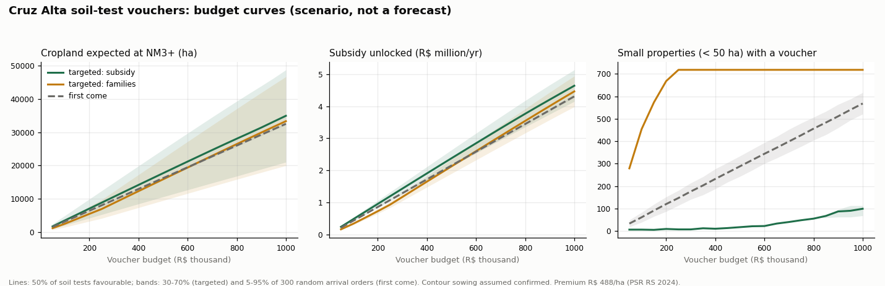
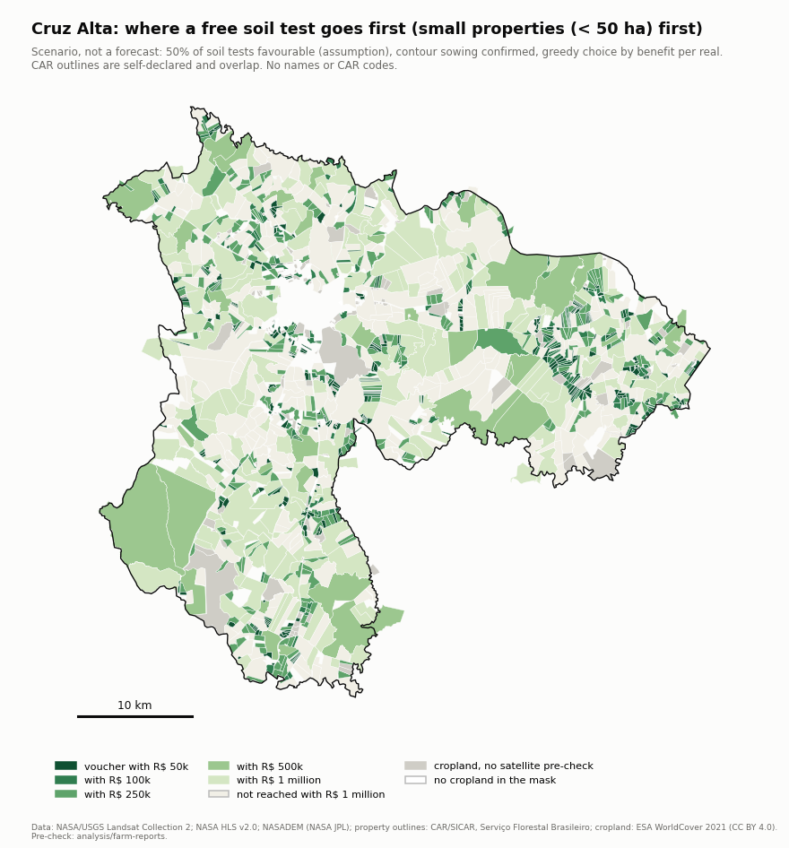

# Where should one public real be spent? Soil-test vouchers for the ZarcNM soybean subsidy in Cruz Alta (RS)

> **SI-assisted:** the idea (turn the farm-by-farm pre-check into a public-policy instrument: "where should one public real be spent?") was synthesized with Claude Code (Anthropic) at the team lead's request; the team confirms it in D-001. The scripts, tests and this text were written with Claude Code. Every number below was produced by running the scripts in this folder on the farm-reports results and the sources listed; none was produced by the AI. Human review pending. See [`SI-USAGE.md`](../../SI-USAGE.md).

Output read by the app: [`results/policy_targeting.json`](results/policy_targeting.json). **Scenario, not a forecast.**



## The question

[`analysis/farm-reports`](../farm-reports/README.md) (PR #60) ran the satellite half of the ZarcNM rule (IN SPA/MAPA 2/2025) on every CAR property of Cruz Alta. **1,263 of the 1,286 assessed properties (98%) are "satellite-ready" for NM3+**: their straw, years without tillage and winter diversity already allow NM3 or NM4. What is missing is not on the satellite side:

- the **soil test** (V%, Ca, m%; 0-20 and 20-40 cm, one composite sample per layer per sampling area of at most 10 ha, IN 2/2025 items 7.2-7.9), about **R$ 14/ha in the first year, ~R$ 5/ha/yr** over its 24-month validity;
- **contour sowing**, needed wherever the mean slope is ≥ 3% (item 3.2.1-I): 1,284 of the 1,286 assessed properties.

Uptake is low: the Paraná pilot of 2025/26 contracted R$ 206 thousand of R$ 8 million (MAPA, 29 May 2026). So a cooperative, a municipality or the state could pay for soil tests. **Which properties should get a free soil test first, for a given budget and goal?**

## What this does

For every assessed property (anonymous; built from the farm-reports per-property table that stays outside git):

1. **Cost** of the soil test: `ceil(cropland / 10 ha)` sampling areas × (2 chemical analyses at R$ 50 + 1 texture analysis at R$ 40).
2. **Outcome** for each soil-test result, with the same rules module (`analysis/zarcnm-precheck/zarcnm_rules.py` through `analysis/farm-reports/indicators.py`): the property's NM if the three soil indicators come back at level 4, 3 or 2. The script recomputes the farm-reports ranges for levels 4 and 3 and stops if they differ.
3. **Expected value** under the soil scenario: P(NM3+), P(NM4), expected subsidy gain per year = Σ P(level) × (subsidy at level − 20%) × premium × cropland, and the straw-covered cropland brought into NM3+ (cropland × the farm-reports straw share).
4. **Targeting**: greedy by benefit per real, filling the budget (a property that does not fit is skipped; later ones may still fit), for three objectives:
   - `subsidy`: most subsidy unlocked per real;
   - `protected`: most straw-covered cropland (soil protected in the November storms) brought into NM3+ per real;
   - `families`: small properties (declared area < 50 ha) first, by chance of NM3+ per real; the rest of the budget by subsidy per real.
5. **Baseline, "first come, first served"** (what happens today): every property with cropland is equally likely to apply; 300 random arrival orders, mean and 5-95%. Properties without the pre-check (223) can apply too and get the per-hectare averages of assessed properties of their size class (generous to the baseline).

Budgets from R$ 50 thousand to R$ 1 million, in steps of R$ 50 thousand.

## Assumptions (all adjustable in `targeting.Assumptions` or on the command line)

| Input | Default | Source / status |
|---|---|---|
| Subsidy by level, soybean 2026/27 | 20 / 30 / 35 / 40% (NM1-NM4); 20% without classification | Resolução CGSR 111/2026 |
| PSR soybean premium | R$ 488/ha (`--premium`) | MAPA PSR open data (SISSER), RS average 2024; Cruz Alta was R$ 408/ha |
| Soil test prices | R$ 50 chemical, R$ 40 texture, per sample | UFPel/FAEM price list (no date on the page); via `docs/research/verifica-impacto.md` in the team workspace |
| Sampling grid | ≤ 10 ha per sampling area, 2 layers | IN SPA/MAPA 2/2025 items 7.2-7.9 (zones of management could lower the count) |
| **P(soil tests favourable, level ≥ 3)** | **scenario 30 / 50 / 70%** | **assumption**: no published distribution of V%, Ca and m% levels for RS soybean fields was found. For context only (overall NM, not soil indicators, and selected samples): Paraná pilot 2025/26, 32% of the area at NM3+; Emater/RS Operação Terra Forte, 101 of 1,082 family-farm fields (9%) at NM3+ |
| Favourable split | 50% at level 4, 50% at level 3 | assumption |
| Unfavourable outcome | the three soil indicators at level 2 → NM2 at most (lock IV-b) | assumption (level 1 would give NM1) |
| P(contour confirmed) | 1.0 (`--contour`) | assumption, as farm-reports; not observable from space |
| Which end of the NM range | lower (`--range-end`) | as farm-reports' "ready" |
| Sampling visit / accredited operator | R$ 0 (`--fixed-cost`) | no public price; sensitivity only |
| "Small property" | declared CAR area < 50 ha | proxy for family farms; Lei 11.326/2006 also needs ≤ 4 fiscal modules, family labour and income, which the CAR does not show |
| Insured area | all of the property's cropland, as soybean under the PSR | assumption; the subsidy is paid only through the PSR, not Proagro Mais |

## Results

Run of 15 November 2026 (BRT). Inputs from the farm-reports run of the same day: 1,509 properties with cropland, **1,286 assessed** (104,100 ha of cropland summed over properties; 718 small), 223 without the pre-check. Testing every assessed property would cost **R$ 1.55 million** (R$ 14.86/ha).

**With R$ 100 thousand and 50% of soil tests favourable** (expected values per year):

| Policy | Properties | Small (< 50 ha) | Cropland → NM3+ (ha) | → NM4 (ha) | Subsidy unlocked (R$/yr) | Total subsidy drawn (R$/yr) |
|---|---|---|---|---|---|---|
| Targeted: subsidy | 21 | 6 | **3,565** | 1,783 | **478,488** | 1,174,471 |
| Targeted: protected soil | 24 | 6 | 3,566 | 1,319 | 467,192 | 1,163,219 |
| Targeted: small first | 454 | **454** | 2,566 | 902 | 336,043 | 838,857 |
| First come (mean of 300) | 98 | 61 | 3,233 | 1,136 | 428,596 | 1,072,440 |

Curve points (50% favourable; 30% and 70% in `budget_curves.csv`):

| Budget | Targeted subsidy: ha NM3+ / R$ unlocked | Small first: small served / R$ unlocked | First come: ha NM3+ / R$ unlocked / small served |
|---|---|---|---|
| R$ 50k | 1,782 / 239,199 | 279 / 161,844 | 1,606 / 212,988 / 33 |
| R$ 250k | 8,893 / 1,193,463 | 718 (all) / 931,863 | 8,107 / 1,074,216 / 147 |
| R$ 500k | 17,723 / 2,378,442 | 718 / 2,125,237 | 16,249 / 2,152,347 / 288 |
| R$ 1 million | 34,923 / 4,640,905 | 718 / 4,464,123 | 32,516 / 4,309,612 / 568 |

What the numbers say:

1. **Targeting for money beats first come by about 10%** (3,565 vs 3,233 ha at NM3+; R$ 478 vs 429 thousand). The gain is small *because* the satellite side is rarely the bottleneck in Cruz Alta: almost every property is ready, so the pre-check mainly removes the 2% that are not and the 15% that cannot be read, and prefers NM4 ranges.
2. **The real choice is who.** For the same R$ 100 thousand, "small first" gives a voucher to **454 small properties, 7 times the 61 of first come**, for 30% less subsidy than the money-maximizing choice (which goes to 21 properties whose range reaches NM4 and whose cropland fits the 10 ha sampling grid with little waste; five of them, over 700 ha each, take most of the area). With R$ 250 thousand every assessed small property is covered.
3. **The pilot budget is the binding cap, not the voucher.** R$ 100 thousand of soil tests in one municipality would draw about **R$ 1.17 million a year of subsidy** at the new levels, more than the whole **R$ 1 million** soybean pilot of CGSR 111/2026 for four states. A voucher programme only makes sense together with a larger subsidy budget.
4. Objectives `subsidy` and `protected` almost coincide: straw is nearly universal (median cover 97%), so "soil protected" is close to "hectares at NM3+".

Sensitivities at R$ 100 thousand, 50% favourable (targeted subsidy / small first / first come; ha NM3+, R$ unlocked):

| Change | Targeted subsidy | Small first | First come |
|---|---|---|---|
| none | 3,565 ha, R$ 478k | 2,566 ha, R$ 336k, 454 small | 3,233 ha, R$ 429k, 61 small |
| premium R$ 408/ha (Cruz Alta 2024) | 3,565 ha, R$ 400k | 2,566 ha, R$ 281k | 3,229 ha, R$ 358k |
| contour confirmed on half | 1,781 ha, R$ 239k | 1,283 ha, R$ 168k | 1,615 ha, R$ 214k |
| upper end of the NM range | 3,567 ha, R$ 479k | 2,558 ha, R$ 343k | 3,268 ha, R$ 441k |
| + R$ 200 fixed cost per property (illustrative) | 3,526 ha, R$ 473k | 1,160 ha, R$ 151k, 266 small | 2,705 ha, R$ 358k, 50 small |

A fixed per-property cost (visit, operator) hits small properties hardest: with R$ 200 per property the number of small properties served drops from 454 to 266. The operator's price is not public.



Maps for the three objectives: [`map-subsidy.png`](results/map-subsidy.png), [`map-protected.png`](results/map-protected.png), [`map-families.png`](results/map-families.png) (each property coloured by the smallest budget at which it gets a voucher; 50% favourable).

## Limitations

1. **CAR is self-declared** and outlines overlap; areas are sums over properties, not municipal hectares. "Small" is a CAR-area proxy, not a family-farm status.
2. **Soil is unknown.** The soil scenario (30/50/70%) is an assumption applied equally to every property; with real soil maps or past analyses the targeting would change most. The model does not know which soils are acidic.
3. **3 of 6 indicators** come from satellite, uncalibrated in Cruz Alta (see farm-reports limitations); contour is assumed confirmed; useful soil depth is not checked.
4. **Subsidy only through the PSR.** Small farmers in RS are mostly in Proagro Mais (Pronaf); they would need to contract PSR for the gain to exist. The "subsidy unlocked" assumes all cropland is insured as soybean under the PSR.
5. **Pilot budget.** CGSR 111/2026 has R$ 1 million for soybean in four states; the totals above exceed it. Nothing here says the money is available.
6. **Accredited steps are not priced**: registration by an accredited operator and the SINM classification have no public price; the fixed-cost sensitivity shows what they could do.
7. **First come is a model**: equal chance per property; in reality larger, better-advised farms may apply first, which would make first come serve even fewer small properties.
8. Expected values, not outcomes: each number is an average over the soil scenario; one property either reaches a level or does not.

## Privacy

The committed files are aggregates (`policy_targeting.json`, `budget_curves.csv`, `curves.png`) and three maps of the self-declared outlines without labels, at the same detail as the farm-reports map. No CAR code, owner field or per-property table is committed; the per-property input stays in the farm-reports raw folder (`~/.cache/fieldshift/farm-reports/<ibge>/`).

## Reproduce

Needs the farm-reports raw folder (run [`../farm-reports/reproduce.py`](../farm-reports/README.md#reproduce) first, ~75 min). Then, from the repository root (about 1 minute):

```bash
uv run --project services/science --with numpy==2.3.4 --with rasterio==1.4.3 --with matplotlib==3.10.7 python -I analysis/policy-targeting/run.py
uv run --project services/science --with numpy==2.3.4 --with rasterio==1.4.3 --with matplotlib==3.10.7 pytest -q analysis/policy-targeting/tests
```

Options: `--premium 408`, `--contour 0.5`, `--range-end upper`, `--fixed-cost 200`, `--runs 300`, `--no-maps`, `--results <dir>`.

| File | What |
|---|---|
| [`targeting.py`](targeting.py) | assumptions, cost, expected outcome, greedy targeting, first-come baseline (pure functions) |
| [`run.py`](run.py) | reads the farm-reports raw table, recomputes the soil-level ranges, writes `results/` |
| [`tests/test_targeting.py`](tests/test_targeting.py) | unit tests (no data needed) |

## Sources

- IN SPA/MAPA nº 2/2025 (Annex, soybean: indicators, locks, soil sampling items 7.2-7.9); Portaria SPA/MAPA nº 209/2026; Resolução CGSR nº 111/2026 (subsidy by level, R$ 1 million soybean pilot): see [`../zarcnm-precheck/README.md`](../zarcnm-precheck/README.md).
- MAPA, dados abertos do PSR (SISSER), CC BY: soybean premium, RS 2024.
- MAPA, 29 May 2026 (updated 27 Oct 2026), "Adesão ao ZarcNM deve começar de imediato com análise de solo": Paraná 2025/26 pilot figures.
- UFPel/FAEM, Departamento de Solos, price list (https://wp.ufpel.edu.br/solos/analises-realizadas/).
- Agrolink, 7 May 2026, Emater/RS Operação Terra Forte (management-level diagnoses of family-farm fields); MAPA via Legismap, 17 Nov 2025 (Paraná pilot level shares). Context only.
- Lei nº 11.326/2006 (family farmer); Lei nº 8.629/1993, art. 4 (fiscal modules).
- Satellite inputs and CAR: see [`../farm-reports/README.md#sources`](../farm-reports/README.md#sources).
