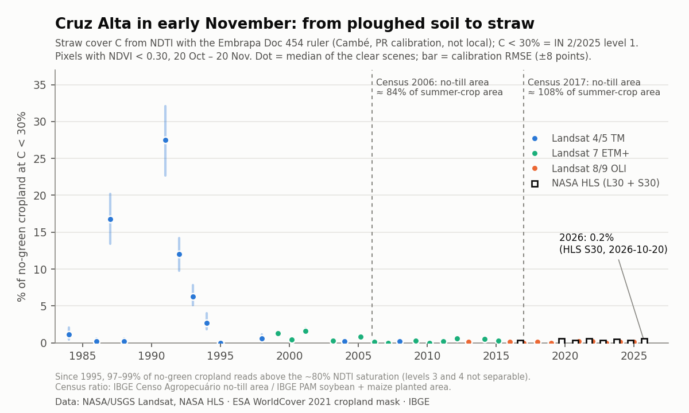
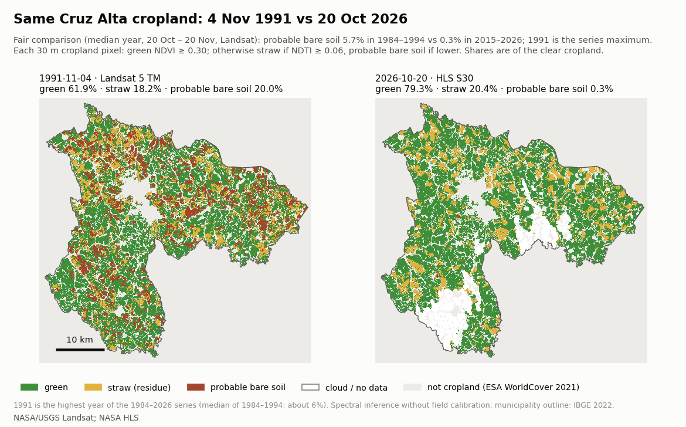

# Straw, not bare soil: 40 years of Cruz Alta cropland in NASA/USGS Landsat and NASA HLS (RS, Brazil)

> **SI-assisted:** origin: the team generated the starting ideas at a human ideation meeting; at the team lead's request, SI helped compare and synthesize options from those ideas and verified data; the team chose the direction (D-001). This idea ("straw, not bare soil", from the team's third innovation round) is one of those SI-synthesized options; the scripts and this text were written with Claude Code. Every number below was produced by running the scripts in this folder on the sources listed, or copied from the cited literature; none was produced by the AI. Human review pending. See [`SI-USAGE.md`](../../SI-USAGE.md).

Method summary for the app: [`content/methods/residue-landsat.md`](../../content/methods/residue-landsat.md).



## Question

The team's bare-soil calendar uses NDVI < 0.25 ("no green") and warns that it cannot tell dry straw from bare soil. Two shortwave-infrared (SWIR) bands of Landsat and HLS can: crop residue absorbs near 2,100–2,300 nm (cellulose and lignin) and soil does not, so the Normalized Difference Tillage Index is higher on straw than on soil.

1. What share of Cruz Alta's cropland shows a **probable bare-soil** signature (no green and a low residue index) in late October to mid November, before the soybean canopy closes, in every year from 1984 (first Landsat 5 year) to 2026? And in April–May, after the soybean harvest?
2. Does the series agree with an independent record of no-till adoption (IBGE Censo Agropecuário 2006 and 2017)?
3. How much of the answer survives the honest checks: few scenes per year, clouds, sensor changes, wet soil, and the threshold choice?

## Answer in one paragraph

In late October to mid November, the share of Cruz Alta cropland with a probable bare-soil signature was **5.7% in the median year of 1984–1994** (Landsat 5 TM; 22.1% in 1991, 10.2% in 1987, 7.9% in 1992) and has stayed **at or below 2.2% in every year since 1995, and 0.3% in the median year since 2005**. In **2026** the only clear scene, NASA HLS S30 on 20 October, gives **0.3%** (0.1–1.5% with the NDTI threshold at 0.04 and 0.10). The drop survives every check run here: NDTI threshold 0.04 to 0.12, NDVI mask 0.25 to 0.35, dry scenes only, and the Roy et al. (2016) transform of TM/ETM+ to OLI; what changes is the level of the early years (2.2% to 19.9% for the 1984–1994 median), not the direction. Most of the "no green" cropland of November is now **straw**: since 1995 the yearly median is 11–74% straw against 0.0–2.2% probable bare soil. The **IBGE Censo Agropecuário** agrees independently: no-till on straw covered 74,003 ha of Cruz Alta in 2006 and 105,036 ha in 2017, about **84% and 108%** of the summer-crop (soybean + maize) planted area of those years, while the satellite gives 0.3% and 0.2% probable bare soil around those years. **Rain before the scene matters, and it hides bare soil rather than inventing it**: in 1984–1999, scenes with ≥ 10 mm in the 3 days before show 2.4% probable bare soil against 9.7% for drier scenes, so the dry-only 1984–1994 median (14.5%, 4 years) is higher than the all-scene one. These are **spectral inferences with a threshold chosen here, not field measurements**: the series shows when the bare-soil signature was common and when it became rare, not hectares of ploughed land.

## Data

| Source | What is used | NASA? | Terms | Committed here? |
|---|---|---|---|---|
| Landsat Collection 2 Level-2 surface reflectance, Landsat 4–5 TM, 7 ETM+, 8 OLI, 9 OLI-2 (USGS/NASA; DOIs [10.5066/P9IAXOVV](https://doi.org/10.5066/P9IAXOVV), [10.5066/P9C7I13B](https://doi.org/10.5066/P9C7I13B), [10.5066/P9OGBGM6](https://doi.org/10.5066/P9OGBGM6)) | red, NIR, SWIR1, SWIR2, `QA_PIXEL`; WRS-2 path/row 223/080 and 222/080 | **NASA/USGS** | public domain; credit requested | **no imagery**: per-scene shares only (`results/scenes.csv`) |
| HLS v2.0 L30 and S30 (NASA LP DAAC; DOIs [10.5067/HLS/HLSL30.002](https://doi.org/10.5067/HLS/HLSL30.002), [10.5067/HLS/HLSS30.002](https://doi.org/10.5067/HLS/HLSS30.002)) | red, NIR, SWIR1, SWIR2, `Fmask`; MGRS tiles T22JBP and T22JBN | **NASA** | NASA data, no restriction; citation requested | **no imagery**: per-scene shares only |
| ESA WorldCover 2021 v200, tile S30W054 | cropland mask (class 40, ≥ 50% of a 60 m pixel) | no (**ESA, partner data**) | CC BY 4.0; "ESA WorldCover project 2021 / Contains modified Copernicus Sentinel data (2021) processed by ESA WorldCover consortium" | no |
| IBGE municipal mesh 2022, municipality 4306106 | municipal boundary | no (IBGE) | public federal data | already in `data/dev/dev-cruz-alta/ibge/` |
| NASA POWER daily `PRECTOTCORR`, point −28.703, −53.563 | rain in the 2, 3 and 7 days before each scene | **NASA** | [POWER referencing](https://power.larc.nasa.gov/docs/referencing/) | cache already in `data/cache/power/cruz-alta/` (to 2026-10-31); the November 2026 tail is fetched at run time |
| GPM IMERG daily as served by NASA POWER (`IMERG_PRECTOT`) | second rain check, 1998–2025 | **NASA** | as above; IMERG DOI 10.5067/GPM/IMERG/3B-HH/07 | cache already in `data/cache/power-imerg/cruz-alta/` |
| IBGE Censo Agropecuário 2006 (SIDRA table 849) and 2017 (table 6855) | establishments and area with no-till on straw ("plantio direto na palha"), Cruz Alta and RS | no (IBGE) | public federal data; cite IBGE | values quoted in `results/residue_landsat.json` |
| IBGE PAM (SIDRA table 1612) | soybean and maize planted area, Cruz Alta, 2006 and 2017 | no (IBGE) | public federal data; cite IBGE | values quoted in `results/residue_landsat.json` |

All imagery is read anonymously through the Microsoft Planetary Computer STAC (`landsat-c2-l2`, `hls2-l30`, `hls2-s30`, `esa-worldcover`; anonymous SAS token, no account). The HLS archive on that server starts in August 2017 (L30) and January 2020 (S30); NASA LP DAAC holds the full archive behind a free Earthdata Login.

## Method

**Scenes.** Every Landsat C2 L2 scene of WRS-2 223/080 or 222/080 and every HLS L30/S30 granule of tiles T22JBP or T22JBN with scene/tile cloud cover < 70%, acquired in one of two windows: **spring, 20 October – 20 November** (after wheat harvest and oat desiccation, before the soybean canopy closes) and **autumn, 1 April – 31 May** (after the soybean harvest). The two HLS tiles of the same day and sensor are merged (their overlap, about 10 km, is counted twice).

**Pixels.** Red, NIR, SWIR1 and SWIR2 are read at about 60 m (2× decimated windows of the 30 m COGs) over the municipality. Kept: clear land pixels (Landsat `QA_PIXEL`: clear bit set, no fill, dilated cloud, cloud, shadow, snow or water; HLS `Fmask`: no cloud, adjacent cloud, shadow, snow or water), inside the IBGE polygon, with ≥ 50% WorldCover 2021 cropland. A scene counts when at least half of the municipality's cropland pixels are clear (the rule of the team's bare-soil calendar).

**Indices.** NDVI = (NIR − red)/(NIR + red) (Tucker 1979). NDTI = (SWIR1 − SWIR2)/(SWIR1 + SWIR2) (Van Deventer et al. 1997), the broadband residue index computable from every Landsat since TM (Hively et al. 2021). The cellulose absorption index (CAI) needs narrow bands at 2,030, 2,100 and 2,210 nm (Daughtry et al. 2005) that no Landsat or HLS band has, so NDTI is the only option for a 40-year series.

**Classes**, per pixel:

| Class | Rule | Source of the threshold |
|---|---|---|
| green | NDVI ≥ 0.30 | "many agricultural studies" mask green vegetation with NDVI < 0.3 before reading residue (Hively et al. 2021, citing Beeson et al. 2020 and others); the team's calendar uses 0.25 (sensitivity: 0.25 and 0.35) |
| straw (non-photosynthetic residue) | NDVI < 0.30 and NDTI ≥ 0.06 | NDTI threshold chosen here, see below |
| **probable bare soil** | NDVI < 0.30 and NDTI < 0.06 | as above |

**Why no "literature threshold" for NDTI.** The literature gives tillage classes in **residue cover** (intensive or conventional tillage < 15%, reduced 15–30%, conservation > 30% after planting; CTIC, used by Beeson et al. 2020), not in NDTI. Turning NDTI into residue cover needs a regression calibrated on field transects for each region and soil (Zheng et al. 2012, 2014; Beeson et al. 2020), and none exists for the Oxisols of the Planalto Médio. Worse, Hively et al. (2021) found that **kaolinite-rich soils** can give NDTI values as high as residue (the 2,200 nm Al-OH absorption lowers SWIR2), and the red Latossolos (Oxisols) of the Planalto Médio are probably kaolinite-rich (the Cruz Alta trial soil is an Oxisol, Campos et al. 2011b; its mineralogy is not measured here). So the threshold here is a reproducible choice, **0.06**, carried over from the team's first sounding, with **0.04 and 0.10** as the sensitivity range (and the full grid 0.04, 0.05, 0.06, 0.07, 0.08, 0.10 available from the stored histograms). An Otsu (1979) valley of the pooled NDTI histogram of no-green pixels is reported as a data check, not used as the threshold.

**Per year.** For each window and year: median, minimum and maximum over the accepted scenes of the share of clear cropland in each class; the same with NDTI at 0.04 and 0.10, with NDVI at 0.25 and 0.35, with dry scenes only, and (TM/ETM+ only) after the Roy et al. (2016) transform. Landsat and HLS are kept as two separate series (HLS L30 is made from the same Landsat 8/9 acquisitions).

**Checks run every time** (in `results/residue_landsat.json`):

- **Rain before the scene.** NASA POWER `PRECTOTCORR` summed over the 2, 3 and 7 days before each scene (GPM IMERG for 1998–2025 as a second source). A scene is "wet" with ≥ 10 mm in the 3 days before (5 and 20 mm also shown). Wet soil darkens and lowers the SWIR contrast between soil and residue (Quemada & Daughtry 2016). Shown: wet against dry scenes per era, and the yearly series with dry scenes only.
- **Sensors.** (a) Near-simultaneous pairs (≤ 8 days apart, same window): Landsat 7 − Landsat 5, Landsat 8 − Landsat 7, Landsat 9 − Landsat 8; HLS L30 − Landsat C2 L2 of the same acquisition; HLS S30 − HLS L30 within 3 days. Pairs differ in date, so part of each difference is real change on the ground. (b) The Roy et al. (2016) ETM+→OLI surface-reflectance transform (OLS, red, NIR, SWIR1, SWIR2) applied to TM and ETM+ (fitted on ETM+, so for TM it is an approximation).
- **Independent record.** No-till area of the IBGE Censo Agropecuário 2006 and 2017 for Cruz Alta, set against the soybean + maize planted area of IBGE PAM for the same years.

## Results

Files in [`results/`](results/) (run of 2026-11-15 02:32 UTC, i.e. 14 Nov 2026 23:32 BRT; STAC search time, POWER tail and IBGE access times inside the JSON):

| File | Content |
|---|---|
| `scenes.csv` | 739 rows (929 items; HLS tiles of the same day merged): date, sensor, path/row or tiles, clear cropland fraction, accepted, rain before the scene (POWER 2/3/7 days, IMERG 3 days), % green / straw / probable bare soil, and every sensitivity variant |
| `series.csv` | one row per family (Landsat, HLS), window and year: n scenes, n dry scenes, dates, median/min/max % probable bare soil and all variants, median % green and straw |
| `residue_landsat.json` | thresholds, classes, STAC search log, counts, epochs, rain check, sensor checks, Otsu check, census check (with SIDRA URLs and access times), attribution, caveats |
| `residue-landsat.png` | the series figure (1200 × 720 px, no logo) |
| `residue-before-after.png`, `residue_before_after.json` | the before / after map (1170 × 728 px, no logo) and its class shares |
| `run_info.json` | run time and library versions |

**Scenes.** 929 items in the windows (Landsat 5/7/8/9 and HLS L30/S30, cloud cover < 70%), 739 after merging the HLS tiles, **317 accepted** (≥ 50% of the cropland clear): Landsat 5 TM 67, Landsat 7 ETM+ 66, Landsat 8 OLI 38, Landsat 9 OLI-2 14, HLS L30 30, HLS S30 102. Spring Landsat has a clear scene in 35 of the 43 years 1984–2026 (median 2 scenes a year, 15 years with one); no clear spring Landsat scene in 1985, 1989, 1990, 1996, 1997, 2002, 2020 and 2026 (HLS covers 2020 and 2026).

### Probable bare soil, Landsat, late October – mid November (median of years)

| Period | Years with data | NDTI < 0.06 (main) | 0.04 | 0.10 | 0.12 | NDVI mask 0.25 / 0.35 | Dry scenes only | TM/ETM+ → OLI (Roy 2016) |
|---|---|---|---|---|---|---|---|---|
| 1984–1994 | 8 | **5.7%** | 2.2% | 14.7% | 19.9% | 5.6% / 5.8% | 14.5% (4 years) | 2.6% |
| 1995–2004 | 7 | 0.7% | 0.2% | 2.2% | 4.1% | | 0.9% | 0.5% |
| 2005–2014 | 10 | 0.3% | 0.1% | 2.0% | 4.3% | | 0.5% | 0.2% |
| 2015–2026 | 10 | **0.3%** | 0.1% | 2.5% | 5.5% | | 0.5% | 0.2% (Landsat 7 years only) |

Years (main threshold; median of the year's clear scenes, NDTI 0.04–0.10 in brackets): 1984 5.4 [1.0–19.2], 1986 3.2 [0.5–14.4], 1987 10.2 [6.8–18.8], 1988 3.2 [0.4–15.0], **1991 22.1 [15.4–30.1]**, 1992 7.9 [5.2–14.1], 1993 6.0 [3.4–11.9], 1994 1.7 [0.7–4.2], 1995 0.1, then between 0.0 and 2.2 every year (highest 1999, 2.2). HLS 2020–2026: 0.2–0.6% per year; **2026: 0.3% [0.1–1.5]** (HLS S30, 20 October; Landsat 2026 had no clear scene in the window). Full table in `series.csv`.

**Autumn (April–May).** The same direction with a lower level: 1.3% in the median year of 1984–1994, 0.1% in 1995–2014 and 0.0% in 2015–2026. After the soybean harvest the ground carries soybean residue in both eras, so the window says less about tillage.

### The Embrapa ruler: NDTI → straw cover → IN 2/2025 class (the series figure)

The norm (IN SPA/MAPA 2/2025, Table 1, indicator 5) classes **straw cover in pre-sowing, C**: level 1 C < 30%, level 2 30–60%, level 3 60–90%, level 4 C ≥ 90%. It gives no conversion from NDTI to C. **Embrapa Soja, Documentos 454** (Franchini et al. 2023), the satellite method behind ZarcNM, publishes two ([`embrapa.py`](embrapa.py)):

1. **Field calibration** (pp. 25–29): 19 fields in Cambé (north Paraná), clayey Latossolo, corn and wheat residue, Sentinel-2 image of 29 Oct 2021, cover by line transect. The document plots a second-order fit (its Figure 12) and states that **NDTI saturates near 80% cover**, but prints only the data (Table 2), not the coefficients. Fitted here to that table: **C = −10,275.5 · NDTI² + 2,265.4 · NDTI − 27.76** (R² 0.906, RMSE 8.3 points, n = 19), flat at 97.1% above NDTI 0.110. The IN limits fall at NDTI 0.029 (C = 30%), 0.050 (60%), 0.069 (80%) and 0.084 (90%).
2. **Field-free, per image** (pp. 21–23, after Beeson et al. 2020): C = 100 · (NDTI − NDTImin)/(NDTImax − NDTImin), with NDTImin/max = image mean ∓ 3 SD. Classes there: < 45, 45–60, 60–75, > 75% (the 2023 criteria of that document, not the IN 2/2025 bands).

Applied per 30 m pixel to the no-green cropland (NDVI < 0.30; Documentos 454 masks NDVI > 0.3), with the fitted ruler:

| Period (Landsat, 20 Oct – 20 Nov, median year) | C < 30% (level 1) | ±RMSE | C ≥ 80% (saturated: level 3 or 4) |
|---|---|---|---|
| 1984–1994 | **4.5%** of no-green cropland (1991: 27.5%; 1987: 16.8%; 1992: 12.0%) | 3.4–5.9% | 72.4% |
| 1995–2004 | 0.4% | 0.3–0.6% | 97.0% |
| 2005–2014 | 0.2% | 0.2% | 98.5% |
| 2015–2026 | **0.1%** (2026, HLS 20 Oct: 0.2%) | 0.1% | 98.6% |

**What the satellite separates, and what it does not.** It separates **level 1 from level 3 or above** (ploughed fields in the Cambé table read NDTI 0.015–0.024, C 5–20%; wheat stubble 0.077–0.101, C 92–97%), and it sees the level-1 share fall from 1991 to today. It does **not separate level 3 (60–90%) from level 4 (≥ 90%)**: the document's own calibration plateaus near 80%, and since 1995 97–99% of Cruz Alta's no-green cropland reads above that plateau. Cruz Alta straw reads higher NDTI than any Cambé field (median of the no-green pixels 0.16–0.18 against 0.10 at most there), so the ruler's absolute values are a **transfer to another soil, region and sensor, not validated here**. The **field-free per-image method cannot compare years**: it maps each image's own spread onto 0–100%, so its mean is 50% in every scene by construction (columns `rel_*`), and it labels about 12% of the no-green cropland "C < 30%" in every recent scene, which the absolute ruler and the census do not support.

### ZarcNM pre-check: slope and three quadrats (IN SPA/MAPA 2/2025)

Script [`zarcnm.py`](zarcnm.py). Applied as the norm writes it: quadrats of 5–10 ha for fields > 100 ha (item 6.2; here 300 m × 300 m = 9 ha), mean slope from NASADEM at 30 m (item 6.3), NDVI and NDTI from Landsat and HLS at 30 m with every image available (items 6.4–6.5), straw cover in the month before sowing (item 6.7), tillage as a sudden change that exposes soil (item 6.8), Table 1 bands for indicators 4 and 5, and the contour rule for slope ≥ 3% (item 3.2.1 I).

**Slope** (`results/nasadem_slope_classes.json`; NASADEM tile `NASADEM_HGT_s29w054` from the Planetary Computer, anonymous, reprojected to UTM 22S 30 m; 104,901 ha of WorldCover cropland): **87.4% of Cruz Alta's cropland has slope ≥ 3%**, where the norm makes contour sowing (or sowing on the level) mandatory on at least 75% of the area, else NM1; 12.6% is below 3%. Context classes (Embrapa relief classes, not the norm's): 0–3% 12.6%, 3–8% 48.7%, 8–20% 38.3%, 20–45% 0.4%. Median slope 6.8%, 90th percentile 12.3%. **The satellite and the DEM cannot see contour sowing, terraces or sowing on the level**: they say where the rule applies, not whether a field complies. NASADEM noise at 30 m inflates slope on gentle relief.

**Quadrats** (no property, owner or CAR record was looked up; they are 9 ha cells of cropland, not declared fields): one per slope class, entirely WorldCover cropland and clear on both map dates, closest to the class's median slope, at least 5 km apart:

| Quadrat | Centre (lat, lon) | NASADEM mean slope | Contour rule applies |
|---|---|---|---|
| CA-Q1 | −28.77507, −53.75102 | 2.75% | no |
| CA-Q2 | −28.55894, −53.59518 | 5.90% | yes |
| CA-Q3 | −28.62604, −53.48027 | 8.88% | yes |

**Per-year indicators** (`results/zarcnm_satellite_indicators.json`; 783 Landsat 4–9 and HLS L30 scenes of 15 Sep – 31 Dec, 1984–2026, an observation counts when ≥ 80 of the 100 quadrat pixels are clear; HLS S30 was left out for time, plan B). Per quadrat and year: the pre-sowing reference (the no-green observation with the lowest NDTI, Zheng et al. 2012, because the sowing date that item 6.7 refers to is unknown), straw cover C of its no-green pixels by the Embrapa ruler and the IN level, a tillage signal (an observation with half the quadrat at C < 30%, the cover of the ploughed Cambé fields), and the years since the last signal (indicator 4). A season with fewer than 3 clear observations cannot exclude a tillage, so the count restarts there as a lower bound ("at least").

| Quadrat | Bare-soil (tillage) signatures | Cover, 1991 | Cover since 1995 | Indicator 4 in 2026 |
|---|---|---|---|---|
| CA-Q1 (2.75%) | none in 1984–2026 | C 57% (level 2) | C 87–97%, level "3 or 4" (saturated) every observed year | T ≥ 24 years (count restarts after the poorly observed 2002 season): level 4 |
| CA-Q2 (5.90%) | 1984, 1986, 1987, 1991 | C 21% (level 1) | C 86–97%, "3 or 4"; some seasons stay green to the end of the window (not observable) | T ≥ 29 years: level 4 |
| CA-Q3 (8.88%) | 1991, 1992, 1993 | C 22% (level 1) | C 76–97% ("3" once, 2024; otherwise "3 or 4") | T ≥ 29 years: level 4 |

Read: the satellite can tell a ploughed season (level 1, the early 1990s here) from a no-till one, and can date the last bare-soil signature to within the gaps; it cannot place the quadrats in level 3 or 4 of indicator 5, because the Embrapa calibration saturates. These are 9 ha cells chosen by a rule, not declared fields, and no part of this replaces the field and soil data the norm requires.

### Before and after



Same cropland, 30 m, one UTM grid: **4 November 1991** (Landsat 5 TM, 100% of the cropland clear) shows green 61.9%, straw 18.2%, **probable bare soil 20.0%**; **20 October 2026** (HLS S30, 87% clear) shows green 79.3%, straw 20.4%, **probable bare soil 0.3%**. 1991 was chosen because the team asked for early November 1991; it is also the highest year of the series, so the left panel is the most bare year, not a typical one (the 1984–1994 median is 5.7%). The 2026 scene is three weeks earlier in the season than the 1991 one.

### Checks

**Rain before the scene** (Landsat spring scenes; NASA POWER `PRECTOTCORR`, 3 days before):

| Era | Threshold | Wet scenes | Dry scenes | Probable bare soil, wet | dry |
|---|---|---|---|---|---|
| 1984–1999 | ≥ 5 mm | 8 | 6 | 2.8% | 10.3% |
| 1984–1999 | ≥ 10 mm | 7 | 7 | 2.4% | 9.7% |
| 1984–1999 | ≥ 20 mm | 6 | 8 | 2.2% | 6.0% |
| 2000–2012 | ≥ 10 mm | 8 | 15 | 0.2% | 0.4% |
| 2013–2026 | ≥ 10 mm | 10 | 17 | 0.2% | 0.4% |

Wet scenes show **less** probable bare soil, as expected if moisture darkens the soil and narrows its NDTI gap with residue (Quemada & Daughtry 2016). So rain cannot explain the fall from the 1980s–90s; it pulls the early years down, not up. The samples are small (7 against 7 scenes in the early era).

**Sensors** (difference in percentage points of probable bare soil):

| Pair | Pairs | Median difference | Median absolute | Max absolute |
|---|---|---|---|---|
| Landsat 7 − Landsat 5 (≤ 8 days) | 27 | +0.1 | 0.2 | 1.4 |
| Landsat 8 − Landsat 7 (≤ 8 days) | 28 | 0.0 | 0.2 | 0.6 |
| Landsat 9 − Landsat 8 (≤ 8 days) | 12 | 0.0 | 0.3 | 1.2 |
| HLS L30 − Landsat 8/9 C2 L2 (same acquisition) | 27 | +0.2 | 0.2 | 0.8 |
| HLS S30 − HLS L30 (≤ 3 days) | 42 | −0.2 | 0.3 | 1.7 |
| Roy et al. 2016 transform − original, TM/ETM+ scenes | 133 scenes | −0.1 | | 6.5 |

The pairs agree within about 2 points, but they all fall in 1999–2026, when probable bare soil is low; **no TM/OLI pair exists** (Landsat 5 ended in 2011, Landsat 8 began in 2013), so the sensor effect at the 1980s–90s level is not measured. The Roy et al. transform lowers the early years (1991: 22.1% → 16.9%; 1984–1994 median 5.7% → 2.6%), which says the early bare pixels sit close to the threshold; the early years stay about ten times the recent ones.

**Otsu valley** of the pooled NDTI of no-green pixels: 0.115 for the spring scenes of 1984–1995, 0.145 for all spring scenes and all autumn scenes. The 1984–1995 valley sits above the main threshold (0.06), close to the 0.12 variant in the table. Recent scenes have one (straw) mode, so their Otsu value splits the straw itself and is not a soil/straw boundary.

**Census** (IBGE, SIDRA tables 849, 6855 and 1612): no-till on straw in Cruz Alta, 418 establishments and 74,003 ha (2006); 404 establishments and 105,036 ha (2017), when 57 establishments reported conventional and 47 minimum tillage (categories can overlap). PAM soybean + maize planted area: 88,000 ha (2006) and 97,000 ha (2017). Rio Grande do Sul: 4,085,316 ha (2006) and 6,051,978 ha (2017) of no-till. No earlier Censo Agropecuário table with this item turned up in a search of the SIDRA catalogue (2026-11-14), so the census marks the end state, not the adoption years.

## Limitations (what this does **not** show)

1. **No field calibration.** "Probable bare soil" is a spectral inference with a threshold chosen here, not a measured residue cover. No Cruz Alta field was checked on the ground on a scene date. The series says when the bare-soil signature was common and when it became rare; it does not give hectares of tilled land or % residue cover.
2. **Kaolinitic soils.** NDTI can confuse kaolinite-rich soil with residue (Hively et al. 2021), and the soils here are probably kaolinite-rich. That would hide bare soil (bias towards "straw"), so the modern near-zero values are a lower bound in principle; the large 1984–1994 values show the index does separate the two classes here, but by how much it under-counts is unknown.
3. **Moisture.** Wet soil and wet residue change NDTI (Quemada & Daughtry 2016). The rain check uses one point (POWER cell 0.5° × 0.625°; IMERG 0.1°), not the field, and rain on the morning of the scene is not counted.
4. **Sensors.** TM, ETM+, OLI, OLI-2 and MSI have different SWIR band passes. Collection 2 and HLS are surface reflectance, and the pair checks bound the difference, but only in 1999–2026, when bare soil is rare: no Landsat 5 TM and Landsat 8 OLI scenes overlap in time, and there is no field-based cross-calibration of NDTI between sensors. The Roy et al. (2016) transform (fitted on ETM+, applied to TM as an approximation) halves the 1984–1994 median (5.7% to 2.6%). Landsat 7 after May 2003 has scan-line gaps (fewer valid pixels, not biased ones).
5. **Few scenes, moving dates.** Some years have one clear scene in the window, some none; sowing advances week by week, so a scene on 22 October and one on 18 November see different stages. Years without a clear scene are gaps, not zeros.
6. **One cropland mask for 40 years.** WorldCover 2021 is applied to 1984: fields that were pasture then, or became cropland later, are misclassified.
7. **Census ratio is an order of magnitude.** The census counts no-till area of establishments in their reference year (all crops); the denominator is the PAM summer-crop planted area. It confirms "almost all", not a percentage.
8. **No erosion, no yield.** Nothing here measures soil loss or its effect on yield.
9. **Timing and cause are not proven.** The signature falls between 1993 and 1995 in a series with gaps (no clear scene in 1989, 1990, 1996, 1997) and one or two scenes a year, so the year of change is uncertain by a few years. The census confirms no-till was near-universal in 2006 and 2017; it does not date the adoption, and the satellite alone cannot say that no-till, rather than other changes (sowing dates, crops), caused the drop.

## Reproduce

From the repository root, with [uv](https://docs.astral.sh/uv/):

```bash
uv run --project services/science --with numpy==2.3.4 --with rasterio==1.4.3 --with pystac-client==0.9.0 --with planetary-computer==1.0.0 --with matplotlib==3.10.7 python -I analysis/residue-landsat/reproduce.py
```

It reads about 930 scenes (small windows, about 40 minutes on a home connection; resumable) and writes per-scene histograms to `~/.cache/fieldshift/residue-landsat/` (or `--raw DIR`), never to git. Steps:

| Step | Script | Output |
|---|---|---|
| 1 | [`scenes.py`](scenes.py) | per-scene NDVI × NDTI histograms of clear municipal cropland (raw folder) |
| 2 | [`fetch_context.py`](fetch_context.py) | IBGE census and PAM responses, NASA POWER rain after 2026-10-31 (raw folder) |
| 3 | [`series.py`](series.py) | `scenes.csv`, `series.csv`, `residue_landsat.json` |
| 4 | [`figure.py`](figure.py) | `residue-landsat.png` |
| 5 | [`map.py`](map.py) | `residue-before-after.png`, `residue_before_after.json` (re-reads the two chosen scenes at 30 m) |
| 6 | [`zarcnm.py`](zarcnm.py) | `nasadem_slope_classes.json`, `zarcnm_satellite_indicators.json` (about 1,100 scenes, small windows; `--slope-only` writes the slope file only) |

The scripts are linted with Ruff (`ruff.toml` here); they live outside the `services/science` package and its CI job. They supersede the team's sounding scripts (`t02_palha_ou_solo.py`, `t02b_chuva_antes_das_cenas.py`, private planning repository), which used one scene per year, NDVI 0.25 and the whole Landsat 5 / Landsat 8–9 contrast only; their numbers are not final.

## References

- Beeson, P.C.; Daughtry, C.S.T.; Wallander, S.A. (2020). Estimates of conservation tillage practices using Landsat archive. *Remote Sensing* 12, 2665. doi:[10.3390/rs12162665](https://doi.org/10.3390/rs12162665)
- Campos, B.H.C. et al. (2011b). Long-term C-CO2 emissions and carbon crop residue mineralization in an oxisol under different tillage and crop rotation systems. *Revista Brasileira de Ciência do Solo* 35(3). doi:[10.1590/S0100-06832011000300017](https://doi.org/10.1590/S0100-06832011000300017)
- Claverie, M. et al. (2018). The Harmonized Landsat and Sentinel-2 surface reflectance data set. *Remote Sensing of Environment* 219, 145–161. doi:[10.1016/j.rse.2018.09.002](https://doi.org/10.1016/j.rse.2018.09.002)
- Daughtry, C.S.T.; Hunt, E.R.; Doraiswamy, P.C.; McMurtrey, J.E. (2005). Remote sensing the spatial distribution of crop residues. *Agronomy Journal* 97, 864–871. doi:[10.2134/agronj2003.0291](https://doi.org/10.2134/agronj2003.0291)
- Hively, W.D.; Lamb, B.T.; Daughtry, C.S.T.; Serbin, G.; Dennison, P.; Kokaly, R.F.; Wu, Z.; Masek, J.G. (2021). Evaluation of SWIR crop residue bands for the Landsat Next mission. *Remote Sensing* 13, 3718. doi:[10.3390/rs13183718](https://doi.org/10.3390/rs13183718)
- Otsu, N. (1979). A threshold selection method from gray-level histograms. *IEEE Transactions on Systems, Man, and Cybernetics* 9, 62–66. doi:[10.1109/TSMC.1979.4310076](https://doi.org/10.1109/TSMC.1979.4310076)
- Quemada, M.; Daughtry, C.S.T. (2016). Spectral indices to improve crop residue cover estimation under varying moisture conditions. *Remote Sensing* 8, 660. doi:[10.3390/rs8080660](https://doi.org/10.3390/rs8080660)
- Roy, D.P. et al. (2016). Characterization of Landsat-7 to Landsat-8 reflective wavelength and normalized difference vegetation index continuity. *Remote Sensing of Environment* 185, 57–70. doi:[10.1016/j.rse.2015.12.024](https://doi.org/10.1016/j.rse.2015.12.024) (coefficients as published in the Google Earth Engine community tutorial [`landsat-etm-to-oli-harmonization`](https://github.com/google/earthengine-community/tree/master/tutorials/landsat-etm-to-oli-harmonization))
- Tucker, C.J. (1979). Red and photographic infrared linear combinations for monitoring vegetation. *Remote Sensing of Environment* 8, 127–150. doi:[10.1016/0034-4257(79)90013-0](https://doi.org/10.1016/0034-4257(79)90013-0)
- Van Deventer, A.P.; Ward, A.D.; Gowda, P.H.; Lyon, J.G. (1997). Using Thematic Mapper data to identify contrasting soil plains and tillage practices. *Photogrammetric Engineering & Remote Sensing* 63(1), 87–93 (no DOI).
- Zheng, B.; Campbell, J.B.; de Beurs, K.M. (2012). Remote sensing of crop residue cover using multi-temporal Landsat imagery. *Remote Sensing of Environment* 117, 177–183. doi:[10.1016/j.rse.2011.09.016](https://doi.org/10.1016/j.rse.2011.09.016)
- Zheng, B.; Campbell, J.B.; Serbin, G.; Galbraith, J.M. (2014). Remote sensing of crop residue and tillage practices: present capabilities and future prospects. *Soil & Tillage Research* 138, 26–34. doi:[10.1016/j.still.2013.12.009](https://doi.org/10.1016/j.still.2013.12.009)
- IBGE. Censo Agropecuário 2006 (SIDRA table 849) and 2017 (table 6855); Produção Agrícola Municipal (table 1612). https://sidra.ibge.gov.br
