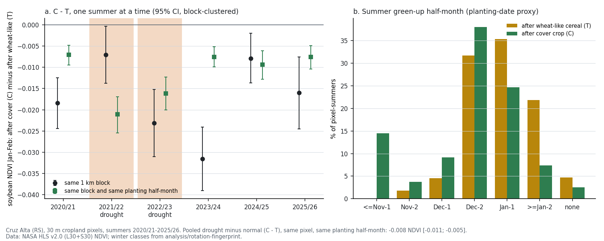

# Did soybean after a winter cover crop suffer less in the drought? A 30 m test with NASA HLS (Cruz Alta, RS, summers 2020/21–2025/26)

> **SI-assisted:** origin: the team generated the starting ideas at a human ideation meeting; at the team lead's request, SI helped compare and synthesize options from those ideas and verified data; the team chose the direction (D-001). This hypothesis (use the per-pixel winter classes of `analysis/rotation-fingerprint/` as the treatment of a natural experiment on soybean vigour in the drought summers) is one of those SI-synthesized options; the scripts and this text were written with Claude Code. Every number comes from running the scripts in this folder; none was produced by the AI. Human review pending. See [`SI-USAGE.md`](../../SI-USAGE.md).

**Status of this file:** the Method section below was written and committed **before any model was run** (pre-registration, commit `c75a707`, 2026-11-15 01:03 BRT). Results were added in a later commit; the method was not changed after seeing them. Deviations are listed under "Deviations".

**Answer in one line:** no. Soybean after a winter cover crop did not keep more canopy in the 2021/22 and 2022/23 droughts than soybean after a wheat-like cereal, once the planting date is held fixed (drought − normal C − T: −0.008 NDVI [−0.011; −0.005], inside the year-to-year noise of ±0.006); what differs is the calendar: after wheat-like winters soybean greens up about half a month later. This confirms the team's earlier result (below).

## Credit and what is already known

This is a re-test, at 30 m and with explicit winter classes, of a natural experiment already run by **the team's earlier analysis** in the private research repository (`docs/research/rotacao/A1_experimento_natural.md`, `RESUMO.md`; Landsat 120 m and MODIS 250 m–1 km, 2002–2025). His verdicts:

1. **Not validated:** a winter crop protecting soybean from drought (municipal panel and pixel panels; the drought interaction is about zero or does not pass the placebo).
2. **Partly validated:** on the same piece of field, soybean after a greener winter has a better canopy in a normal year (+0.026 NDVI per SD of winter NDVI, Landsat 120 m), and that gain does not grow in dry summers (+0.0015 [−0.004; +0.007]).
3. **Soybean enters later after a green winter** (December NDVI lower), read as later sowing, pending a real planting date.

An earlier team probe with Sentinel-2 k-means groups (2022 only, no planting-date control) also found no sign and attributed the group differences to the sowing calendar.

What is new here: (a) **classes, not a continuous winter NDVI**: wheat-like cereal (T), autumn-sown cover crop (C) and other (O) per 30 m pixel and year, from `analysis/rotation-fingerprint/`; the team's winter NDVI cannot tell a cover crop from a wheat crop; (b) **a planting-date proxy per pixel-year** from the HLS green-up of the summer crop, used as an explicit control; (c) 30 m pixels inside ~1 km blocks, with block × summer fixed effects for local rain.

## Question (pre-registered)

In Cruz Alta, did the soybean that followed a **winter cover crop (C)** keep more of its canopy in the drought summers than the soybean that followed a **wheat-like winter cereal (T)**, on the same pixel, compared with normal summers, **after allowing for the planting date**?

## Method (pre-registered; written before running any model)

**Units.** Pixel-summers: every 30 m cropland pixel of `analysis/rotation-fingerprint/` (WorldCover 2021 cropland in the IBGE polygon, 1,165,531 pixels) in the summers 2020/21 … 2025/26. Summer Y/Y+1 follows winter Y.

**Treatment.** The winter class of the pixel in winter Y from `analysis/rotation-fingerprint/` (main run): T, C, O; fallow P (0.3–0.8% of the cropland) is merged into O. Reference: T. Unclassified pixel-years are dropped.

**Outcome (NASA HLS NDVI).** Half-month median composites from 1 October (year Y) to 31 March (Y+1), 12 half-months, built exactly as the fingerprint composites (Fmask-clear observations, median, linear gap fill). October–November come from the fingerprint raw vectors; December–March are read by `scenes_summer.py` with the same reader. A pixel-summer is kept when ≥ 8 of the 12 half-months are clear, ≥ 2 of the 4 January–February half-months are clear and ≥ 1 of November-1 … December-2 is clear.

- **Primary:** mean NDVI of January-1 … February-2 (the "integral" of January–February; the window that tracks soybean yield in Cruz Alta, municipal r = 0.80 in the team's research note `cruz-alta-satelite.md`).
- **Secondary:** peak NDVI of December-1 … February-2 (comparable with the earlier analysis' peak).
- A within-summer drop ("veranico") is **not** used: in a pixel planted in early October the canopy matures in February, so a drop is confounded with maturity.

**Drought summers.** Fixed in advance from the team's earlier work (soybean yield −53% and −33% in IBGE PAM, January–February NDVI z −2.95 and −1.36): **2021/22 and 2022/23**. NASA POWER (PRECTOTCORR) December–February rainfall is used only as a confirmation (`fetch_power.py`, `results/power_rain_dec_feb.csv`): 181.5 mm and 185.2 mm, the 2nd and 3rd driest of 26 summers (2000/01–2025/26). The other four summers are "normal" (2020/21 302 mm, 2023/24 460 mm, 2024/25 323 mm, 2025/26 372 mm).

**Planting-date proxy.** Summer green-up = the first half-month after the lowest half-month of October-1 … December-2 (the gap between the winter canopy and the summer crop) whose NDVI is ≥ 0.50, searched up to February-1; otherwise "none". Strata: ≤ November-1, November-2, December-1, December-2, January-1, ≥ January-2, none. It is a proxy for emergence, not a sowing date. Because cover crops are killed earlier than wheat is harvested, the planting date is partly a **consequence** of the treatment (a mediator), so two estimands are reported: **total** (no planting-date control) and **direct** (within the same planting-date stratum).

**Models.** OLS with fixed effects removed by alternating projections:

- **M1 total:** `y = pixel FE + (1 km block × summer) FE + b_C·C + b_O·O + d_C·C·Drought + d_O·O·Drought`
- **M2 direct (main test):** M1 + (planting-date stratum × summer) FE.
- **M3 matched:** M1 on the pixel-summers in the planting-date strata where both C and T have ≥ 10% of their pixel-summers (computed mechanically from the data).

Reported effects: **C − T in normal summers = b_C**; **C − T in drought = b_C + d_C**; **protection = d_C** (C − T in drought minus C − T in normal summers). The pixel fixed effect absorbs soil, slope and anything else fixed in the pixel; the block × summer fixed effect absorbs the rain of that summer in that ~1 km block (blocks of 33 × 33 pixels, 990 m).

**Inference.** Standard errors clustered by 1 km block (CR1). With six summers, a year-clustered error is not reliable, so the year dimension is checked by (i) the per-summer C − T contrast (pixel-summers of one summer, block FE + planting-date stratum FE), (ii) leave-one-summer-out and (iii) placebo P2.

**Placebos.** **P1 future winter:** the same models with the class of winter **Y+1** (after the summer) as a fake treatment (summers 2020/21–2025/26, winters 2021–2026; 2026 provisional); a real effect of the previous winter should not show up here. **P2 fake drought:** among the four normal summers only, each one in turn labelled "drought"; the spread of the four fake d_C is the year-to-year noise a real d_C has to beat.

**Robustness.** R1 history: share of cover-crop winters in 2020 … Y as a continuous treatment (× Drought), summers from 2021/22. R2 conservative classes: drop pixel-years whose winter green-up is within one half-month of the T/C split (keep C with green-up ≤ June-1, T with green-up ≥ July-2). R3 the secondary outcome (peak). R4 leave-one-summer-out.

**Decision rule (fixed before the results).** "Soybean after cover crop suffered less in the drought" is supported only if, in **M2**, d_C > 0 with a 95% block-clustered CI above zero, **and** d_C is larger than every fake d_C of P2, **and** the P1 placebo d_C is not of similar size (less than half of d_C). Otherwise the answer is "not shown". A positive b_C alone (better canopy in normal years) is **not** a drought-protection result.

**Translation to yield.** Only if the effect passes the rule: by the municipal relation between January–February NDVI and PAM soybean yield (team note `cruz-alta-satelite.md`, r = 0.80, n = 25), with the caveat that a municipal slope is not a field response.

## Results (run of 2026-11-15, 02:37–02:51 BRT)

**Answer: no.** With 30 m winter classes and a planting-date control, soybean after a cover crop did **not** hold up better in the 2021/22 and 2022/23 droughts than soybean after a wheat-like cereal. The pre-registered decision rule fails on all three conditions (`decision_rule` in the JSON). **This confirms the team's earlier natural experiment verdict 1** ("not validated: a winter crop protecting soybean from drought") with a different sensor, resolution and treatment, and **sharpens his verdict 3**: after a wheat-like winter the soybean greens up about half a month later than after a cover crop.

Data: 904 HLS granules (584 April–November from the fingerprint run + 320 December–March read here; 21 December–March granules skipped as cloudy, no read error); 6,989,490 pixel-summers, 1,165,511 pixels, 1,506 blocks of ~1 km; ≥ 99.9% of the cropland eligible in every summer. Winter classes in the panel: T 39.9%, C 48.0%, O 12.1%.

**How big the drought was in the canopy:** mean January–February NDVI after T fell from 0.85 (2020/21) to 0.57 (2021/22) and 0.69 (2022/23) (`results/per_summer.csv`). Every C − T difference below is one to two orders of magnitude smaller.

| Model (primary outcome: mean NDVI Jan–Feb) | C − T, normal summers | C − T, drought summers | Protection d_C (drought − normal) |
|---|---|---|---|
| M1 total (pixel FE + block × summer FE) | −0.035 [−0.040; −0.030] | −0.031 [−0.037; −0.024] | **+0.005 [−0.001; +0.010]** |
| **M2 direct (+ planting half-month × summer FE), main test** | −0.007 [−0.009; −0.006] | −0.016 [−0.019; −0.012] | **−0.008 [−0.011; −0.005]** |
| M3 matched (only green-up Dec-2 and Jan-1, the common support) | +0.005 [+0.003; +0.007] | −0.001 [−0.004; +0.002] | −0.006 [−0.009; −0.002] |

95% CIs clustered by 1 km block.

**Placebos.**

| Check | d_C | Reading |
|---|---|---|
| P1 future winter (class of winter Y+1), total | +0.005 [−0.001; +0.011] | **the same size as the M1 "protection" (+0.005)**: the total-model interaction cannot be read as an effect of the previous winter |
| P1 future winter, direct | +0.006 [+0.003; +0.009] | as large as M2's d_C, with the opposite sign |
| P1 future winter, C − T in normal summers (total) | +0.043 [+0.039; +0.048] | the class of the **next** winter "explains" more summer NDVI than the previous one: the level differences between classes are confounded by the farm calendar, not caused by the winter |
| P2 fake drought (each normal summer in turn), direct | 2020/21 +0.006, 2023/24 +0.001, 2024/25 −0.005, 2025/26 −0.003 | the year-to-year noise is about ±0.006, the size of every d_C above; block-clustered CIs understate it |

**Planting date (the confounder the 2022 probe missed).** Share of pixel-summers by summer green-up half-month, all summers (`planting_date` in the JSON; figure, panel b):

| Green-up | ≤ Nov-1 | Nov-2 | Dec-1 | Dec-2 | Jan-1 | ≥ Jan-2 | none by Feb-1 |
|---|---|---|---|---|---|---|---|
| after T | 0.1% | 1.8% | 4.6% | 31.7% | 35.4% | 21.9% | 4.7% |
| after C | 14.5% | 3.8% | 9.1% | 38.0% | 24.7% | 7.3% | 2.5% |

Soybean after a cover crop greens up earlier (one in seven C pixel-summers is green by early November, almost no T pixel); 57% of T pixel-summers green up in January or later against 32% of C. In the drought summers this shifts the calendar of exposure: on the **peak** NDVI of December–February the total model gives C a drought "advantage" of +0.015 [+0.011; +0.018] (R3), which turns into −0.011 [−0.014; −0.008] once the planting half-month is held fixed. **The apparent protection in the peak is the calendar (an earlier canopy), not the soil.**

**Robustness** (all with the planting-date control):

| Run | d_C |
|---|---|
| R1 share of cover winters 2020…Y (0 → 1), summers from 2021/22 | −0.016 [−0.020; −0.011] |
| R2 conservative classes (18.1% of pixel-summers near the T/C split dropped) | −0.009 [−0.013; −0.005] |
| R3 peak NDVI Dec–Feb | −0.011 [−0.014; −0.008] (total +0.015, see above) |
| R4 leave one summer out | −0.013 to +0.001; **dropping 2021/22 gives +0.001** |

**Per summer** (cross-section, block FE ± planting-stratum FE, `results/per_summer.csv`; figure, panel a): C − T is negative in every summer, drought or not, by 0.007–0.032 NDVI; within the same block and planting half-month it is −0.007 to −0.009 in the normal summers and −0.021 / −0.016 in the two drought summers.



**What it adds to the team's earlier natural experiment.**

| Team's earlier verdict (Landsat 120 m / MODIS, continuous winter NDVI) | This test (HLS 30 m, T/C classes, planting control) |
|---|---|
| 1. Not validated: winter crop protects soybean from drought | **Confirmed.** No protection for cover vs wheat-like; the pooled direct estimate is slightly negative (−0.008 NDVI), inside the year-to-year noise and gone when 2021/22 is dropped |
| 2. Partly validated: greener winter → better soybean canopy in normal years | **Not tested as such**: T and C are both green winters. C − T in normal years is −0.035 (total) to +0.005 (matched), and the future-winter placebo (+0.043) shows class level differences are confounded, so no level claim is made here |
| 3. Soybean enters later after a green winter | **Sharpened**: between two green winters, soybean after a wheat-like cereal greens up about half a month later than after a cover crop |

**Translation to yield:** not done. The rule failed, and the effects are 0.005–0.015 NDVI against a 0.28 NDVI drought drop.

## What this does NOT allow us to say

- That cover crops protect soybean from drought (the opposite is not shown either: the small negative direct estimate is inside the year noise).
- Anything about soil health, straw, erosion, infiltration or the income of the winter: only soybean canopy greenness in January–February.
- Anything causal about a field: the class is the farmer's choice and the placebos show the classes track the farm calendar.
- Yield in bags: NDVI near its peak saturates; the municipal NDVI–yield relation (r = 0.80) is not a field response.
- Anything about cover species, about real sowing dates (the green-up half-month is a proxy) or about summers other than these six (two droughts only).

## Limitations

- Classes are phenological hypotheses without field labels (see `analysis/rotation-fingerprint/`); a cover and an early cereal are confusable. R2 drops the pixel-years nearest the split and the answer does not change.
- Two drought summers: the drought contrast rests on 2 vs 4 years. Block-clustered CIs do not capture year-level noise; P2 and R4 do, and they say ±0.006.
- No soybean mask: maize and other summer crops are in the panel (WorldCover cropland); the green-up strata absorb part of that (early-green pixels).
- Slope: absorbed as a level by the pixel fixed effect; a slope × drought term was not added (no per-pixel NASADEM layer in the repository).
- The green-up proxy is read in half-months; within a half-month, a planting-date difference remains.

## Reproduce

From the repository root (Python 3.12, [uv](https://docs.astral.sh/uv/)):

```bash
uv run --project services/science --with numpy==2.3.4 --with rasterio==1.4.3 --with pystac-client==0.9.0 --with planetary-computer==1.0.0 --with matplotlib==3.10.7 python -I analysis/rotation-drought-test/reproduce.py
```

Runs the fingerprint first if its `classes.npz` is missing (`--fingerprint-raw DIR`, default `~/.cache/fieldshift/rotation-fingerprint`), then `scenes_summer.py` (HLS December–March, ~340 granules, resumable; `--raw DIR`, default `~/.cache/fieldshift/rotation-drought-test`, never committed), `fetch_power.py`, `analyze.py` (about 15 min on a laptop; several GB of RAM) and `figure.py`. Results: `results/rotation_drought_test.json` (every model, placebo, robustness run, planting-date shares, decision rule, granule counts), `results/per_summer.csv`, `results/power_rain_dec_feb.csv`, `results/rotation-drought-test.png`.

## Deviations

- **POWER rain:** IMERG_PRECTOT came back all −999 from the POWER API for this point, so the confirmation uses PRECTOTCORR only (the pre-registration already named PRECTOTCORR; the drought summers were not changed).
- None in the models, outcomes, strata, placebos or decision rule.

## References

- the team's earlier analysis, `docs/research/rotacao/A1_experimento_natural.md` and `RESUMO.md`, team research repository (private), 14 Nov 2026.
- Claverie, M. et al. (2018). The Harmonized Landsat and Sentinel-2 surface reflectance data set. *Remote Sensing of Environment* 219, 145–161. doi:10.1016/j.rse.2018.09.002
- NASA POWER, Daily API, PRECTOTCORR. "The data was obtained from National Aeronautics and Space Administration (NASA) Langley Research Center's Prediction Of Worldwide Energy Resources (POWER) project funded through the NASA Earth Science Division."
