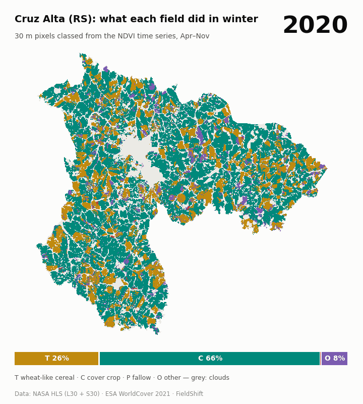
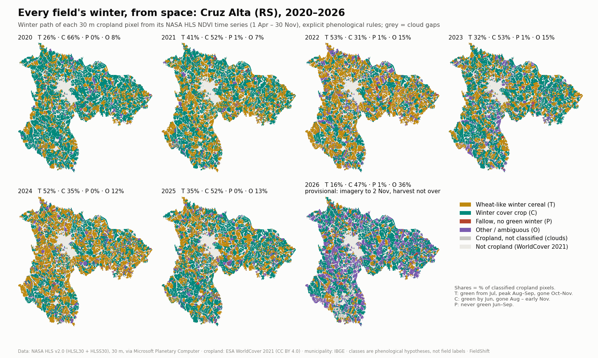
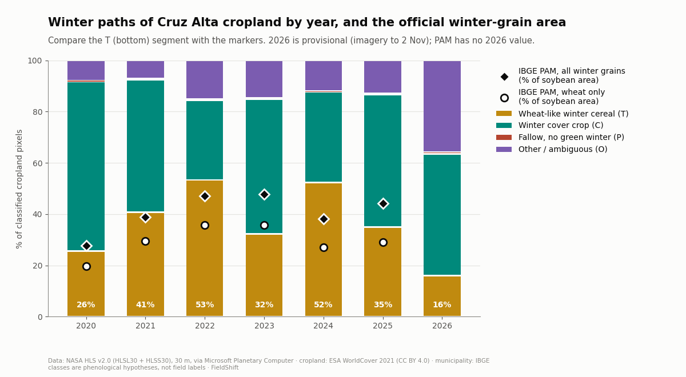
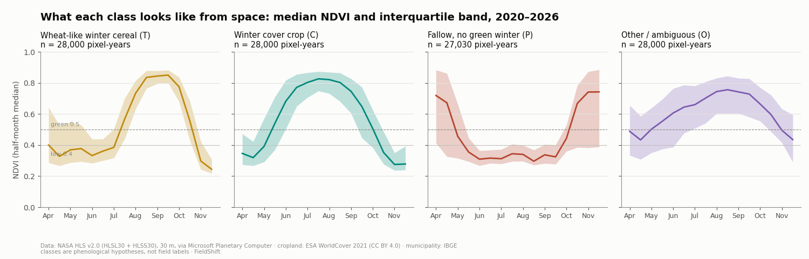
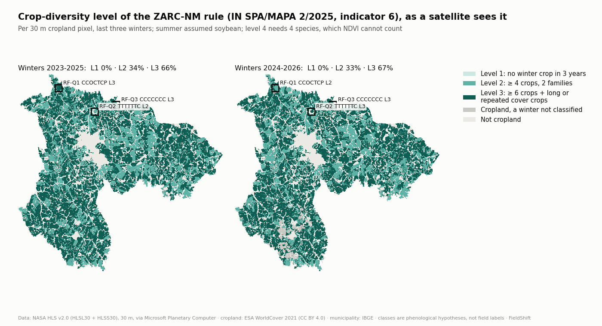

# Every field's winter, from space: the rotation fingerprint of Cruz Alta in NASA HLS (RS, Brazil, 2020–2026)

> **SI-assisted:** the idea (read the winter of every 30 m pixel from the NASA HLS NDVI series and treat the 2020–2026 sequence as a rotation fingerprint, the input of the ZARC-NM diversity indicator) was synthesized with Claude Code (Anthropic) at the team lead's request, and the team adopted it; the scripts and this text were written with Claude Code. Every number below was produced by running the scripts in this folder on the sources listed; none was produced by the AI. Human review pending. See [`SI-USAGE.md`](../../SI-USAGE.md).

Method summary for the app: [`content/methods/rotation-fingerprint.md`](../../content/methods/rotation-fingerprint.md).



## Question

In the Planalto Médio, soybean fills the summer and the farmer chooses the winter: **wheat**, a **cover crop** (mostly black oat) or **fallow**. The ZARC-NM rule (IN SPA/MAPA 2/2025) scores a field partly on the **diversity of crops in the last three agricultural years** (Table 1, indicator 6) and asks for that history from remote sensing at 30 m or better (Landsat, Sentinel-2 or HLS; items 6.4–6.6, which accept visual or automated reading of the series).

1. Can the NASA HLS NDVI series of April–November tell, **pixel by pixel**, which winter path each field took in each year 2020–2026?
2. Does the share of each path agree with an independent record, the planted area of IBGE PAM?
3. What does each pixel's 2020–2026 sequence (its **rotation fingerprint**) say about the diversity level of the ZARC-NM rule, and what can it not say?

## Answer in one paragraph

From **584 NASA HLS granules** (L30 + S30, April–November 2020–2026) every one of the **1.17 million 30 m cropland pixels** of Cruz Alta gets a winter path per year (97.5–100% classified each year). In 2020–2025 the **wheat-like winter cereal (T)** class covers **25.6% to 53.3%** of the cropland (mean **39.9%**), against **27.8% to 47.8%** (mean **40.7%**) for the winter grains of IBGE PAM (wheat, oat, barley, rye, triticale, canola) as a share of the soybean area: **the level agrees within 1 point on average**, but **year by year the agreement is weak** (Pearson 0.41, n = 6; mean absolute difference 8.2 points; −15.5 points in 2023, +14.1 in 2024), and wheat alone (mean 29.4%) is clearly below T, so T means "a winter cereal sown in June–July", not "wheat". The **cover crop (C)** class takes 31–66% of the cropland and **fallow with no green winter (P) only 0.3–0.6%**, which matches the team's Sentinel-2 finding that a green-less winter almost does not exist here. Each pixel's 2020–2026 sequence is a fingerprint: only **5.2%** of the pixels took the same path in all seven winters (the most common fingerprint is `CCCCCCC`, 4.0% of the cropland), **93%** took two or three different paths, and **97.3%** were never fallow. Read with the ZARC-NM rule (IN SPA/MAPA 2/2025, indicator 6) for the winters 2023–2025, **66.5% of the cropland meets the satellite-visible part of level 3** (a winter crop every year plus long or repeated cover crops) and **33.5% level 2**; level 4 cannot be assigned from space because it needs four species, but 42.3% meet its cover-duration conditions. **These are phenological hypotheses without field labels**: the classes, the PAM comparison and the diversity level are a pre-check of what a field's history probably was, not a measurement of what was sown.

## Data

| Source | What is used | NASA? | Terms | Committed here? |
|---|---|---|---|---|
| HLS v2.0 HLSL30 and HLSS30 (NASA LP DAAC; DOIs [10.5067/HLS/HLSL30.002](https://doi.org/10.5067/HLS/HLSL30.002), [10.5067/HLS/HLSS30.002](https://doi.org/10.5067/HLS/HLSS30.002); Claverie et al. 2018) | red (B04), NIR (L30 B05, S30 B8A) and `Fmask`, MGRS tile T22JBP (it alone covers the municipality), 1 April – 30 November 2020–2026 | **NASA** | NASA data, no restriction; citation requested | **no imagery**: aggregates, three 9 ha quadrats and figures only |
| ESA WorldCover 2021 v200, tile S30W054 | cropland mask (class 40 covering ≥ 50% of the 30 m pixel) | no (**ESA, partner data**) | CC BY 4.0; "ESA WorldCover project 2021 / Contains modified Copernicus Sentinel data (2021) processed by ESA WorldCover consortium" | no |
| IBGE municipal mesh 2022, municipality 4306106 | municipal boundary | no (IBGE) | public federal data | already in `data/dev/dev-cruz-alta/ibge/` |
| IBGE PAM, SIDRA table 1612, variable 109 (planted area) | wheat, oat, barley, rye, triticale, canola, soybean and maize, Cruz Alta, 2015–2025 | no (IBGE) | public federal data; cite IBGE | yes, `results/ibge_pam_1612_cruz_alta.csv` (URL and access time in the header) |

Imagery is read anonymously through the Microsoft Planetary Computer STAC (`hls2-l30`, `hls2-s30`, `esa-worldcover`; anonymous SAS token, no account). On that server tile T22JBP has **no April–November 2019 granule** (searched with tile cloud cover < 90%) and S30 starts in 2020, so the series is **2020–2026** (2026 up to the last granule on the server at the run, 2 November 2026); NASA LP DAAC holds the full archive behind a free Earthdata Login.

## Method

**Pixels.** Every HLS granule of tile T22JBP from 1 April to 30 November with tile cloud cover < 90% is read on its own 30 m UTM grid (no resampling). Kept: pixels clear in `Fmask` (no cloud, adjacent cloud, shadow, snow or water), with ≥ 50% WorldCover 2021 cropland, inside the IBGE polygon (1,165,531 pixels, 104,898 ha). Granules with < 2% of those pixels clear are logged and skipped. NDVI = (NIR − red)/(NIR + red) (Tucker 1979).

**Time series.** Per pixel and year, the **median** NDVI of the clear observations in each half-month (days 1–15 and 16–end), 16 half-months from April-1 to November-2. A pixel-year is kept when it has ≥ 10 clear half-months and at least one in each of June–July, August–September and October–November; gaps are filled by linear interpolation in time. The maximum-value composite (Holben 1986) is run as a sensitivity: it moves every date towards the greenest observation, and the rules below are calendar dates. **This choice was made after a first look at 2020 with both composites** (2020: 15.6% wheat-like with the maximum, 25.6% with the median); both are reported.

**Dates read from each pixel-year** (in half-months):

- **peak**: the highest NDVI from June-1 to October-1;
- **establishment gap**: the last half-month before the peak with NDVI < 0.40 (no canopy: after the soybean harvest, or after weeds are desiccated for sowing); if there is none, the lowest half-month before the peak;
- **green-up**: the first half-month after the gap with NDVI ≥ 0.50;
- **canopy end**: the first half-month after the peak with NDVI < 0.40 (harvest, senescence or desiccation).

**Rules** (one class per pixel-year; constants and sources in `classify.py`):

| Class | Rule | Why |
|---|---|---|
| **P** fallow (no green winter) | NDVI never reaches 0.50 from June-1 to September-2 | no winter canopy |
| **T** wheat-like winter cereal | green-up from July-1 to August-2, peak at or after August-2, canopy end at or after October-1 (or still declining at the end of November) | wheat is sown in June–July (ZARC rainfed wheat at Cruz Alta: lowest risk class 1 June – 20 July, 30% class from 21 May; MAPA Portaria 385/2022), heads around September and is harvested in October–November (Emater/RS state harvest progress, cited in `analysis/storms-bare-soil/straw_parameters.json`) |
| **C** winter cover crop | green-up by June-2 (sown in autumn) and canopy end from August-1 to November-1 | black oat is sown after the soybean harvest and desiccated before soybean sowing (team brief: September–October; one half-month of tolerance because the half-month of the kill still holds green dates). The team's Sentinel-2 k-means centroid of this group is green in June (0.74) and falls from September |
| **O** other / ambiguous | any other green winter | reasons counted in `results/rotation_fingerprint.json` (`other_reasons_by_year`): green to the end of November (pasture, an early summer crop), long autumn-sown cycle ending after November-1, autumn canopy gone before August, green-up after August, short or early-ending cycles |

Thresholds: NDVI 0.50 lies between the winter lows (0.33–0.39) and peaks (0.81–0.84) of the centroids of the team's Sentinel-2 k-means of winter profiles (Cruz Alta 2019–2025, private planning repository); 0.40 is above the 0.25 "no green" of the team's bare-soil calendar because a half-month composite of a dying canopy rarely reaches 0.25.

**Sensitivity grid** (12 runs, `results/sensitivity.csv`): green 0.45 / 0.55; low 0.35 / 0.45; fallow 0.40 / 0.60; wheat/cover green-up split one half-month earlier or later; cover end October-2 / November-2; maximum-value composite. For each: shares by year, correlation and mean difference with PAM, and the share of pixel-years whose class does not change.

**Rotation fingerprint.** The 2020–2026 sequence of classes of each pixel, e.g. `CTCTCTC` (`-` = year not classified).

**Diversity level (IN SPA/MAPA 2/2025, Table 1, indicator 6), as far as NDVI can see it.** For the last three complete winters (2023–2025, the three before the 2026/27 soybean; 2024–2026 also shown):

| Level in the norm | Applied here |
|---|---|
| 1: requirements of the other levels not met | no winter crop in the three years |
| 2: ≥ 4 crops, ≥ 2 species, 2 botanical families | 3 summers (assumed soybean, Fabaceae) + at least one winter crop (T, C or O; assumed a grass, Poaceae) |
| 3: ≥ 6 crops, ≥ 2 species, 2 families, and 1 cover crop > 4 months **or** 3 cover crops > 45 days each | a winter crop in all three years, and a C year lasting ≥ 8 half-months (121.8 days) or three C years lasting ≥ 3 half-months (45.7 days) each |
| 4: ≥ 6 crops, **≥ 4 species**, 2 families, 1 cover > 4 months **and** 2 covers > 45 days each | **never assigned**: NDVI cannot count species. Pixels meeting the cover durations of level 4 are flagged "level 4 possible", pending the species the farmer declares |

Cover duration = green-up to canopy end, at half-month resolution; a cover already green on 1 April gives a lower bound.

**Quadrats.** The residue analysis (`analysis/residue-landsat/`) planned three ZARC-NM quadrats in `results/zarcnm_satellite_indicators.json`, but that file did not exist in any branch at the time of this run, so three quadrats were chosen here by a written rule (`pick_quadrats` in `classify.py`): 300 m × 300 m blocks (9 ha, the size of item 6.2 IV for fields > 100 ha) entirely cropland and classified in 2023–2025; for diversity levels 3, 2 and 1 the purest block (mean share of the yearly majority class), at least 5 km apart; a level with no block is replaced by the purest block with a new 2020–2026 sequence. They were **chosen to show one example per level, not at random**. When the residue quadrats exist, rerun with `--quadrats <file>` to use the same centres.

**Independent check.** IBGE PAM planted area of all winter grains (wheat + oat + barley + rye + triticale + canola) and of wheat alone, as a share of the PAM soybean area of the same year (soybean fills about the whole summer cropland), against the satellite T share of classified cropland. PAM year y = winter of year y (winter crops are sown and harvested in the same calendar year). IBGE publishes municipal totals, not fields, so **a pixel confusion matrix is impossible**: the "area confusion" table is the 2 × 2 table (satellite T / not T × PAM winter grain / not) filled in the most and least favourable ways the two totals allow, and the true agreement lies between the two.

## Results

Files in [`results/`](results/) (run of 2026-11-15 between 02:56 and 03:41 UTC, i.e. 14 Nov 23:56 – 15 Nov 00:41 BRT; STAC search time and IBGE access time inside the files):

| File | Content |
|---|---|
| `rotation_fingerprint.json` | parameters and rules, coverage by year (granules and clear observations per half-month), shares by year, PAM check with area-agreement bounds, sensitivity, reasons for "other", top fingerprints and their statistics, diversity levels, NDVI profiles by class, what cannot be said, references |
| `winter_paths_by_year.csv` | one row per year: % classified, % T / C / P / O, T hectares (scaled to the WorldCover cropland), PAM wheat, winter grains and soybean |
| `sensitivity.csv` | the 12 runs: T / C / P / O by year, correlation and mean difference with PAM |
| `fingerprints_top25.csv` | the 25 most common 2020–2026 fingerprints, pixels and % of cropland |
| `zarcnm_diversity_examples.json` | the three 9 ha quadrats: centre, yearly class counts, green-up and canopy-end half-months, green days, sequence and diversity level |
| `ibge_pam_1612_cruz_alta.csv` | IBGE PAM planted area, Cruz Alta, 2015–2025 (URL and access time in the header) |
| `rotation-fingerprint.gif` | the yearly map, 7 frames × 1.3 s (9.1 s), 720 × 800 px, no logo |
| `rotation-fingerprint-maps.png`, `rotation-fingerprint-vs-pam.png`, `rotation-fingerprint-profiles.png`, `rotation-diversity-zarcnm.png` | the figures below (no logo; "NASA HLS" in every footer) |
| `run_info.json` | run times and library versions |

**Coverage.** 636 granules searched, **584 read**, 52 skipped (< 2% of the cropland clear), no read error. Per year 67–95 granules; the median pixel has 0–8 clear observations per half-month; 99.9–100% of the cropland is classified in 2020–2025, 97.5% in 2026. **2026 is provisional**: the last granule on the server at the run is from 2 November (4% of the cropland clear; the last largely clear scene is 20 October), with no granule in November-2, the wheat harvest is not over, and a wheat canopy still standing at the last image is kept as T.



### Share of each winter path against IBGE PAM

| Year | T wheat-like | C cover | P fallow | O other | PAM winter grains, % of soybean | PAM wheat, % of soybean | T − PAM winter grains (points) | T area / PAM winter-grain area |
|---|---|---|---|---|---|---|---|---|
| 2020 | 25.6% | 66.2% | 0.3% | 8.0% | 27.8% | 19.6% | −2.2 | 1.05 |
| 2021 | 40.8% | 51.7% | 0.6% | 7.0% | 38.8% | 29.5% | +2.0 | 1.20 |
| 2022 | 53.3% | 31.0% | 0.5% | 15.2% | 47.2% | 35.8% | +6.1 | 1.28 |
| 2023 | 32.3% | 52.6% | 0.5% | 14.6% | 47.8% | 35.7% | −15.5 | 0.77 |
| 2024 | 52.4% | 35.3% | 0.4% | 11.9% | 38.2% | 27.1% | +14.1 | 1.55 |
| 2025 | 35.0% | 51.5% | 0.5% | 13.0% | 44.2% | 29.0% | −9.2 | 0.88 |
| 2026 (provisional) | 16.1% | 47.4% | 0.8% | 35.8% | — | — | — | — |

Shares are % of the classified cropland pixels; T area = T share × 104,898 ha of WorldCover cropland. **Pearson T × PAM winter grains 0.41, T × PAM wheat 0.45 (n = 6)**: with six years this is a check of level and direction, not a validation. The two largest misses go in opposite directions (2023 below PAM, 2024 above); this analysis does not explain them.



**Area "confusion" against PAM** (winter-grain area, `area_confusion_bounds` in the JSON). Because PAM gives only the municipal total, the 2 × 2 table can only be bounded: overall agreement is **at most 81–99%** (2024 lowest, 2020 highest) and **at least 5–50%** (the two totals would allow zero overlap in every year). Example, 2025: satellite T 36,735 ha, PAM winter grains 41,695 ha in 104,898 ha of cropland; best case 36,735 ha counted by both, 4,960 ha by PAM only, 63,203 ha by neither (95.3% agreement); worst case no overlap (25.2%). No field data can narrow this here.

### What each class looks like



T stays near 0.35 until July, peaks at about 0.85 from late August to September and falls to about 0.25 by November (a cereal sown in June–July, harvested in October–November). C is green from May, peaks at about 0.82 in July–August and is gone by late October (autumn-sown canopy killed before soybean). P is low (about 0.3) from late May to September, between a late soybean in April and an early summer crop in October–November. O is a mixed bag, green from June into November. Reasons for O in 2020–2025 (`other_reasons_by_year`): a long autumn-sown cycle ending after November-1 (the largest group in 2021, 2022, 2023 and 2025), green to the end of November, short or early-ending cycles, autumn canopy gone before August, green-up after August.

### Sensitivity

| Run | T 2020 | T 2023 | T 2025 | Pearson with PAM | Mean abs. difference (points) | Pixel-years unchanged |
|---|---|---|---|---|---|---|
| main | 25.6% | 32.3% | 35.0% | 0.41 | 8.2 | — |
| green 0.45 / 0.55 | 20.9% / 28.4% | 28.9% / 35.2% | 32.2% / 37.4% | 0.44 / 0.40 | 9.3 / 8.4 | 95.5% / 95.6% |
| low 0.35 / 0.45 | 24.1% / 26.0% | 30.1% / 34.1% | 32.5% / 37.2% | 0.39 / 0.44 | 8.5 / 8.3 | 93.2% / 95.2% |
| fallow 0.40 / 0.60 | 25.6% / 25.4% | 32.3% / 32.2% | 35.0% / 34.8% | 0.41 / 0.41 | 8.2 / 8.2 | 99.7% / 99.0% |
| wheat/cover split Jun-2 / Jul-2 | 32.2% / 14.1% | 40.9% / 18.7% | 40.9% / 32.5% | 0.38 / 0.32 | 8.9 / 13.1 | 87.7% / 91.5% |
| cover end Oct-2 / Nov-2 | T unchanged | T unchanged (C 34.6% / 57.0%) | T unchanged | 0.41 / 0.41 | 8.2 / 8.2 | 88.8% / 97.1% |
| maximum-value composite | 15.6% | 24.6% | 29.0% | 0.39 | 12.1 | 87.8% |

The **fallow** class does not depend on its threshold (0.40–0.60). The **wheat/cover split** and the **composite** move the most: half a month on the split, or the maximum composite, changes 8–12% of the pixel-years and up to 14 points of T in a year. The correlation with PAM stays between 0.32 and 0.44 in every run and the mean difference between 8.2 and 13.1 points; no run turns the weak year-by-year agreement into a strong one.

### Rotation fingerprints

| Fingerprint 2020–2026 | % of cropland |
|---|---|
| `CCCCCCC` | 3.98 |
| `CCCCCCO` | 2.27 |
| `CCTCTCO` | 1.77 |
| `CTTCTCC` | 1.37 |
| `CCTCTCC` | 1.34 |
| `CTTTTCC` | 1.25 |
| `TCTCTCO` | 1.17 |
| `CCCCTCC` | 1.14 |
| `TTTTTTC` | 1.12 |

(2026 letters are provisional.) Of the pixels classified in all seven winters (97.4% of the cropland): **5.2%** took one path every year, **40.8%** two paths, **52.2%** three, 1.8% four; **97.3%** were never fallow; wheat-like years per pixel: none in 13.9%, 1–3 in 60.0%, 4–7 in 26.0%. The fingerprints are fragmented (the top 25 cover about a quarter of the cropland), which is what alternation between cereal and cover looks like at 30 m.

### Diversity level of the ZARC-NM rule, as far as a satellite sees it



| Winters | Pixels with all three classified | Level 1 | Level 2 | Level 3 | "Level 4 possible" (cover durations met; species unknown) |
|---|---|---|---|---|---|
| 2023–2025 | 99.9% | 0.0% (31 ha) | 33.5% (35,160 ha) | 66.5% (69,706 ha) | 42.3% |
| 2024–2026 (2026 provisional) | 97.5% | 0.1% | 33.1% | 66.8% | 38.8% |

**Three example quadrats** (9 ha each, `results/zarcnm_diversity_examples.json`; chosen by the rule in Method, one example per level, not at random; no block reached level 1, so the third is the purest block with a new sequence):

| Quadrat | Centre (lat, lon) | Fingerprint 2020–2026 | Winters 2023–2025 | Level 2023–2025 | Level 2024–2026 |
|---|---|---|---|---|---|
| RF-Q1 | −28.51379, −53.68014 | `CCOCTCP` | cover about 76 days (Jun-1 → Aug-2), wheat-like, cover about 122 days (green on 1 April, so at least) | **3** (84 of 100 pixels; "level 4 possible" in 84) | 2 (2026 provisional: no green winter so far) |
| RF-Q2 | −28.57250, −53.58352 | `TTTTTTC` | wheat-like every year, no cover | **2** (six crops, but no cover crop) | 3 (2026 cover of about 137 days) |
| RF-Q3 | −28.55737, −53.52491 | `CCCCCCC` | cover every year, about 167–183 days (May → late Oct / early Nov) | **3**, "level 4 possible" (100 of 100 pixels) | 3, "level 4 possible" |

RF-Q2 shows the point of the indicator: a cereal in every winter for six years gives six crops and two families, but no cover crop, so the field stays at level 2.

## What this does not show

- **Which crop is in a pixel.** T is any winter cereal sown in June–July and harvested in October–November: wheat, barley, triticale, rye and white oat for grain look alike in NDVI; T matches all PAM winter grains in level, not wheat. C is any autumn-sown canopy gone by early November: black oat, ryegrass, vetch or oat mixes, grazed oat, but also volunteer soybean, weeds or a winter cereal sown early (the ZARC 30% risk class opens on 21 May). A **black oat cover and an early oat or wheat crop are confusable**, and so are wheat, barley and oat.
- **Whether a C canopy was sown as a cover crop**, grazed, or cut for forage (item 2.4 III excludes silage and hay from the crop count). The large C share and the near absence of fallow say that cropland is green in winter, not that it was sown with a cover crop.
- **The summer.** The diversity count assumes one soybean crop per summer; maize summers (6,400–10,000 ha in PAM 2020–2025), a second summer crop or summer cover crops are not classified here.
- **Species and families.** NDVI cannot count four species, so level 4 is never assigned; canola (Brassicaceae, 4,200 ha in PAM 2025) would add a family but is not separated from the other classes.
- **Fields.** Pixels are classified one by one, without parcel boundaries; field edges mix classes, and a 9 ha quadrat is not a field.
- **Agreement with fields.** There are no field labels: the only independent check is a municipal area total (n = 6 years), which bounds the agreement between 5–50% and 81–99% and cannot be turned into a pixel accuracy.
- **Time resolution.** Dates are read in half-months; a crop sown half a month earlier or later can change class (that is the most sensitive rule), and durations ("more than 45 days", "more than 4 months") are ± 15 days.
- **2019 and before.** No April–November 2019 HLS granule of tile T22JBP on the Planetary Computer; the LP DAAC archive (free Earthdata Login) would add it.
- **2026.** Provisional until the harvest is over; its PAM value does not exist yet.

## Reproduce

From the repository root (Python 3.12, [uv](https://docs.astral.sh/uv/)):

```bash
uv run --project services/science --with numpy==2.3.4 --with rasterio==1.4.3 --with pystac-client==0.9.0 --with planetary-computer==1.0.0 --with matplotlib==3.10.7 python -I analysis/rotation-fingerprint/reproduce.py
```

Raw files go to `~/.cache/fieldshift/rotation-fingerprint/` (`--raw DIR` to change; about 0.7 GB of per-granule NDVI vectors, never committed). The scene step reads about 640 granules (three bands each) and resumes where it stopped. Steps: `scenes.py` (HLS NDVI per granule), `fetch_pam.py` (IBGE SIDRA), `classify.py` (composites, rules, sensitivity, fingerprints, diversity, quadrats), `figure.py` (PNG and GIF). Lint: `ruff.toml` in this folder.

## References

- Claverie, M. et al. (2018). The Harmonized Landsat and Sentinel-2 surface reflectance data set. *Remote Sensing of Environment* 219, 145–161. doi:10.1016/j.rse.2018.09.002
- Holben, B. N. (1986). Characteristics of maximum-value composite images from temporal AVHRR data. *International Journal of Remote Sensing* 7(11), 1417–1434. doi:10.1080/01431168608948945
- Tucker, C. J. (1979). Red and photographic infrared linear combinations for monitoring vegetation. *Remote Sensing of Environment* 8(2), 127–150. doi:10.1016/0034-4257(79)90013-0
- MAPA (2025). Instrução Normativa SPA/MAPA nº 2/2025, Annex: Table 1 (indicator 6), items 2.2, 2.4, 6.2, 6.4–6.6.
- MAPA (2022). ZARC risk table 2022/2023, Portaria 385 of 8 December 2022 (rainfed wheat, Cruz Alta), as transcribed in `data/sites/cruz-alta/input/replay-2023.yaml`.
- IBGE. Produção Agrícola Municipal, SIDRA table 1612.
