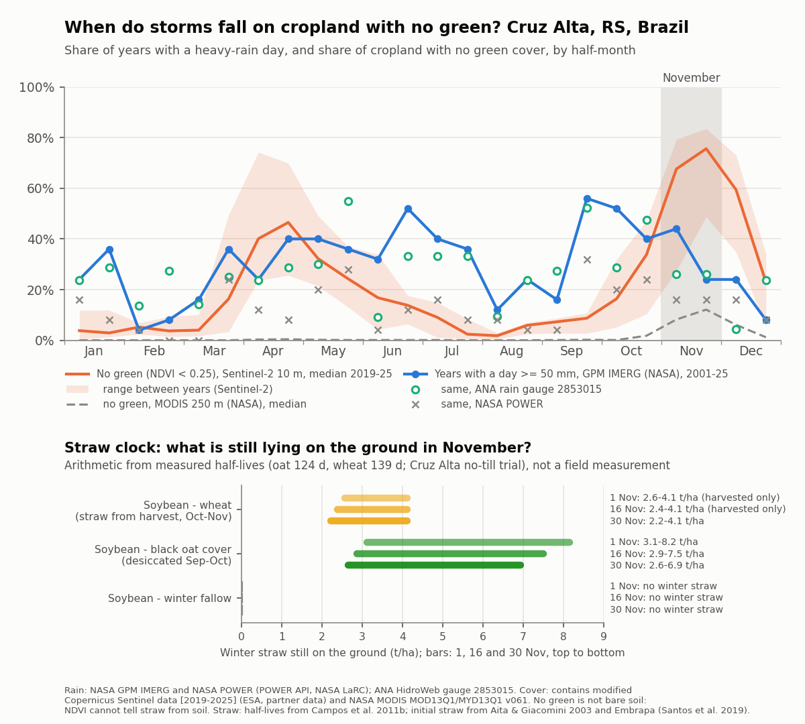

# Storms meet soil: heavy rain on cropland with no green, and the straw clock (Cruz Alta, RS, Brazil)

> **SI-assisted:** the idea ("Storms meet Soil") was synthesized with Claude Code (Anthropic) at the team lead's request from the team's research, and the team chose it; the scripts and this text were written with Claude Code. Every number below was produced by running the scripts in this folder on the sources listed, or copied from the cited literature; none was produced by the AI. Human review pending. See [`SI-USAGE.md`](../../SI-USAGE.md).

Method summary for the app: [`content/methods/storms-bare-soil.md`](../../content/methods/storms-bare-soil.md).



## Question

1. In which half-months of the year does a heavy-rain day (≥ 50 mm) fall on cropland that has no green cover?
2. Satellites cannot tell dry straw from bare soil. How much winter straw is still lying on the ground when the November storms arrive, for each rotation?

## Answer in one paragraph

Heavy-rain days happen all year: GPM IMERG shows at least one day ≥ 50 mm in **4% to 56% of the years** of each half-month (2001–2025). What changes is what the rain falls on. Cropland with no green cover (Sentinel-2 10 m, NDVI < 0.25) peaks at **67.6% (1–15 Nov) and 75.6% (16–30 Nov)** in the median of 2019–2025, with a second peak of 46.5% in the second half of April. Multiplying the two, **1–15 November is the most exposed half-month** (heavy-rain day in **44% of the years**, 95% interval 27–63%), followed by 16–30 April and 16–30 November. In the seven years with Sentinel-2, **5 of the 57 IMERG heavy-rain days** that have a scene in the same half-month fell when at least half of the cropland had no green: all five in November (once in 2019, three times in 2023, once in 2025). The rain gauge agrees on the November cases (2023 and 2025) and adds one in April 2019. "No green" is not "bare": in November it is largely straw, and the straw clock gives the arithmetic. With the half-lives measured in the Cruz Alta no-till trial (black oat 124 days, wheat 139 days), black oat desiccated in September–October still leaves **3.1–8.2 t/ha on 1 November**, wheat harvested by then **2.6–4.1 t/ha**, and winter fallow leaves **no winter straw**. These straw values are **arithmetic from measured half-lives, not a field measurement**.

## Data

| Source | What is used | NASA? | Terms | Committed here? |
|---|---|---|---|---|
| GPM IMERG daily precipitation, served by NASA POWER (`IMERG_PRECTOT`, UTC days), point −28.703, −53.563 | heavy-rain days by half-month, 2001–2025 (main rain series) | **NASA** | [POWER referencing](https://power.larc.nasa.gov/docs/referencing/); IMERG DOI 10.5067/GPM/IMERG/3B-HH/07 | raw already in `data/cache/power-imerg/cruz-alta/` (accessed 2026-11-14) |
| NASA POWER daily, `PRECTOTCORR` (MERRA-2 bias-corrected), same point | check series | **NASA** | as above | raw already in `data/cache/power/cruz-alta/` (accessed 2026-11-14) |
| ANA rain gauge 2853015 (Três Capões, 14.9 km from the point), HidroWeb legacy service `HidroSerieHistorica` | check series (ground) | no (ANA, Brazil) | Brazilian federal open data; cite ANA | **no**: downloaded to the raw folder (about 2 MB); access time in `results/storms_bare_soil.json` |
| Copernicus Sentinel-2 L2A, 10 m: cropland share with NDVI < 0.25 per half-month, 2019–2025 | "no green" curve, median and range | no (**ESA, partner data**) | Copernicus open data licence, credit "contains modified Copernicus Sentinel data" | already in `data/sites/cruz-alta/output/bare-soil-calendar.json` and `input/bare-soil-s2-scenes.csv` |
| MODIS MOD13Q1/MYD13Q1 v061, 250 m | "no green" beside Sentinel-2 | **NASA** | [LP DAAC citation policy](https://lpdaac.usgs.gov/data/data-citation-and-policies/) | same calendar file |
| Literature (straw) | half-lives and initial straw, with citation per number in [`straw_parameters.json`](straw_parameters.json) | no | — | values only |

Code reuse: the loaders and constants come from the `services/science` package by import, never edited: `fieldshift.sources.power_imerg.parse`, `fieldshift.sources.power.parse`, `fieldshift.complements.rain_signal` (50 mm threshold and `season_years`), `fieldshift.complements.baresoil` (years, NDVI threshold, clear-fraction rule, straw caveat, access times).

## Method

**Half-months.** The 24 half-months of the bare-soil calendar: days 1–15 and 16–end of each month (index 0–23).

**Heavy rain.** A day with ≥ 50 mm (the threshold of the published ENSO heavy-rain signal). For each source and half-month, a year counts only when every day of that half-month has a value. Columns: years counted, % of them with at least one heavy day, and mean number of heavy days. Common window **2001–2025** (25 years) for the three sources; the gauge's long record (1982–2025) is given as an extra column. For IMERG, a 95% Wilson interval shows how much 25 years can say.

**No green.** Taken unchanged from the published calendar: per scene, share of clear cropland pixels with NDVI < 0.25; per half-month, median, minimum and maximum over 2019–2025 (Sentinel-2) and median (MODIS).

**Exposure index.** `% of years with a heavy day (IMERG) × median % of cropland with no green (Sentinel-2) / 100`. It ranks half-months; it treats the two as independent and is **not** an erosion amount or a probability of soil loss.

**Observed coincidences, 2019–2025.** Each heavy-rain day (IMERG and gauge) matched with the Sentinel-2 scene of the same year and half-month. The scene can be up to about two weeks away from the storm.

**Straw clock.** `straw(t) = initial × 2^(−days since management / half-life)`, evaluated on 1, 16 and 30 November:

| Rotation | Residue | Half-life (no-till, Cruz Alta) | Initial straw (t/ha) | Management window (scenario) |
|---|---|---|---|---|
| Soybean–wheat | wheat straw at harvest | 139 d (Campos et al. 2011b) | 3.0 (Roman 1990, cited in Santos et al. 2019) – 4.12 (Coxilha 1995–2002, Santos et al. 2019) | harvest 1 Oct – 30 Nov |
| Soybean–cover | black oat, desiccated | 124 d (Campos et al. 2011b) | 4.39 (Santa Maria, Aita & Giacomini 2003) – 8.2 (Roman 1990, cited in Santos et al. 2019) | desiccation 1 Sep – 31 Oct |
| Soybean–fallow | none | — | 0 | — |

The range on a date goes from the lowest initial straw managed at the start of the window (oldest straw) to the highest initial straw managed on the last date before the target (freshest). Wheat fields still unharvested on the target date are left out and flagged ("harvested only" in the figure). The windows are scenarios from the team brief; for context, Emater/RS reported 42% of the state's wheat harvested on 6 Nov 2025 against a 5-season average of 64% for that date, and the harvest practically over on 11 Dec 2025. No Cruz Alta harvest or desiccation calendar was found.

**Checks run every time** (recorded in `results/storms_bare_soil.json`, `checks`):
- September–November heavy-rain days and totals recomputed with the pipeline's own `season_years` match the published `enso-rain-signal.json` in every year: IMERG 28 of 28, POWER 44 of 44, gauge 39 of 39. So the series read here are the same as the app's.
- The Sentinel-2 medians recomputed from the per-scene input match the published calendar in all 24 half-months.

## Results

Files in [`results/`](results/) (run of 2026-11-15 00:47 UTC, i.e. 14 Nov 2026 BRT; source access times inside each file):

| File | Content |
|---|---|
| `storms_by_fortnight.csv` | 24 rows: rain by source, no green (Sentinel-2, MODIS), exposure index and rank |
| `storms_bare_soil.json` | same table, the source of every column (`columns`), sources with URL and access time, attribution, observed coincidences 2019–2025, checks, caveats |
| `straw_clock.csv`, `straw_clock.json` | straw on 1, 16 and 30 Nov per rotation (t/ha, fraction left, days since management), parameters with citations, limitations |
| `storms-bare-soil.png` | figure for the app (1200 × 1080 px, no logo) |
| `run_info.json` | run time and library versions |

### Most exposed half-months

| Half-month | Heavy day, IMERG (% of years, 95% interval) | Gauge ANA | NASA POWER | No green, Sentinel-2 median (range 2019–2025) | MODIS median | Exposure index |
|---|---|---|---|---|---|---|
| 1–15 Nov | **44.0** (26.7–62.9) | 26.1 | 16.0 | **67.6** (27.4–79.3) | 8.2 | **29.7** |
| 16–30 Apr | 40.0 (23.4–59.3) | 28.6 | 8.0 | 46.5 (25.6–69.9) | 0.4 | 18.6 |
| 16–30 Nov | 24.0 (11.5–43.4) | 26.1 | 16.0 | 75.6 (48.7–83.5) | 12.1 | 18.1 |
| 1–15 Dec | 24.0 (11.5–43.4) | 4.5 | 16.0 | 59.4 (34.8–73.1) | 6.1 | 14.3 |

For contrast, the half-months with the most heavy-rain years fall on green cropland: 16–30 Sep (IMERG 56.0%, gauge 52.4%; no green 8.7%) and 16–30 Jun (52.0%; no green 13.8%).

### Observed 2019–2025

| Source | Heavy-rain days | With a scene in the same half-month | On ≥ 25% no green | On ≥ 50% no green |
|---|---|---|---|---|
| GPM IMERG | 65 | 57 | 20 | **5** (all in November) |
| ANA 2853015 | 68 | 60 | 20 | 4 (27 Apr 2019; 16 and 18 Nov 2023; 8 Nov 2025) |

The exact dates are in `observed_2019_2025.events`: IMERG 4 Nov 2019; 13, 17 and 18 Nov 2023; 7 Nov 2025.

### Straw clock (t/ha; arithmetic from measured half-lives, not a field measurement)

| Rotation | 1 Nov | 16 Nov | 30 Nov |
|---|---|---|---|
| Soybean–wheat (harvest 1 Oct – 30 Nov) | 2.57–4.12 (harvested fields; 47.5% of the window still ahead) | 2.39–4.12 (harvested fields; 23.0% still ahead) | 2.22–4.12 |
| Soybean–black oat (desiccated 1 Sep – 31 Oct) | 3.12–8.15 | 2.87–7.50 | 2.65–6.93 |
| Soybean–fallow | 0 | 0 | 0 |

Read: on 1 November, black oat desiccated on 1 September keeps 2^(−61/124) ≈ 71% of its straw, and one desiccated on 31 October keeps 99%; wheat harvested on 1 October keeps 2^(−31/139) ≈ 86%.

## Limitations

1. **NDVI does not separate straw from bare soil.** NDVI < 0.25 means "no green cover", not "exposed soil": under no-till, dry straw after desiccation or harvest looks like bare ground. That is why the straw clock exists. The exposure index therefore ranks when storms meet ground **without a growing crop**, not ground without protection.
2. **The straw clock is arithmetic, not a measurement.** The half-lives come from **one long-term trial** (Cruz Alta, no-till; Campos et al. 2011b); decomposition changes with rain, temperature and residue placement. A single exponential is assumed. The initial straw values come from other sites (Santa Maria, Coxilha, Roman 1990 as cited by Embrapa). No source here converts t/ha of straw into % of soil covered, so how much straw is "enough" has no number. Soybean residue from the April harvest is not modelled (the trial gives no soybean half-life).
3. **Seven years of Sentinel-2** (2019–2025, one scene per half-month, the scene date varies by year; 2023 second half of October has no scene) against **25 years of rain**: the two curves describe different periods, and the cover curve is a calendar, not a trend.
4. **Point against field.** Rain is one IMERG cell (0.1°), one POWER cell (0.5° × 0.625°) and one gauge 14.9 km away; cover is a municipal share over 9 blocks (672 km² of cropland). A heavy-rain day at the point does not mean it rained on every field, and a 76% share does not say which fields.
5. **The sources disagree in some half-months.** POWER shows far fewer heavy-rain days than IMERG and the gauge (it smooths storms over a large cell). IMERG and the gauge differ by up to about 20 points in some half-months (1–15 Dec: 24.0% vs 4.5%; 1–15 Nov: 44.0% vs 26.1%). IMERG and POWER use UTC days; the gauge is read in the morning, so its day is shifted. The gauge has a gap in 2013–2016 (fewer years counted).
6. **Small samples.** With 25 years, one year moves a percentage by 4 points; the 95% intervals are about ±18 points. Only 5 observed heavy-rain days fell on ≥ 50% no green.
7. **50 mm is a convention**, not an erosion threshold, and erosion itself is not measured here.
8. **The management windows are scenarios** from the team brief, not observed dates for Cruz Alta.
9. Winter fallow is rare in the Sentinel-2 winter profiles of Cruz Alta (the team's unsupervised read found 95% of pixel-years above NDVI 0.68 in winter; private planning repository, not published here), so the fallow row is a reference, not a common practice.

## Reproduce

From the repository root, with [uv](https://docs.astral.sh/uv/):

```bash
uv run --project services/science --with matplotlib==3.10.7 python -I analysis/storms-bare-soil/reproduce.py
```

It downloads only the ANA gauge series (about 2 MB) to `~/.cache/fieldshift/storms-bare-soil/` (or `--raw DIR`); everything else is read from files already committed in `data/`. Steps:

| Step | Script | Output |
|---|---|---|
| 1 | [`fetch_ana.py`](fetch_ana.py) | raw ANA XML and daily CSV in the raw folder, with access log |
| 2 | [`storms.py`](storms.py) | `storms_by_fortnight.csv`, `storms_bare_soil.json` |
| 3 | [`straw_clock.py`](straw_clock.py) | `straw_clock.csv`, `straw_clock.json` |
| 4 | [`figure.py`](figure.py) | `storms-bare-soil.png` |

The scripts are linted with Ruff (`ruff.toml` here); they live outside the `services/science` package and its CI job. They supersede the team's earlier sounding script (private planning repository), whose numbers used 1998–2025 and whole gauge years and are not final.

## References

- Campos, B.H.C.; Amado, T.J.C.; Tornquist, C.G.; Nicoloso, R.S.; Fiorin, J.E. (2011b). Long-term C-CO2 emissions and carbon crop residue mineralization in an oxisol under different tillage and crop rotation systems. *Revista Brasileira de Ciência do Solo* 35(3). doi:[10.1590/S0100-06832011000300017](https://doi.org/10.1590/S0100-06832011000300017)
- Aita, C.; Giacomini, S.J. (2003). Decomposição e liberação de nitrogênio de resíduos culturais de plantas de cobertura de solo solteiras e consorciadas. *RBCS* 27(4):601–612. [PDF](https://www.redalyc.org/pdf/1802/180214026004.pdf)
- Santos, H.P. et al. (ed.) (2019). *Sistemas de produção para cereais de inverno: três décadas de estudos.* Embrapa. [PDF](https://www.alice.cnptia.embrapa.br/alice/bitstream/doc/1111855/1/ID446652019LVSistemasdeproducao.pdf)
- Emater/RS Informativo Conjuntural, as reported by Revista Cultivar: [6 Nov 2025](https://revistacultivar.com.br/noticias/rs-safra-2025-26-colheita-do-trigo-avanca-em-ritmo-moderado); [11 Dec 2025](https://revistacultivar.com.br/noticias/rs-safra-2025-26-colheita-do-trigo-e-finalizada-no-estado)
- Huffman, G.J. et al. GPM IMERG Final Precipitation L3 Half Hourly V07, doi:[10.5067/GPM/IMERG/3B-HH/07](https://doi.org/10.5067/GPM/IMERG/3B-HH/07) (as served by NASA POWER)
